# 70 ans d'intelligence artificielle

## Pourquoi commencer par l'histoire ?

On parle de l'IA comme d'une nouveauté de 2022. Son histoire s'étend pourtant sur plusieurs décennies et se compose de promesses, de déceptions et de retours en force. Connaître ces cycles aide à garder la tête froide face au discours « de l'IA partout ».

Cette histoire oppose surtout deux grandes approches, que vous retrouverez toute la semaine :

- **L'IA à base de règles** : un humain écrit les règles. Pour comprendre cette logique, pensez à une règle de bannissement après cinq échecs SSH dans Fail2ban.
- **L'IA qui apprend des données** : on montre des exemples à un programme, qui ajuste un modèle à partir de ces données. C'est ce que vous ferez au J3.

!!! note "Une comparaison à nuancer"
    Fail2ban illustre ici une automatisation fondée sur des règles ; cet exemple ne suffit pas à en faire une IA. Pour la frise, justifiez les classements et signalez les systèmes hybrides ou les événements qui ne correspondent pas à un modèle particulier.

## Mission — Construire une frise chronologique

Construisez une frise chronologique de l'IA au format de votre choix : **Excalidraw, draw.io ou tableau**. Elle doit contenir au minimum les événements ci-dessous, **que vous datez vous-même**.

Pour chaque événement, indiquez s'il relève d'une **IA à base de règles** ou d'une **IA qui apprend des données**. Si cette distinction est insuffisante, précisez pourquoi : approche hybride, contexte historique ou architecture dont l'usage dépend du modèle associé.

## Frise chronologique — Des règles aux agents

**Lecture de haut en bas.** Les flèches indiquent l'ordre des jalons, sans représenter la durée ni un lien de causalité. Les périodes peuvent se chevaucher.

**Légende :** ambre = règles et recherche ; bleu = apprentissage ; violet = combinaison de méthodes ou modèle et outils ; gris = contexte ; rose = hiver. Chaque bloc porte aussi son classement en texte.

```mermaid
%%{init: {"theme": "base", "themeVariables": {"fontFamily": "Inter, Arial, sans-serif", "fontSize": "16px", "lineColor": "#64748b"}, "flowchart": {"htmlLabels": true, "curve": "linear", "rankSpacing": 28, "nodeSpacing": 20, "padding": 18, "wrappingWidth": 300}}}%%
flowchart TB
    turing["<b>1950 · LE JEU DE L'IMITATION</b><br/>Alan Turing propose un test conversationnel<br/>CONTEXTE · pas un algorithme"]
    dartmouth["<b>1955–1956 · DARTMOUTH</b><br/>Proposition en 1955, atelier à l'été 1956<br/>CONTEXTE · naissance d'un domaine"]
    perceptron["<b>1957–1958 · LE PERCEPTRON</b><br/>Frank Rosenblatt : ajuster des poids sur des exemples<br/>APPRENTISSAGE · réseau de neurones"]
    eliza["<b>1966 · ELIZA</b><br/>Joseph Weizenbaum : donner l'illusion du dialogue<br/>RÈGLES · scripts et reformulations"]
    winterOne["<b>ANNÉES 1970 · PREMIER HIVER</b><br/>Promesses déçues et financements réduits<br/>CONTEXTE · repère : rapport Lighthill, 1973"]
    experts["<b>ANNÉES 1980 · LES SYSTÈMES EXPERTS</b><br/>XCON configure des ordinateurs chez DEC dès 1980<br/>RÈGLES · connaissances humaines formalisées"]
    denning["<b>1987 · DOROTHY DENNING</b><br/>Détecter les écarts dans les journaux d'audit<br/>HYBRIDE · profils statistiques et règles"]
    winterTwo["<b>FIN 1980 – DÉBUT 1990 · SECOND HIVER</b><br/>Crise commerciale et limites des systèmes experts<br/>CONTEXTE · la recherche continue"]
    deepBlue["<b>1997 · DEEP BLUE BAT KASPAROV</b><br/>Explorer des positions et évaluer les coups<br/>RÈGLES ET RECHERCHE · approche dominante"]
    spam["<b>1998 · APPRENDRE À FILTRER LE SPAM</b><br/>Sahami et ses collègues : classification bayésienne<br/>APPRENTISSAGE · exemples de courriels"]
    lecun["<b>1998 · YANN LECUN ET LENET-5</b><br/>Avec Bottou, Bengio et Haffner : reconnaître l'écriture<br/>APPRENTISSAGE · réseau convolutif"]
    alexnet["<b>2012 · ALEXNET À IMAGENET</b><br/>Données + GPU + réseau profond performant<br/>APPRENTISSAGE · reconnaissance d'images"]
    alphago["<b>2016 · ALPHAGO FACE À LEE SEDOL</b><br/>Victoire 4–1 en mars, à Séoul<br/>HYBRIDE · réseaux appris et recherche arborescente"]
    transformer["<b>2017 · LE TRANSFORMER</b><br/>Attention Is All You Need<br/>APPRENTISSAGE · architecture à attention"]
    react["<b>OCTOBRE 2022 · REACT</b><br/>Un modèle de langage alterne raisonnement et actions<br/>MODÈLE ET OUTILS · jalon des agents récents"]
    chatgpt["<b>30 NOVEMBRE 2022 · CHATGPT</b><br/>Ouverture d'une interface conversationnelle au public<br/>APPRENTISSAGE · modèle déjà entraîné"]
    agents["<b>22 OCTOBRE 2024 · AGIR SUR UN ORDINATEUR</b><br/>Claude computer use : bêta publique pour développeurs<br/>MODÈLE ET OUTILS · écran, clics et clavier"]

    turing --> dartmouth --> perceptron --> eliza
    eliza --> winterOne --> experts --> denning --> winterTwo
    winterTwo --> deepBlue --> spam --> lecun --> alexnet --> alphago
    alphago --> transformer --> react --> chatgpt --> agents

    classDef context fill:#f1f5f9,stroke:#64748b,color:#0f172a,stroke-width:2px,rx:12px,ry:12px;
    classDef rules fill:#fff7ed,stroke:#c2410c,color:#7c2d12,stroke-width:2px,rx:12px,ry:12px;
    classDef learning fill:#eff6ff,stroke:#2563eb,color:#1e3a8a,stroke-width:2px,rx:12px,ry:12px;
    classDef hybrid fill:#f5f3ff,stroke:#7c3aed,color:#4c1d95,stroke-width:2px,rx:12px,ry:12px;
    classDef winter fill:#fff1f2,stroke:#be123c,color:#881337,stroke-width:2px,stroke-dasharray:5 4,rx:12px,ry:12px;

    class turing,dartmouth context;
    class eliza,experts,deepBlue rules;
    class perceptron,spam,lecun,alexnet,transformer,chatgpt learning;
    class denning,alphago,react,agents hybrid;
    class winterOne,winterTwo winter;
```

!!! note "Pourquoi ces nuances de dates et de classement ?"
    Le terme « intelligence artificielle » figure déjà dans la proposition du **31 août 1955**, avant l'atelier de **1956**. Pour le Perceptron, **1957** correspond aux premiers travaux et **1958** à une publication majeure. Les hivers sont des périodes de recul inégales selon les pays et les secteurs : leurs bornes ne sont pas des dates universelles. Enfin, les agents ne naissent pas en 2024 : ReAct illustre dès 2022 le couplage entre modèle de langage et actions. Le jalon de 2024 concerne une bêta publique précise de contrôle d'ordinateur.

### Dates, approches et double vérification

**Références consultées le 19 octobre 2026.** Le classement est une synthèse pédagogique fondée sur les mécanismes décrits dans les publications. « Hybride » n'est pas ici une famille d'algorithmes unique : le terme signale les combinaisons explicitées dans chaque ligne.

| Date ou période retenue | Jalon et justification du classement | Source 1 | Source 2 |
| --- | --- | --- | --- |
| **1950** | Turing publie le jeu de l'imitation : un critère d'évaluation, sans imposer une méthode à règles ou à apprentissage. | [Article de Turing — Mind](https://doi.org/10.1093/mind/LIX.236.433) | [Archives de Turing — King's College](https://turingarchive.kings.cam.ac.uk/publications-lectures-and-talks-amtb/amt-b-9) |
| **1955–1956** | Le nom figure dans la proposition de 1955 ; l'atelier de Dartmouth se tient en 1956. Événement fondateur, pas un modèle à classer. | [Proposition originale — McCarthy et al.](https://www-formal.stanford.edu/jmc/history/dartmouth/dartmouth.html) | [Dartmouth — origines de l'IA](https://ai.dartmouth.edu/founding-and-future-ai) |
| **1957–1958** | Perceptron : apprentissage de poids à partir d'exemples. Premiers travaux en 1957, article de référence en 1958. | [Rosenblatt — rapport de 1957](https://bpb-us-e2.wpmucdn.com/websites.umass.edu/dist/a/27637/files/2016/03/rosenblatt-1957.pdf) | [Rosenblatt — article de 1958](https://web.stanford.edu/class/psych209a/ReadingsByDate/01_30/Rosenblatt58Perceptron.pdf) |
| **1966** | Publication d'ELIZA : scripts, détection de motifs et règles de reformulation ; pas d'apprentissage de langage sur un corpus. | [Weizenbaum — Communications of the ACM](https://doi.org/10.1145/365153.365168) | [Computer History Museum — entrée 1966](https://www.computerhistory.org/timeline/ai-robotics/#1966) |
| **Années 1970** | Premier hiver : recul des soutiens après les limites constatées. Repère documentaire : rapport Lighthill de 1973 ; période de contexte, pas une méthode. | [Rapport Lighthill — copie universitaire](https://www.aiai.ed.ac.uk/events/lighthill1973/lighthill.pdf) | [Russell et Norvig — histoire de l'IA, § 1.3](https://aima.cs.berkeley.edu/4th-ed/pdfs/newchap01.pdf) |
| **Années 1980 ; XCON dès 1980** | Essor industriel des systèmes experts : bases de connaissances et règles écrites par des humains. XCON est utilisé pour configurer des systèmes DEC. | [Bachant et McDermott — R1 Revisited](https://doi.org/10.1609/aimag.v5i3.445) | [Russell et Norvig — § 1.3, applications industrielles](https://aima.cs.berkeley.edu/4th-ed/pdfs/newchap01.pdf) |
| **Février 1987** | Denning publie un modèle de détection d'intrusion : profils statistiques issus des journaux et règles d'activité. Combinaison, sans réseau profond. | [Denning — article conservé sur son site universitaire](https://faculty.nps.edu/dedennin/publications/IDS%20model.pdf) | [CERIAS, Purdue — notice bibliographique](https://www.cerias.purdue.edu/apps/reports_and_papers/view/979) |
| **Fin des années 1980–début des années 1990** | Second hiver : difficultés commerciales et désillusion autour des systèmes experts. Les travaux scientifiques se poursuivent. Bornes approximatives. | [Russell et Norvig — § 1.3, AI Winter](https://aima.cs.berkeley.edu/4th-ed/pdfs/newchap01.pdf) | [IBM — histoire de l'IA, avertissement de 1984 et recul ultérieur](https://www.ibm.com/think/topics/history-of-artificial-intelligence) |
| **1997** | Deep Blue remporte le match contre Kasparov. Classement dominant : recherche dans l'arbre des coups et évaluation spécialisée, avec expertise humaine ; réduire ce système à une simple liste de règles serait insuffisant. | [IBM — Deep Blue](https://www.ibm.com/history/deep-blue) | [Équipe de Deep Blue — publication technique](https://research.ibm.com/publications/deep-blue) |
| **1998** | Sahami, Dumais, Heckerman et Horvitz publient un filtre bayésien de courriels : apprentissage sur des exemples. Jalon de recherche retenu, pas invention de tous les antispams. | [AAAI — A Bayesian Approach to Filtering Junk E-Mail](https://aaai.org/papers/055-ws98-05-009/) | [Microsoft Research — publication de l'équipe, juillet 1998](https://www.microsoft.com/en-us/research/publication/a-bayesian-approach-to-filtering-junk-e-mail/) |
| **1998** | LeCun, Bottou, Bengio et Haffner décrivent notamment LeNet-5 pour reconnaître des caractères manuscrits : réseau convolutif entraîné sur des exemples. Date de cette publication, pas naissance de tous les réseaux convolutifs. | [Article — Gradient-Based Learning Applied to Document Recognition](https://leon.bottou.org/publications/pdf/ieee-1998.pdf) | [Notice sur le site du coauteur Léon Bottou](https://leon.bottou.org/papers/lecun-98h) |
| **2012** | AlexNet / équipe SuperVision remporte l'épreuve de classification ImageNet : réseau convolutif profond entraîné sur des images, avec GPU. | [Krizhevsky, Sutskever et Hinton — NIPS 2012](https://papers.nips.cc/paper_files/paper/2012/hash/c399862d3b9d6b76c8436e924a68c45b-Abstract.html) | [ImageNet — résultats officiels 2012](https://www.image-net.org/challenges/LSVRC/2012/results.html) |
| **Mars 2016** | AlphaGo bat Lee Sedol 4–1 : apprentissage supervisé et par renforcement, associé à une recherche arborescente. | [DeepMind — AlphaGo](https://deepmind.google/research/alphago/) | [British Go Association — compte rendu du match](https://britgo.org/alphago-leesedol) |
| **2017** | Attention Is All You Need présente le Transformer : architecture neuronale entraînée sur des données, initialement étudiée pour la traduction. | [Vaswani et al. — article, dépôt initial en juin 2017](https://arxiv.org/abs/1706.03762) | [Google Research — présentation d'août 2017](https://research.google/blog/transformer-a-novel-neural-network-architecture-for-language-understanding/) |
| **Octobre 2022** | ReAct : première version de l'article ; alternance de raisonnement et d'actions dans un environnement. Modèle appris associé à des outils. Le billet de présentation suit en novembre 2022, la publication en conférence en 2023. | [Yao et al. — article ReAct](https://arxiv.org/abs/2210.03629) | [Google Research — présentation de ReAct](https://research.google/blog/react-synergizing-reasoning-and-acting-in-language-models/) |
| **30 novembre 2022** | ChatGPT ouvre une interface conversationnelle au public. Le modèle a été entraîné auparavant ; lui poser une question relève de l'utilisation du modèle. | [OpenAI — annonce de ChatGPT](https://openai.com/index/chatgpt/) | [Étude de terrain sur les usages — date de lancement rappelée](https://arxiv.org/abs/2309.02142) |
| **22 octobre 2024** | Bêta publique pour développeurs de Claude computer use : perception de l'écran et actions via outils. Exemple précis d'agent utilisant un modèle appris, pas date de naissance de tous les agents. | [Anthropic — annonce computer use](https://www.anthropic.com/news/3-5-models-and-computer-use) | [AWS — annonce du même jour sur Bedrock](https://aws.amazon.com/blogs/aws/upgraded-claude-3-5-sonnet-from-anthropic-available-now-computer-use-public-beta-and-claude-3-5-haiku-coming-soon-in-amazon-bedrock/) |

Les deux références de l'antispam documentent le **même article de recherche** via deux organismes ; elles confirment sa date, sans constituer deux expériences indépendantes. Une seconde étude sur les méthodes d'apprentissage antispam paraît en [2000 — Androutsopoulos et al.](https://arxiv.org/abs/cs/0009009).

!!! tip "Vérifier chaque date sur deux sources"
    C'est un bon réflexe… surtout si vous la demandez à un chatbot. Conservez deux références distinctes pour chaque date : titre, organisme ou auteur et lien précis. Précisez le jalon retenu (publication, démonstration, lancement ou diffusion en entreprise). Si les sources divergent, notez l'écart plutôt que de choisir sans justification. Pour une période ou une évolution progressive, explicitez les bornes retenues.

## Yann LeCun — Des chiffres manuscrits au Deep Learning

**Yann LeCun est l'un des pionniers des réseaux de neurones convolutifs, ou CNN**, particulièrement adaptés à l'analyse d'images. Avec ses collègues, il contribue à montrer qu'un réseau peut apprendre des caractéristiques visuelles utiles à partir d'exemples, au lieu de les faire toutes définir manuellement.

En **1998**, il publie avec **Léon Bottou, Yoshua Bengio et Patrick Haffner** un article de référence présentant notamment **LeNet-5**, appliqué à la reconnaissance de caractères manuscrits. Des filtres appris repèrent des motifs locaux, puis les couches combinent ces informations pour classer l'image. C'est du **Deep Learning supervisé** : les images et leurs étiquettes servent à ajuster les paramètres du réseau. [Article original](https://leon.bottou.org/publications/pdf/ieee-1998.pdf), [notice du coauteur](https://leon.bottou.org/papers/lecun-98h).

Ce jalon aide à comprendre **AlexNet en 2012** : les réseaux convolutifs existaient déjà ; leur essor bénéficie ensuite de davantage de données, du calcul sur GPU et de techniques d'entraînement efficaces. L'IA ne se résume donc pas aux modèles de langage : reconnaître un chiffre dans une image est une autre tâche d'apprentissage.

LeCun partage avec **Geoffrey Hinton et Yoshua Bengio le prix Turing 2018**, dont l'attribution est annoncée en **2019**, pour leurs contributions aux réseaux neuronaux profonds. [Annonce de l'ACM SIGAI](https://sigai.acm.org/main/2019/04/01/472/).

!!! note "Repère historique"
    **1998** désigne ici l'article sur LeNet-5, pas l'invention de toute la famille des CNN. Le jalon et le passage citent les coauteurs ; les deux références de cette ligne renvoient à la même étude et à sa notice bibliographique. Pour le prix Turing, distinguer le **millésime 2018** de l'**annonce en 2019**.

## Questions d'analyse

### 1. Les deux hivers de l'IA

Qu'est-ce qui a provoqué chacun des deux hivers de l'IA ? Qu'est-ce que cela vous inspire face aux promesses actuelles ?

**Premier hiver :** les succès sur de petits problèmes ne se généralisent pas comme promis. Les ressources de calcul sont limitées et le nombre de possibilités à explorer augmente très vite. Les évaluations critiques, dont le rapport Lighthill en 1973 au Royaume-Uni, contribuent à un recul du soutien. Ce mouvement varie selon les pays et ne signifie pas l'arrêt de toute recherche. [Lighthill](https://www.aiai.ed.ac.uk/events/lighthill1973/lighthill.pdf), [Russell et Norvig, § 1.3](https://aima.cs.berkeley.edu/4th-ed/pdfs/newchap01.pdf).

**Second hiver :** les systèmes experts réussissent dans certains domaines, mais leurs bases de connaissances coûtent cher à construire et à maintenir. Leur fragilité hors du périmètre prévu et les promesses commerciales déçues participent au recul du marché ; les matériels spécialisés subissent aussi la concurrence des ordinateurs généralistes. [Russell et Norvig, § 1.3](https://aima.cs.berkeley.edu/4th-ed/pdfs/newchap01.pdf), [IBM — histoire de l'IA](https://www.ibm.com/think/topics/history-of-artificial-intelligence).

**Ce que j'en retiens pour Hexalp :** une démonstration convaincante ne prouve pas qu'un outil sera fiable sur nos données. Face au souhait du COMEX, je proposerais un besoin précis, un essai limité, des critères mesurables et une comparaison avec la supervision existante. Je vérifierais également les données exposées, les coûts et les actions autorisées avant d'élargir l'usage. C'est une proposition pour le scénario, pas une décision déjà appliquée.

### 2. L'accélération à partir de 2012

À partir de 2012, tout s'accélère. Quels sont les trois ingrédients qui se sont réunis à ce moment-là ?

Les trois ingrédients sont **les données, la puissance de calcul et les progrès des méthodes d'apprentissage**. Ils existaient avant 2012 ; leur combinaison rend alors possible un résultat particulièrement marquant avec AlexNet.

| Ingrédient | Apport dans le cas AlexNet |
| --- | --- |
| **Des données nombreuses et annotées** | ImageNet fournit des exemples d'images et leurs catégories pour entraîner et comparer les modèles. |
| **Du calcul parallèle accessible, notamment les GPU** | Il devient possible d'entraîner un grand réseau convolutif dans un délai praticable. |
| **Des architectures et techniques d'entraînement efficaces** | Réseau profond, activations ReLU, augmentation des données et dropout contribuent à l'apprentissage et à la maîtrise du surapprentissage. |

Ces éléments sont décrits dans [l'article AlexNet](https://papers.nips.cc/paper_files/paper/2012/hash/c399862d3b9d6b76c8436e924a68c45b-Abstract.html) et situés dans les [résultats officiels ImageNet 2012](https://www.image-net.org/challenges/LSVRC/2012/results.html). La leçon pour nos logs : augmenter le calcul ne compense pas des données peu représentatives ou une évaluation mal conçue.

### 3. IA et cybersécurité

Que nous apprend la place de Dorothy Denning sur cette frise à propos du lien entre IA et cybersécurité ?

Dès **1987**, Denning formalise une détection des intrusions à partir des **journaux d'audit**, des **profils de comportement** et des **écarts statistiques**. Le lien entre méthodes d'IA, statistiques et cybersécurité précède donc de plusieurs décennies les chatbots récents. Son système associe règles et profils statistiques : détection d'anomalies et apprentissage profond ne sont pas synonymes. [Article de Denning](https://faculty.nps.edu/dedennin/publications/IDS%20model.pdf), [notice CERIAS](https://www.cerias.purdue.edu/apps/reports_and_papers/view/979).

Pour Hexalp, le projet consiste à rechercher des comportements inhabituels dans les logs, puis à les analyser. **Une anomalie n'est pas automatiquement une attaque** : une opération de maintenance peut modifier le comportement normal. Denning souligne déjà le problème des fausses alertes. Le modèle devra donc être évalué et comparé aux règles existantes avant toute décision opérationnelle.

## Résultat attendu

- Une frise lisible réunissant tous les événements demandés, avec dates ou périodes vérifiées sur deux sources.
- Un classement argumenté des approches, avec les nuances nécessaires.
- Les réponses aux trois questions dans votre document.

La frise et les réponses ci-dessus constituent une synthèse documentaire renseignée. Elles n'attestent ni la réalisation d'un TP, ni l'entraînement d'un modèle, ni une mesure de ses performances sur le SI d'Hexalp.

## Ressources proposées

- [Elements of AI — cours gratuit en français, chapitre 1](https://www.elementsofai.fr/)
- [Wikipédia — Histoire de l'intelligence artificielle](https://fr.wikipedia.org/wiki/Histoire_de_l%27intelligence_artificielle)
- [Excalidraw — outil de schéma en ligne](https://excalidraw.com/)

[Retour à l'itération](index.md)
