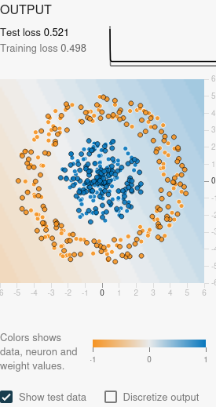
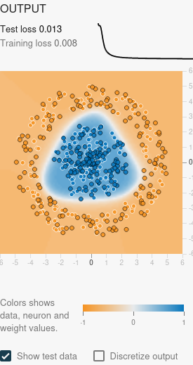
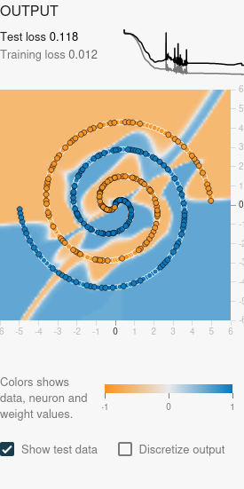
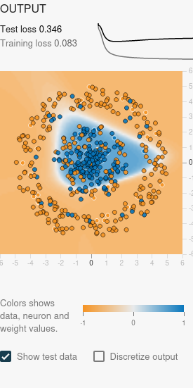

# Le Deep Learning

## Le concept

Un **neurone artificiel** combine des valeurs d'entrée avec des **poids**, ajoute un **biais**, puis applique une **fonction d'activation**. Avec deux entrées, son calcul peut s'écrire :

```text
z = poids_1 × x_1 + poids_2 × x_2 + biais
sortie = activation(z)
```

Les poids indiquent l'influence des entrées ; le biais décale la réponse. **Ce sont des paramètres ajustés pendant l'entraînement.** Pour une décision binaire, un seuil permet ensuite de convertir le score de sortie en catégorie. Dans un perceptron à seuil, on peut intégrer ce seuil au biais ; les réseaux entraînés par rétropropagation emploient généralement des activations permettant de calculer des gradients.

Avec seulement les entrées brutes **x₁ et x₂**, un neurone de sortie à activation monotone délimite deux catégories par une **droite**. Dans davantage de dimensions, cette frontière est un hyperplan. Des **couches cachées avec des activations non linéaires** permettent de construire des frontières plus complexes. Empiler des couches purement linéaires ne suffit pas : leur composition reste linéaire.

Le **Deep Learning** utilise des réseaux de neurones à plusieurs couches pour apprendre des représentations intermédiaires. Le réseau peut ainsi apprendre des caractéristiques utiles plutôt que de toutes les définir à la main. Mais nous choisissons encore les données, leur préparation, l'architecture et l'objectif d'apprentissage. Un réseau ne découvre pas automatiquement toutes les informations pertinentes et ne compense pas des données insuffisantes ou biaisées.

Dans l'[exercice SSH précédent](machine-learning-apprendre-exemples.md), nous avions choisi les colonnes et le seuil. Ici, les poids d'un réseau sont ajustés automatiquement pour réduire une **fonction de perte — loss**. Les grands réseaux peuvent demander davantage de données et de calcul, et leurs décisions sont souvent plus difficiles à expliquer qu'une règle simple ; le coût dépend cependant du modèle et de la tâche.

## Mission — Expérimenter dans TensorFlow Playground

Ouvrir [TensorFlow Playground](https://playground.tensorflow.org/). Les points orange et bleus représentent deux catégories : c'est une expérience de **classification supervisée sur des données synthétiques**, pas une détection d'attaques dans des journaux SSH.

### Préparer une comparaison compréhensible

| Réglage | Choix de départ | Pourquoi le noter |
| --- | --- | --- |
| Problem type | **Classification** | L'objectif est de séparer deux catégories. |
| Entrées | **x₁ et x₂ uniquement** | Désactiver x₁², x₂², x₁x₂ et les fonctions trigonométriques pour observer l'apport des couches. |
| Activation | **Tanh** | Introduire une non-linéarité dans les couches cachées. |
| Learning rate | **0,03** | Fixer le pas d'apprentissage pendant les comparaisons. |
| Batch size | **10** | Conserver la même taille de mini-lot. |
| Regularization | **None**, taux **0** | Commencer sans régularisation pour observer la capacité du réseau. |
| Noise | **0** au départ | Commencer avec des données peu perturbées. |
| Part d'entraînement | **50 %** au départ | Garder des points distincts pour l'évaluation. |
| Graine des essais documentés | **0.4242** | Identifier l'initialisation et la génération pseudo-aléatoire utilisées. |

Pour comparer des architectures, repartir de zéro après chaque changement. Conserver la graine et les réglages, puis relever le nombre d'époques et les deux pertes. Le temps écoulé dépend du navigateur, de la machine et de l'affichage ; il n'est pas une propriété universelle de l'architecture.

!!! note "Le piège des caractéristiques déjà transformées"
    Avec x₁² et x₂², une combinaison linéaire peut exprimer une condition du type x₁² + x₂² > seuil, donc une frontière circulaire dans le plan d'origine. L'échec du modèle sans couche cachée sur le cercle suppose ici que **seuls x₁ et x₂ sont activés**. Le code de [Playground](https://github.com/tensorflow/playground/blob/master/src/playground.ts) expose explicitement ces transformations d'entrée.

### 1. Cercle sans couche cachée : que se passe-t-il ?

**Manipulation :** choisir **Circle**, retirer toutes les couches cachées et entraîner avec x₁ et x₂.

**Explication :** une droite ne peut pas séparer une catégorie au centre d'une autre qui l'entoure. Le réseau trouve un compromis mais ne peut pas représenter la bonne séparation avec cette architecture. Une durée d'entraînement plus longue ne supprime pas cette limite : il s'agit d'un **sous-apprentissage lié à une capacité insuffisante** pour ces entrées.

### 2. Cercle avec une couche cachée de 3 ou 4 neurones

**Manipulation :** ajouter **une couche de 4 neurones**, conserver Tanh et relancer l'entraînement depuis zéro.

**Explication :** les neurones cachés construisent plusieurs réponses non linéaires que la sortie combine. La frontière peut entourer le groupe central : on attend une forme fermée et arrondie ou polygonale, sans imposer un cercle géométriquement parfait. Le résultat dépend de l'initialisation et de l'entraînement. Trois neurones donnent aussi une configuration à explorer ; aucune réussite universelle n'est garantie pour un nombre fixé.

Avec deux entrées, quatre neurones cachés et une sortie, ce réseau dense compte **17 paramètres** : 8 poids et 4 biais dans la couche cachée, puis 4 poids et 1 biais en sortie. Sans couche cachée, il n'en compte que **3** : deux poids et un biais.

### 3. Spirale : combien de couches, combien de neurones, combien de temps ?

**Manipulation :** passer à **Spiral**. Comparer d'abord une couche de 4 neurones, puis **trois couches cachées de 8 neurones chacune**, toujours avec x₁ et x₂ et Tanh.

La spirale demande une frontière qui s'enroule : elle est plus difficile à représenter et à apprendre que le cercle. Ajouter des neurones et des couches augmente la capacité, mais ne garantit ni une bonne optimisation ni une meilleure généralisation.

**Il n'existe pas de nombre minimal ni de durée unique déductible de la consigne.** Les essais chiffrés ci-dessous donnent des configurations testées, pas une architecture optimale démontrée. Trois couches de huit neurones représentent **177 paramètres** dans cette configuration : 24 + 72 + 72 + 9, biais compris.

### 4. Bruit et moins de données : que deviennent les pertes ?

**Manipulation :** choisir une architecture fixe, par exemple **8–8**, et comparer un cercle sans bruit avec **50 %** d'entraînement à un cercle avec **Noise = 40** et seulement **10 %** d'entraînement.

| Courbe | Ce qu'elle mesure | Ce qu'elle ne démontre pas seule |
| --- | --- | --- |
| **Training loss** | Erreur du réseau sur les exemples utilisés pour ajuster ses poids. | Sa capacité à traiter de nouveaux exemples. |
| **Test loss** | Erreur sur les points laissés hors de cet ajustement. | Une performance définitive si l'on utilise cette courbe pour choisir les réglages. |

**Un signe de surapprentissage** est une perte d'entraînement qui baisse alors que la perte sur les données laissées à l'écart stagne ou remonte. Le modèle s'adapte alors à des particularités du jeu d'apprentissage qui se retrouvent mal ailleurs. Bruit, faible quantité de données et forte capacité peuvent favoriser cette situation.

**L'écart ne s'élargit pas obligatoirement à chaque essai.** Si les deux pertes restent élevées, le réseau peut sous-apprendre ou mal s'optimiser. Un écart ponctuel ne suffit pas : examiner son évolution et répéter avec plusieurs graines. Augmenter le bruit et diminuer la part d'entraînement simultanément montre un effet combiné ; pour isoler leurs effets, modifier un seul réglage à la fois.

Pour limiter un surapprentissage confirmé : données plus représentatives, capacité adaptée, régularisation et arrêt à un moment choisi sur un jeu de validation. Le libellé **Test loss** appartient à Playground ; si nous nous en servons pour choisir l'architecture, ces points jouent en pratique un rôle de **validation**, et une évaluation finale indépendante reste nécessaire. Voir [TensorFlow — surapprentissage et sous-apprentissage](https://www.tensorflow.org/tutorials/keras/overfit_and_underfit) et [Scikit-learn — séparation des jeux d'évaluation](https://scikit-learn.org/stable/modules/cross_validation.html).

### 5. Ma phrase pour Nadia

> **Le réseau a classé ce point en orange parce que ses coordonnées, transformées par les poids et les activations appris, produisent une sortie du côté orange de la frontière de décision ; ce calcul ne prouve pas que le point représente une attaque.**

On peut inspecter les poids, les activations et la frontière de ce petit réseau. Cela décrit son calcul ; cela ne fournit pas automatiquement une explication métier ou une cause à l'activité observée. Sur des logs, il faudrait encore relier les caractéristiques à des événements et les faire qualifier par l'analyste.

## Essais réalisés — Mesures et captures

Les **six essais suivants ont été exécutés par l'assistant le 19 octobre 2026**, avec Firefox en mode sans interface, sur une copie locale des fichiers officiels de Playground. Le calcul du réseau est celui de l'application ; les appels de suivi d'audience ont été neutralisés. Il s'agit de données synthétiques et ces essais ne sont pas attribués à une manipulation de l'apprenant.

Réglages communs : **x₁ et x₂ seuls, Tanh, learning rate 0,03, batch size 10, sans régularisation, graine 0.4242**. Arrêt au budget d'époques fixé ci-dessous, sans recherche d'un minimum de perte. Les durées mesurent l'exécution avec l'affichage de Playground, pas le seul calcul d'optimisation.

| Essai | Couches cachées | Bruit | Part d'entraînement | Époques | Durée mesurée | Training loss | Test loss |
| --- | --- | --- | --- | --- | --- | --- | --- |
| Cercle, sans couche cachée | Aucune | 0 | 50 % | 500 | 8,32 s | 0.498 | 0.521 |
| Cercle, une couche | 4 | 0 | 50 % | 500 | 8,34 s | 0.008 | 0.013 |
| Spirale, une couche | 4 | 0 | 50 % | 1 000 | 16,67 s | 0.389 | 0.426 |
| Spirale, trois couches | 8–8–8 | 0 | 50 % | 2 000 | 53,26 s | 0.012 | 0.118 |
| Cercle, référence pour le bruit | 8–8 | 0 | 50 % | 1 000 | 19,12 s | 0.000 | 0.001 |
| Cercle bruité, peu de données | 8–8 | 40 | 10 % | 1 000 | 18,7 s | 0.083 | 0.346 |

Les pertes sont **les valeurs affichées à trois décimales**, et non des pourcentages d'erreurs. **0.000 est un arrondi, pas la preuve d'une perte exactement nulle.** Playground utilise ici la moyenne de la demi-erreur quadratique entre la sortie et l'étiquette, comme le montre son [code source](https://github.com/tensorflow/playground/blob/master/src/nn.ts).

**Ce que ces essais montrent :**

- **Cercle :** à 500 époques dans les deux cas, les quatre neurones cachés permettent une frontière fermée et une perte de test de **0.013**, contre **0.521** sans couche cachée.
- **Spirale :** le réseau **8–8–8** produit une frontière qui s'enroule et obtient **0.012 / 0.118** après **2 000 époques en 53,26 s**. Il conserve des zones mal classées : « mieux séparer » ne signifie pas réussir parfaitement. Le réseau à quatre neurones n'a été entraîné que 1 000 époques ; cette comparaison change donc **l'architecture et le budget d'entraînement**, et n'isole pas l'effet du seul nombre de couches.
- **Bruit et faible part d'entraînement :** pour **8–8** à 1 000 époques, l'écart affiché test − entraînement passe d'environ **0.001** à **0.263**. Les pertes finales **0.083 / 0.346** montrent une généralisation moins bonne dans cet essai bruité. La courbe et cet écart sont compatibles avec du surapprentissage ; modifier deux facteurs à la fois et ne tester qu'une graine empêche d'attribuer l'effet à une seule cause ou d'en faire une loi générale.

### Captures des sorties

Les captures montrent les pertes, leur évolution et la frontière colorée. **Show test data** est activé pour afficher les points laissés à l'écart. Les couleurs indiquent les classes et le score signé ; ce ne sont pas des probabilités calibrées ni des niveaux de risque cyber.

=== "Cercle sans couche"

    

=== "Cercle avec 4 neurones"

    

=== "Spirale avec 8–8–8"

    

=== "Bruit et 10 % d'entraînement"

    

[Relevé des six essais : réglages, graines, URL et mesures au format JSON](../../assets/img/ia-cybersecurite/it-1/playground-resultats-2026-10-19.json). Chaque fragment d'URL permet de recharger une configuration ; les temps et les arrondis peuvent varier selon l'environnement. Ces essais ne recherchent ni l'architecture minimale ni un réglage optimal.

## Surapprentissage : le lien avec l'exercice SSH

Dans l'exercice précédent, la règle « échecs > 20 » était parfaite sur les douze exemples d'entraînement mais commettait quatre erreurs sur le test. Ce résultat montre un **échec de généralisation sur ces nouveaux cas** ; il ne suffit pas, à lui seul, à prouver qu'un modèle trop complexe a mémorisé les données.

En revanche, retoucher la règle après lecture des réponses du test rend ce test impropre à une évaluation finale indépendante. Pour le réseau comme pour le seuil SSH, **réussir sur des données déjà consultées ne démontre pas la fiabilité sur des situations nouvelles**.

## Et les LLM ?

Les LLM modernes reposent eux aussi sur des réseaux de neurones entraînés en ajustant des paramètres. Beaucoup utilisent l'architecture **Transformer**, présentée en **2017** dans [Attention Is All You Need](https://arxiv.org/abs/1706.03762), déjà située sur [notre frise](70-ans-intelligence-artificielle.md).

Ils ne sont toutefois pas une simple copie agrandie du réseau dense de Playground : ils traitent notamment des **tokens**, des représentations vectorielles et des mécanismes d'**attention**. Leur objectif d'entraînement et leur architecture diffèrent du classement de points en deux dimensions.

Certains grands modèles comptent des dizaines ou des centaines de milliards de paramètres ; il existe aussi des modèles de langage plus petits. Le nombre de paramètres varie donc selon le modèle. Dans notre expérience, les réseaux comparés comptent de **3 à 177 paramètres** : l'écart d'échelle est considérable, mais la taille seule ne suffit pas à expliquer leurs capacités ni leurs risques.

## Ressources

- [TensorFlow Playground](https://playground.tensorflow.org/)
- [Code source officiel du réseau — poids, biais, activations et perte](https://github.com/tensorflow/playground/blob/master/src/nn.ts)
- [Code source officiel de l'interface — entrées et entraînement](https://github.com/tensorflow/playground/blob/master/src/playground.ts)
- [TensorFlow — surapprentissage et sous-apprentissage](https://www.tensorflow.org/tutorials/keras/overfit_and_underfit)
- [Elements of AI — cours gratuit en français, chapitre 5](https://www.elementsofai.fr/) : ressource proposée dans la consigne.

Sources consultées et essais réalisés le **19 octobre 2026**.

[Retour à l'itération](index.md)
