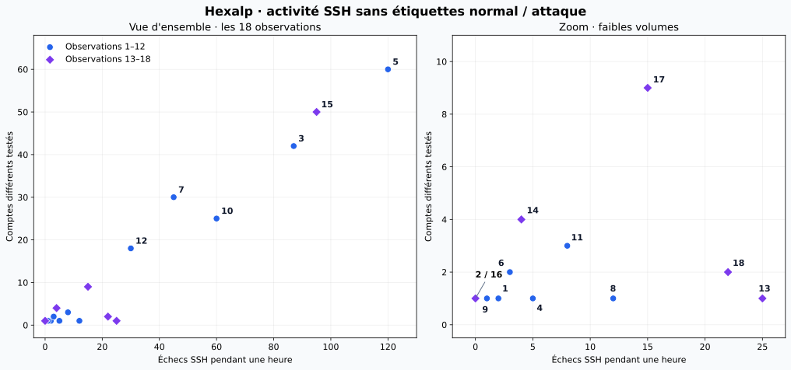

# Le Machine Learning : apprendre à partir d'exemples

## Le problème à résoudre

L'équipe supervision d'Hexalp veut « un modèle qui détecte les attaques dans les logs ». Avant de confier ce travail à une machine, vous allez le faire vous-même, sur papier. Vous verrez qu'entraîner un modèle, c'est chercher une règle qui sépare bien des exemples connus, puis vérifier qu'elle tient sur des cas qu'elle n'a jamais vus.

Cette fiche propose une résolution complète des quatre missions. Les **18 observations sont les données pédagogiques de la consigne**, pas des journaux réels collectés chez Hexalp. Les calculs portent uniquement sur ces lignes.

## Vocabulaire clé

| Terme | Ce que c'est concrètement |
| --- | --- |
| **Observation** | Une ligne de données : ici, l'activité d'une adresse IP pendant une heure. |
| **Caractéristique — feature** | Une donnée utilisée pour décider : nombre d'échecs SSH, heure ou nombre de comptes testés. Le numéro de ligne sert à retrouver l'observation, pas à prédire son étiquette. |
| **Étiquette — label** | La réponse de référence fournie par l'analyste : « normal » ou « attaque ». Elle peut être imparfaite dans des données réelles. |
| **Modèle** | La fonction ou la règle utilisée pour produire une prédiction. Ici, une comparaison à un seuil. |
| **Entraînement** | La recherche de cette règle à partir des exemples réservés à l'apprentissage. |
| **Jeu d'entraînement / de test** | Les exemples qui servent à trouver la règle / ceux mis de côté pour l'évaluer sans la modifier. Ici : lignes 1–12 / lignes 13–18. |
| **Faux positif — FP** | Une alerte « attaque » sur une observation étiquetée « normal ». |
| **Faux négatif — FN** | Une observation étiquetée « attaque » que la règle prédit « normal ». |

!!! note "Méthode de lecture"
    Les réponses et étiquettes sont visibles dans ce corrigé. Le tableau de test présente le résultat de l'application d'une règle figée ; il ne constitue pas la preuve qu'un test à l'aveugle a été réalisé. Pour refaire l'exercice, masquer les étiquettes avant de prédire.

## Mission 1 — Entraîner mon modèle

### Les douze observations d'entraînement

| N° | Échecs SSH dans l'heure | Heure | Comptes différents testés | Étiquette |
| --- | --- | --- | --- | --- |
| 1 | 2 | 09 h | 1 | normal |
| 2 | 0 | 14 h | 1 | normal |
| 3 | 87 | 03 h | 42 | attaque |
| 4 | 5 | 10 h | 1 | normal |
| 5 | 120 | 02 h | 60 | attaque |
| 6 | 3 | 18 h | 2 | normal |
| 7 | 45 | 23 h | 30 | attaque |
| 8 | 12 | 08 h | 1 | normal |
| 9 | 1 | 22 h | 1 | normal |
| 10 | 60 | 15 h | 25 | attaque |
| 11 | 8 | 11 h | 3 | normal |
| 12 | 30 | 04 h | 18 | attaque |

### 1. Ma caractéristique, mon seuil et mes erreurs

Je choisis le **nombre d'échecs SSH pendant une heure**, avec la règle **R1** :

```text
Si échecs_SSH > 20 : prédire « attaque ».
Sinon : prédire « normal ».
```

Les observations normales ont au maximum **12 échecs**, et les attaques au minimum **30 échecs**. Le seuil 20 les sépare donc toutes : **0 faux positif et 0 faux négatif sur les 12 lignes**.

| Résultat de R1 sur l'entraînement | Nombre | Observations |
| --- | --- | --- |
| Vrais positifs : attaques détectées | 5 | 3, 5, 7, 10, 12 |
| Vrais négatifs : comportements normaux correctement reconnus | 7 | 1, 2, 4, 6, 8, 9, 11 |
| Faux positifs | 0 | Aucune |
| Faux négatifs | 0 | Aucune |

### 2. Une règle fondée uniquement sur l'heure

Je définis explicitement « la nuit » comme **de 22 h inclus à 06 h exclu** : heure ≥ 22 ou heure < 6. La règle prédit « attaque » pendant cette plage et « normal » le reste du temps.

| Erreur | Observation | Pourquoi la règle se trompe |
| --- | --- | --- |
| **Faux positif** | **9** : 1 échec à 22 h, 1 compte, normal | Une activité nocturne peut être légitime. |
| **Faux négatif** | **10** : 60 échecs à 15 h, 25 comptes, attaque | Une attaque peut avoir lieu en journée. |

La règle horaire fait **2 erreurs sur 12**, contre zéro pour R1. La définition de « nuit » influence le décompte : elle doit être précisée avant de compter. L'heure peut apporter du contexte, mais elle ne suffit pas ici à séparer les comportements. Une caractéristique doit être choisie pour son utilité démontrée sur les données, pas pour une intuition comme « la nuit est suspecte ».

### 3. Plusieurs seuils donnent-ils zéro erreur ?

Oui. Pour une règle **échecs > seuil**, tout seuil **12 ≤ seuil < 30** donne zéro erreur sur l'entraînement, soit les entiers **12 à 29**.

Je retiens **20**, un entier simple situé dans cet intervalle, en utilisant seulement les douze exemples d'entraînement. **Ce choix n'est pas un optimum démontré** : les données ne départagent pas ces seuils. Le milieu exact de l'intervalle entre 12 et 30 serait 21, qui fonctionne aussi. Une évaluation séparée sera nécessaire pour juger le comportement sur de nouveaux cas.

## Mission 2 — Tester R1 sans la modifier

### Les six nouvelles observations et mes prédictions

La règle reste **échecs SSH > 20 → attaque**.

| N° | Échecs SSH dans l'heure | Heure | Comptes différents testés | Prédiction R1 | Étiquette réelle | Résultat |
| --- | --- | --- | --- | --- | --- | --- |
| 13 | 25 | 10 h | 1 | **attaque** | normal | **Faux positif** |
| 14 | 4 | 03 h | 4 | **normal** | attaque | **Faux négatif** |
| 15 | 95 | 01 h | 50 | **attaque** | attaque | Vrai positif |
| 16 | 0 | 13 h | 1 | **normal** | normal | Vrai négatif |
| 17 | 15 | 21 h | 9 | **normal** | attaque | **Faux négatif** |
| 18 | 22 | 09 h | 2 | **attaque** | normal | **Faux positif** |

### 1. Faux positifs, faux négatifs et coût pour Hexalp

R1 produit **2 faux positifs** (13 et 18) et **2 faux négatifs** (14 et 17). Elle classe correctement **2 observations sur 6**, soit environ **33,3 %**. Le résultat parfait à l'entraînement ne se retrouve pas sur ces nouveaux exemples.

| Matrice de confusion du test | Réel : attaque | Réel : normal |
| --- | --- | --- |
| **Prédit : attaque** | 1 vrai positif — n° 15 | 2 faux positifs — n° 13 et 18 |
| **Prédit : normal** | 2 faux négatifs — n° 14 et 17 | 1 vrai négatif — n° 16 |

**Dans une hypothèse de supervision avec validation humaine**, je considère le faux négatif comme potentiellement le plus coûteux : une intrusion non détectée pourrait affecter les opérations logistiques. Mais le dossier ne fournit ni coûts ni impacts mesurés permettant de chiffrer cette priorité. Si l'alerte provoquait un blocage automatique, un faux positif pourrait aussi interrompre un accès ou un traitement métier critique. Le coût dépend donc de l'actif, de l'action déclenchée et du contexte ; Nadia doit valider l'arbitrage.

### 2. Explications plausibles pour les observations 13, 14 et 18

| Observation | Hypothèse réaliste | Éléments à rechercher pour la vérifier |
| --- | --- | --- |
| **13 — 25 échecs sur 1 compte à 10 h ; normal** | Une tâche automatisée utilise encore un ancien mot de passe ou une ancienne clé après une rotation. | Propriétaire de l'IP et de la tâche, changement récent, compte concerné, message d'erreur SSH et horaire des relances. |
| **14 — 4 échecs sur 4 comptes à 03 h ; attaque** | Une tentative à faible volume teste un secret courant sur plusieurs comptes : scénario compatible avec du password spraying. | Comptes visés, origine, tentatives avant et après cette heure, éventuelles connexions réussies et autres IP impliquées. |
| **18 — 22 échecs sur 2 comptes à 09 h ; normal** | Une reprise d'activité ou une maintenance relance des outils avec des identifiants périmés pour deux comptes de service. | Ticket de maintenance, outils relancés, historique des secrets et confirmation des responsables des comptes. |

Ces explications sont **des hypothèses proposées**, pas des faits établis par les quatre colonnes. Les observations ne précisent notamment pas les succès SSH, la source exacte ou le contenu des erreurs.

### 3. Une règle combinant deux caractéristiques ferait-elle mieux ?

Après analyse des erreurs, je propose **R2** :

```text
Si échecs_SSH > 3 ET comptes_différents > 3 : prédire « attaque ».
Sinon : prédire « normal ».
```

| N° du test | Échecs > 3 ? | Comptes > 3 ? | Prédiction R2 | Étiquette réelle | Résultat |
| --- | --- | --- | --- | --- | --- |
| 13 | Oui | Non | normal | normal | Vrai négatif |
| 14 | Oui | Oui | attaque | attaque | Vrai positif |
| 15 | Oui | Oui | attaque | attaque | Vrai positif |
| 16 | Non | Non | normal | normal | Vrai négatif |
| 17 | Oui | Oui | attaque | attaque | Vrai positif |
| 18 | Oui | Non | normal | normal | Vrai négatif |

R2 fait **0 erreur sur les 12 lignes d'entraînement et 0 erreur sur les 6 lignes du test**. Le nombre de comptes permet ici d'écarter les échecs concentrés sur un ou deux comptes et de repérer les essais répartis entre plusieurs comptes.

**Deux caractéristiques ne sont cependant pas nécessaires pour obtenir ce résultat sur ces données :** la règle « comptes différents > 3 » seule classe aussi correctement les 18 observations. Cela ne prouve pas que cette règle soit fiable en exploitation.

!!! warning "Ce test a maintenant servi à améliorer la règle"
    R2 est proposée après consultation des erreurs des lignes 13–18. Son zéro erreur est un résultat exploratoire sur des données déjà vues ; ce n'est plus une estimation indépendante de sa généralisation. Il faut figer R2 puis l'évaluer sur un nouveau jeu tenu à l'écart. Dans un projet réel, on utilise un jeu de validation pour choisir les réglages, puis un test final séparé. Voir [Scikit-learn — évaluation et jeux de données séparés](https://scikit-learn.org/stable/modules/cross_validation.html).

### 4. Que se passe-t-il si je baisse le seuil pour détecter le n° 14 ?

Le n° 14 compte **4 échecs**. Avec une comparaison stricte « > », il faut un seuil inférieur à 4 ; je prends **3**. Cette variante utilise **uniquement le nombre d'échecs**, sans la condition sur les comptes de R2.

| Jeu | R1 : échecs > 20 | Variante : échecs > 3 |
| --- | --- | --- |
| Entraînement, lignes 1–12 | 0 FP, 0 FN | **3 FP** : 4, 8, 11 ; 0 FN |
| Test, lignes 13–18 | 2 FP : 13, 18 ; 2 FN : 14, 17 | **2 FP** : 13, 18 ; **0 FN** |
| Ensemble des 18 lignes | 2 FP, 2 FN | **5 FP**, 0 FN |

Sur les six nouvelles lignes, je récupère les attaques 14 et 17, mais les alertes injustifiées sur 13 et 18 restent présentes. Sur l'entraînement, trois comportements normaux deviennent suspects. **Baisser un seuil peut augmenter la détection en augmentant aussi les fausses alertes** ; cela ne résout pas à lui seul le choix des caractéristiques.

## Mission 3 — Sans étiquettes

### Graphique des 18 observations

L'abscisse représente les **échecs SSH**, l'ordonnée les **comptes différents testés**. Les couleurs et formes distinguent seulement les deux lots de la consigne : **elles ne représentent pas les étiquettes normal / attaque**. Le panneau de droite agrandit la zone des faibles volumes.



Les numéros **2 et 16 se superposent exactement en (0 ; 1)**. Leurs heures diffèrent, mais cette information n'apparaît pas sur ce graphique à deux caractéristiques.

### 1. Quels points se ressemblent, lesquels s'éloignent ?

- **Zone dense près de l'origine :** 1, 2, 4, 6, 8, 9, 11, 14 et 16, avec peu d'échecs et peu de comptes. Le n° 14 reste proche des faibles volumes, malgré un nombre de comptes un peu supérieur.
- **Volumes d'échecs plus élevés sur peu de comptes :** 13 et 18, à (25 ; 1) et (22 ; 2).
- **Point intermédiaire :** 17, à (15 ; 9), dont le nombre de comptes est plus élevé que celui du groupe proche de l'origine.
- **Points nettement décalés vers le haut et la droite :** 3, 5, 7, 10, 12 et 15, qui combinent davantage d'échecs et de comptes testés.

Ce regroupement est une **lecture visuelle**, pas le résultat d'un algorithme de clustering. L'échelle, la normalisation des caractéristiques et la méthode de détection influenceraient les distances et les scores d'anomalie.

### 2. Les points éloignés sont-ils tous des attaques ? Le groupe est-il entièrement normal ?

**Dans ce jeu précis, les six points nettement en haut à droite sont tous étiquetés attaque.** Mais un éloignement ne suffit pas à établir cette qualification : 13 et 18 sont étiquetés normaux et pourraient paraître atypiques par leur nombre d'échecs. Une maintenance ou une panne peut produire un comportement rare.

**Le groupe des faibles volumes n'est pas entièrement normal : le n° 14 est une attaque.** Le n° 17 montre aussi qu'une attaque peut avoir un volume modéré. Un attaquant peut chercher à rester proche des comportements habituels. Le caractère rare et le caractère malveillant sont donc deux propriétés distinctes.

### 3. La phrase complétée

> **Un modèle non supervisé ne détecte pas des attaques, il détecte des anomalies qu'un analyste doit ensuite qualifier.**

Dans cette phrase, « modèle non supervisé » désigne le **détecteur d'anomalies de l'exercice**. L'apprentissage non supervisé comprend aussi d'autres tâches, comme regrouper des observations ou réduire le nombre de dimensions. Le principe de détection d'anomalies prépare le J3 ; l'algorithme et ses conditions d'entraînement restent à préciser. [Scikit-learn — détection d'anomalies](https://scikit-learn.org/stable/modules/outlier_detection.html).

## Mission 4 — Les grandes familles d'apprentissage

### Ce que l'entraînement ajuste

Nous avons testé des seuils et compté les erreurs. Un algorithme automatise une recherche ou une optimisation selon une méthode et un objectif définis ; il ne procède pas nécessairement par essais exhaustifs et ne garantit pas de trouver une règle parfaite.

Les **paramètres** sont les valeurs apprises : poids d'un réseau, coefficients ou seuils de découpage d'un arbre, par exemple. Les **hyperparamètres** encadrent l'apprentissage : profondeur maximale d'un arbre, nombre d'arbres, etc. Le seuil d'alerte peut aussi être réglé séparément sur un score : son statut dépend de la façon dont il a été obtenu. Dans notre exercice, **20 est un seuil de décision choisi manuellement à partir des exemples**.

### Tableau complété

| Type d'apprentissage | Ce qu'on donne à la machine | Ce qu'elle produit | Un exemple en cybersécurité |
| --- | --- | --- | --- |
| **Supervisé** | Des observations avec leurs caractéristiques **et leurs étiquettes de référence**, ainsi qu'un objectif d'apprentissage. | Un modèle capable de prédire une classe ou une valeur sur de nouvelles observations. | Apprendre à classer des activités SSH « normal / attaque » à partir des lignes étiquetées, puis évaluer les erreurs sur des données séparées. |
| **Non supervisé** | Des observations **sans étiquettes de cible** pour l'apprentissage ; le choix des caractéristiques et de la méthode reste humain. | Selon la méthode : groupes, représentation des données ou scores d'anomalie. | Attribuer un score d'anomalie à une activité SSH inhabituelle pour orienter l'analyse ; le score ne prouve pas une intrusion. |
| **Par renforcement** | Un environnement ou des trajectoires d'interaction, des observations, des actions possibles et un signal de **récompense / pénalité**. | Une politique de choix d'actions visant à maximiser la récompense cumulée attendue. | **Exemple pédagogique proposé :** dans un simulateur de cyberdéfense, apprendre quand isoler un poste en récompensant la limitation de l'attaque et en pénalisant l'interruption d'un service légitime. Aucun agent de ce type n'est déployé chez Hexalp dans le scénario fourni. |

L'apprentissage par renforcement ne signifie pas qu'un analyste corrige chaque exemple avec une étiquette. L'agent apprend à partir des conséquences de ses actions et du signal de récompense défini. Référence : [Spinning Up — concepts du renforcement](https://spinningup.openai.com/en/latest/spinningup/rl_intro.html).

## Ce que je peux expliquer à Nadia

Le seuil 20 sépare parfaitement les exemples d'entraînement, mais manque des attaques à faible volume et alerte sur des activités normales dans le test. Le choix des caractéristiques compte autant que celui du seuil. Une règle améliorée après lecture du test exige une nouvelle évaluation indépendante. Enfin, un score d'anomalie aide à prioriser l'analyse ; il ne transforme pas automatiquement un comportement inhabituel en attaque prouvée.

**Vérification :** les prédictions et les listes de FP/FN présentées ici ont été recalculées par un script Python sur les 18 lignes fournies. Le graphique reprend leurs coordonnées exactes. Il s'agit d'une résolution pédagogique, sans entraînement Scikit-learn ni mesure sur des journaux réels d'Hexalp.

## Ressources

- [Scikit-learn — apprentissage supervisé](https://scikit-learn.org/stable/supervised_learning.html)
- [Scikit-learn — apprentissage non supervisé](https://scikit-learn.org/stable/unsupervised_learning.html)
- [Scikit-learn — évaluation et validation croisée](https://scikit-learn.org/stable/modules/cross_validation.html)
- [Scikit-learn — éviter les fuites de données](https://scikit-learn.org/stable/common_pitfalls.html)
- [Spinning Up — concepts de l'apprentissage par renforcement](https://spinningup.openai.com/en/latest/spinningup/rl_intro.html)

Sources consultées le **19 octobre 2026**. Les calculs et hypothèses de contexte sont explicités dans les missions correspondantes.

[Retour à l'itération](index.md)
