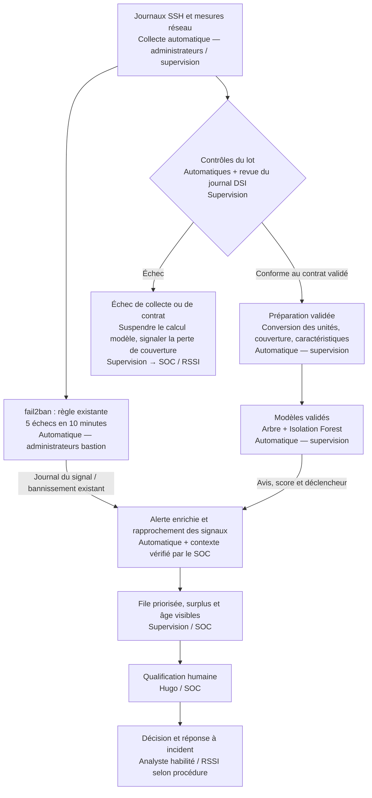

# Exploiter sans se fier aveuglément

**Séquence 4.8 — 45 min — Présentiel**

> **Nadia [16:15]** Si je résume : il voit des choses que fail2ban ne voit pas, il en rate d’autres, et on peut le tromper 🙃 Si on le met en service, c’est à quelles conditions ? Il me faut une page que je puisse défendre en comité.

## Objectif et état du travail

Relier journaux, règles, modèles et analyste ; définir les conditions d’exploitation et terminer la recommandation. Source : kit apprenant PDF, section 4.8. Cette feuille et les décisions ci-dessous sont **des propositions dans le scénario Hexalp**, pas la preuve d’un déploiement, d’un accord de Nadia ou d’une procédure déjà appliquée. Les expériences et captures des sections précédentes constituent les preuves disponibles.

## Mission 1 — La chaîne de détection

**Chaîne cible proposée**, à distinguer du script actuel : la V2 produit un CSV mais ne crée ni intégration SOC, ni orchestrateur de qualification, ni blocage. La branche fail2ban est indépendante du calcul hebdomadaire des modèles.

| Maillon | Automatique ou humain ? Responsable proposé | En cas de panne |
| --- | --- | --- |
| **Journaux et sonde** | Collecte automatique ; administrateurs et supervision vérifient sa présence | Signaler perte de visibilité, conserver les sources encore disponibles, réparer la sonde ; ne pas transformer absence de mesure en activité normale |
| **Contrôles de qualité** | Contrôles automatiques, revue humaine des changements ; Sofia | Refuser le lot modèle, tracer les anomalies et prévenir SOC/RSSI ; fail2ban continue si ses propres journaux sont disponibles |
| **Préparation** | Automatique, transformations revues par mainteneur et supervision | Arrêter en cas de schéma/unité inconnus ; garder brut et versions, corriger puis rejouer sans écraser les preuves |
| **fail2ban** | Règle et bannissement existants automatiques ; administrateurs bastion | Alerter sur son indisponibilité, appliquer les mesures de continuité prévues ; ne pas supposer que le modèle le remplace |
| **Modèles** | Prédiction automatique d’une version validée ; supervision | Signaler l’échec et suspendre la production d’avis ; retour à une version validée seulement si données compatibles ; conserver les règles existantes |
| **Enrichissement et file** | Automatique pour joindre les champs, humain pour valider le contexte ; supervision/SOC | Conserver CSV et logs dans une file de reprise, signaler retard/doublons et éviter une perte silencieuse ; pas de connexion actuelle démontrée vers un outil SOC |
| **Analyste** | Qualification humaine ; Hugo/SOC | Renfort/escalade prévu, stock et ancienneté suivis ; aucune « validation automatique » pour vider la file |
| **Décision** | Humaine, selon habilitation/procédure ; SOC/RSSI | Escalader au responsable de permanence ; aucune délégation au modèle pour compenser l’absence de décideur |

Une panne du modèle n’est pas une panne de fail2ban, et une panne de collecte commune peut affecter les deux : suivre chaque dépendance. Les dispositifs de continuité cités doivent être définis et validés avant exploitation.

## Mission 2 — Les conditions d’exploitation

| Rubrique | Conditions proposées à approuver avant exploitation |
| --- | --- |
| **Données** | Sofia contrôle à chaque lot schéma, unités, valeurs, périodes, doublons IP/heure et manques ; rapprochement avec le journal DSI. Arrêt du calcul modèle si contrat invalide ; manques/exclusions tracés et incident de collecte distinct. Le seuil actuel de 10 % reste pédagogique, à faire approuver ; un lot sous ce seuil n’est pas réputé sain pour autant. |
| **Réévaluation** | Revue hebdomadaire des alertes et de la collecte ; bilan formel au plus tard après quatre semaines de pilote. Revue immédiate après changement de sonde/VPN/rôle, incident manqué ou suspicion d’altération. Comparer ancien et candidat sur période future intacte, étiquetée/revue par Hugo et le SOC, avec cas ciblés de sécurité. Pas d’apprentissage automatique sur les traces récentes. |
| **Protection** | Mainteneurs désignés pour le script ; Hugo/SOC préparent et relisent corpus/étiquettes ; déploiement réservé à un compte de service sans droit de modifier les références validées. Modèles/corpus/normaliseur/paramètres versionnés, accès restreints, modifications revues, empreintes confrontées à un manifeste approuvé. Aucune liste blanche globale ; toute exception contextuelle, datée et validée. |
| **Alertes** | Capacité de référence : **30 qualifications par semaine**, pas un seuil supprimant les autres alertes. Priorité selon impact métier, identité, destination, volume cumulé et contexte ; score comme indice secondaire. Surplus conservé dans un stock visible, avec âge et escalade RSSI/SOC pour renfort ou limitation du pilote. Aucune file saturée présentée comme maîtrisée. |
| **Interdits** | Le modèle ne bloque jamais une IP, ne désactive aucun compte, ne modifie aucune configuration et n’exécute aucune commande générée. Ni remplacement automatique du modèle, ni ajout automatique d’exception. fail2ban garde sa règle indépendante déjà autorisée ; son bannissement existant n’est pas une décision du modèle. |
| **Indicateurs** | Chaque semaine : couverture/manques et exclusions ; alertes par détecteur, doublons/incidents regroupés ; stock non qualifié et ancienneté ; temps de qualification ; FP/FN, précision/rappel par profil et gravité quand une référence indépendante existe. Si FN inconnus, rappel « non encore mesurable », jamais 100 % par défaut. |
| **Responsabilités** | Sofia/supervision : lancement et contrôle de collecte ; administrateurs bastion : journaux et fail2ban ; Hugo/SOC : qualification, revue des étiquettes et incidents ; mainteneurs habilités : candidat et retour arrière ; Nadia : arbitrage de charge/risque et décision de mise en service ou mise à jour. DSI : habilitations, sauvegardes et intégrité des artefacts. |

### Ce que doit recevoir l’analyste

La V2 fournit déjà date, heure, IP, origine, mesures, avis arbre, score/anomalie IF et modèle(s) déclencheur(s). Ajouter **identifiant d’alerte et du lot, version/empreinte du modèle et du script, qualité/couverture de collecte, rôle de la source, identité/destination si disponibles, liens vers les journaux et décision de qualification**. Ces ajouts sont proposés ; ils ne figurent pas tous dans le CSV actuel. L’étiquette historique est réservée à l’évaluation, pas présentée comme une vérité connue pour une nouvelle alerte.

La V2 trie actuellement par score d’anomalie ; cet ordre **n’est pas une priorité métier**. Une file de trente lignes exportées en oubliant les autres ne résoudrait pas la saturation : sur notre essai, 179 alertes dépassent la capacité cumulée de 60. Le regroupement doit conserver les événements et son impact sur la détection doit être mesuré ; trente incidents regroupés n’équivalent pas automatiquement à trente qualifications de dix minutes.

### Décider d’un remplacement de modèle

Grille de travail **à faire approuver**, et non objectifs déjà validés :

- Sur une période future indépendante, rechercher un **rappel d’au moins 95 %** et une **précision d’au moins 85 %**, avec effectifs, erreurs par profil/gravité et exclusions publiés. Ce sont des seuils proposés pour ce pilote, pas une norme ni une garantie statistique.
- Ne pas accepter une régression sur les scénarios critiques retenus pour la recette, notamment exfiltration et spraying ; expliciter tout risque résiduel. Zéro régression sur un jeu de tests ne signifie pas zéro attaque manquée dans la réalité.
- Vérifier une charge réellement qualifiable à moyens constants, ou faire approuver un renfort ; la limite de trente concerne le travail, pas une sélection qui masquerait les FN ou les alertes excédentaires.
- Exiger corpus/étiquettes revus, intégrité vérifiée, procédure de retour arrière et décision écrite de Nadia avec le SOC. Les données d’octobre déjà explorées ne servent pas de nouveau test aveugle.

La V2 atteint un rappel de 95,73 % mais une précision de 84,52 % sur les lignes conservées ; surtout elle produit 104 puis 135 alertes/semaine et laisse quatorze lignes hors couverture. **Elle ne satisfait donc pas aujourd’hui cette grille proposée.** Ne pas arrondir la précision à 85 % pour déclarer le critère rempli.

## Mission 3 — Recommandation en cinq lignes

**Pas de mise en service opérationnelle générale en l’état ; poursuite d’un pilote local supervisé pendant quatre semaines.**  
Le modèle reste une aide, avec fail2ban et les contrôles existants ; aucune action de blocage ne lui est déléguée.  
Le pilote exige des données contrôlées, des versions protégées et des alertes réellement qualifiées, surplus compris.  
Avant élargissement, Nadia et le SOC doivent valider la capacité, les erreurs acceptables et une évaluation sur une période future intacte.  
Réévaluation hebdomadaire, bilan formel au plus tard à quatre semaines, et immédiate après incident manqué ou changement significatif.

La période du pilote commence à son autorisation effective, pas à la date fictive d’un message du scénario. Sans moyens pour qualifier et suivre le surplus, rester en évaluation hors exploitation ; un pilote ne rend pas la surcharge acceptable par son seul nom.

### Cinq questions à l’éditeur

1. **Que signifie « 99 % de détection » ?** Rappel ou accuracy, sur combien d’attaques et normales, quelles périodes et avec quels intervalles d’incertitude ? Donnez matrices et résultats par type d’attaque, y compris spraying lent et exfiltration interne.
2. **Comment l’avez-vous mesuré indépendamment ?** Quelles sources et étiquettes, quelle séparation temporelle, quelles exclusions ou imputations, et quelle validation sur une infrastructure comparable à Hexalp sans réutiliser le test pour régler la sonde ?
3. **Que coûte réellement le bruit ?** Combien d’alertes et de FP par semaine chez un client comparable, combien de temps de qualification, et que se passe-t-il au-delà de trente alertes ou pendant une panne de collecte ? « Zéro FP » est-il observé sur un jeu limité ou garanti contractuellement ?
4. **Comment protégez-vous le cycle du modèle ?** Provenance, données d’entraînement, versions, mises à jour, essais d’évasion/empoisonnement, contrôle d’intégrité, explications et retour arrière ; quels accès et rôles sont nécessaires chez nous ?
5. **Quelles données et actions vous confie-t-on ?** Traitement local ou distant, conservation, sous-traitants, journaux exportables et droits sur le SI ; peut-on imposer validation humaine, absence de blocage autonome et réversibilité sans perdre nos preuves ?

Une réponse commerciale ne vaut pas validation : demander un protocole et des preuves vérifiables dans un essai encadré. Ne pas exiger la publication de données clients confidentielles pour obtenir ces éléments.

## Livrables finalisés et limites restantes

La rubrique **Conditions d’exploitation** et le résumé de `rapport_evaluation.md` sont complétés ; le carnet reprend les trois missions. Ces conditions restent à approuver et à implémenter. Les notebooks 03/04 sont exécutés localement avec assistance ; les captures de l’apprenant corroborent les exercices, sans remplacer une vérification complète de l’environnement et des fichiers de sa VM. Deux relances identiques de la V2 dans la VM et l’identité des fichiers par empreinte ne sont toujours pas démontrées.

Le rapport et les fichiers sont préparés pour une **remise groupée** ; aucun message ou fichier n’est envoyé au formateur. Le PDF final est actualisé :13 pages, dont trois pour le rapport. Une archive unique `Remise-J4-Hexalp-Olivier-HIMBLOT.zip` contient PDF, script, dépendances, alertes, carnets, notebooks, données de reproduction et preuves. L’ancienne version PDF reste conservée séparément. Les propositions d’exploitation ne sont pas présentées comme déjà appliquées.

- [Et le Deep Learning ? — 4.7](et-le-deep-learning.md)
- [Rapport d’évaluation — 4.4](le-rapport-evaluation.md)
