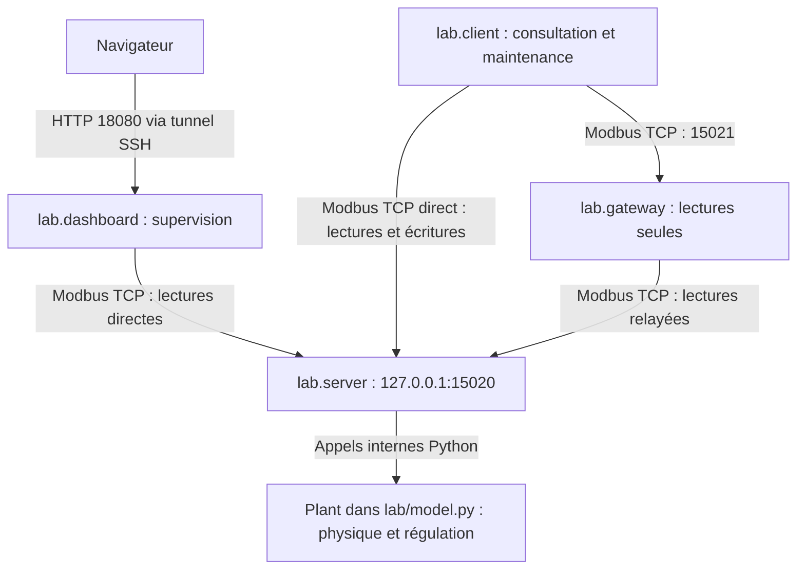

# J2-validation-jumeau-numerique

## 2.7 — Atelier 7 | Finaliser le dossier de validation du jumeau numérique

**Auteur : Olivier HIMBLOT · AIS 2026 · 27 octobre 2026.** Travail en binôme et bilan avec le formateur prévus ; restitution collective et appréciation finale à confirmer.

**Objectif :** documenter le modèle construit, ses communications et ses résultats de validation.

[📄 Télécharger le dossier pour le formateur — PDF, 7 pages](../../assets/files/informatique-industrielle/it-1/J2-validation-jumeau-numerique-Olivier-HIMBLOT.pdf)

**C2 — Mettre en œuvre et valider un jumeau numérique simplifié.** Critères : met en œuvre les services du jumeau numérique ; vérifie les échanges Modbus et les comportements simulés ; identifie les limites de la simulation. Preuve de travail : **J2 — Dossier de validation du jumeau numérique**.

Ce dossier rassemble les cinq parties attendues et les captures en un livrable unique. Il s’appuie sur le code fourni, les captures utilisateur et le PCAP d’assemblage. Les observations partielles restent signalées ; elles ne valent pas validation d’une installation réelle.

## 1 — Architecture du modèle

Environnement déclaré : VM Debian 13, 2 vCPU, 2 Go de RAM, disque 20 Go, accès SSH. Les services du PoC écoutent sur l’interface locale de la VM. Le navigateur du poste peut accéder à la supervision par un tunnel SSH vers le port 18080.



| Composant | Fonction et interaction |
| --- | --- |
| `lab/model.py` | Simule température, porte, capteur, compresseur, régulation et alarme. |
| `lab/server.py` | Expose cet état par Modbus TCP et fait avancer le modèle. |
| `lab/client.py` | Consulte et modifie les variables par requêtes Modbus. |
| `lab/dashboard.py` | Lit le serveur Modbus et fournit une interface HTTP ; aucun accès direct à l’objet `Plant`. |
| `lab/gateway.py` | Relaie FC01–FC04 et rejette les autres fonctions par exception 01. |

**Contrôle local / supervision :** arrêter seulement le dashboard supprime la vue, pas la régulation dans le serveur. Arrêter le serveur arrête la simulation et le contrôle ; le relancer réinitialise l’état. Redémarrer la VM commune affecte tous les services. OpenPLC et FUXA ont été explorés séparément ; aucune connexion au modèle n’est attestée. Le schéma avec bastion représente une architecture cible proposée, distincte de cet assemblage.

## 2 — Table des variables

Adresses **PDU à partir de zéro** ; une adresse n’identifie une variable qu’avec sa table.

| Variable | Type / adresse | Lecture | Écriture | Unité ou valeur |
| --- | --- | --- | --- | --- |
| Consigne | Holding Register 0 | FC03 | FC06 | Dixièmes de °C : 40 = 4 °C, 60 = 6 °C ; serveur : 0 à 500 acceptés. |
| Température mesurée | Input Register 0 | FC04 | Non | Dixièmes de °C ; valeur calculée et arrondie. |
| Compresseur | Input Register 1 / Discrete Input 0 | FC04 / FC02 | Non directement | 0 arrêt, 1 marche ; commande simulée, sans retour matériel indépendant. |
| Porte | Coil 0 | FC01 | FC05 | 0 fermée, 1 ouverte. Injection d’un événement simulé. |
| Alarme haute | Input Register 2 / Discrete Input 1 | FC04 / FC02 | Non | 1 si T > 8 °C pendant au moins 10 s consécutives. |
| Défaut capteur | Coil 1 / Input Register 3 | FC01 / FC04 | FC05 sur Coil 1 seulement | 0 inactif, 1 actif ; Input Register en lecture seule. |
| Mode automatique | Holding Register 2 | FC03 | FC06 | 1 actif, 0 régulation suspendue ; 0 ne force pas l’arrêt. |
| Limite haute conseillée | Holding Register 1 | FC03 | Non | 80 = 8 °C ; information, pas borne imposée à la consigne. |

FC05 code vrai par `FF00`, faux par `0000`. FC06 écrit une valeur numérique. Les températures négatives calculables par le modèle sont une limite de l’encodage non signé de cette implémentation.

## 3 — Preuves de communication

Fichier original conservé : `livrables/informatique-industrielle/it-1/validation-j2/assemblage-j2.pcap`. Tous les échanges ci-dessous utilisent `127.0.0.1`. Les numéros de trame sont propres à **ce PCAP**.

| Opération | Requête → réponse | Client → serveur | Résultat observé |
| --- | --- | --- | --- |
| Lecture relayée | 2554 → 2564 | 47576 → 15021 | FC03, adresse 0, quantité 3 ; valeurs 40, 80, 1 ; réponse en 793 µs. |
| Lecture température relayée | 2572 → 2584 | Port client temporaire → 15021 | FC04, adresse 0, quantité 4 ; valeurs 42, 1, 0, 0. |
| Écriture directe | 2734 → 2736 | 58330 → 15020 | FC06, adresse 0, valeur 60 ; écho normal en 494 µs. |
| Restauration directe | 8204 → 8206 | 55040 → 15020 | FC06, adresse 0, valeur 40 ; écho normal en 473 µs. |
| Écriture refusée | 11574 → 11576 | 56566 → 15021 | FC06, valeur 60 ; réponse `86 01` : Illegal Function. |

MBAP : identifiant de transaction 1, protocole 0, unité 1. L’écho FC06 confirme la réponse applicative d’acceptation ; il ne prouve pas un effet thermique instantané. L’exception est une réponse du service, distincte d’un délai d’attente sans réponse.

```text
frame.number in {2554,2564,2734,2736,8204,8206,11574,11576}
```


Lecture FC03 relayée : réponse du serveur, valeurs 40, 80, 1.


Écriture via passerelle : exception 01, fonction retournée 0x86.

Les lectures FC01/FC03/FC04, l’écriture de porte FC05 et l’exception 02 sur adresse invalide sont également documentées dans [2.3](cartographier-variables-tester-modbus.md). L’exception 02 est attestée en terminal ; sa trame réseau n’est pas fournie dans cet essai.

## 4 — Résultats de validation

Attendus issus du modèle initial : consigne 4 °C, seuils ±0,5 °C. La version des seuils réellement chargée pendant les captures J2 reste à confirmer après les modifications du J1.

| Scénario | Résultat attendu | Résultat observé et conclusion |
| --- | --- | --- |
| V1 — Normal | À 4 °C, marche à ≥ 4,5 et arrêt à ≤ 3,5 ; température progressive. | J1 : états de régulation cohérents. Série 2.6 : aucun cycle complet horodaté à 4 °C. **Partiel.** |
| V2 — Consigne | Écriture 4 → 6 °C puis adaptation de la commande et de la température. | FC06 60 accepté, consigne 6 visible dans la supervision en 2.5 ; capture 11:12:54 : 4,1 °C, consigne 6, compresseur arrêté. Écriture établie ; cycle complet à 6 non documenté. |
| V3 — Porte | Apport thermique accru à l’ouverture ; effet selon l’état du compresseur. | Consigne 6, compresseur arrêté : porte ouverte, 4,8 → 5,4 °C en 25 s ; fermée, 6,0 → 6,3 °C en 25 s. Cohérent, mais états initiaux différents : ne valide pas quantitativement un facteur 2. |
| V4 — Défaut | Compresseur arrêté pendant le défaut selon la règle du modèle. | Défaut 1 : compresseur 0, température 5,8 → 6,1 °C ; ensuite défaut 0 et compresseur 1 à 6,3 °C. Pas de bascule marche→arrêt capturée dans cette série. J1 montre 5 °C / consigne 4 / défaut / arrêt. |
| V5 — Lecture relayée | Lecture possible par 15020 et 15021 sur le même état. | FC03 et FC04 relayés dans le PCAP ; CLI directe et via passerelle concordantes dans les captures. **Établi pour les lectures présentées.** |
| V6 — Écriture refusée | Refus via 15021 et consigne inchangée. | `86 01` dans le PCAP ; capture 11:17:47 : refus puis consigne toujours 4 par les deux chemins. **Établi.** Le port direct reste writable. |

### Annexe intégrée — Captures fonctionnelles


Porte ouverte : consigne 6, compresseur arrêté, température 4,8 → 5,4 °C.


Porte fermée : consigne 6, compresseur arrêté, température 6,0 → 6,3 °C.


Défaut actif : compresseur arrêté ; aucune bascule depuis la marche visible dans cette capture.


Fin : consigne 4, porte fermée, défaut inactif, automatique actif ; écriture via passerelle refusée puis relecture à 4. Température 5,8 °C, refroidissement en cours.

Les six captures de la série sont commentées dans [2.6](valider-comportements-jumeau-numerique.md). Les délais TCP en microsecondes ne sont pas des temps de réponse thermique. Paramètres restaurés ne signifie pas température déjà stabilisée.

## 5 — Limites et précautions d’interprétation

- **Thermique simplifiée :** température unique, coefficients non calibrés ; pas de modèle détaillé des produits, pressions, humidité, dégivrage ni consommation.
- **Capteurs et actionneurs simulés :** aucune interface terrain ni mesure indépendante de la puissance frigorifique ; commande ON ne prouve pas un refroidissement réel.
- **Protections partielles :** arrêt sur défaut choisi pour le scénario ; pas de représentation exhaustive des sécurités, temporisations et défaillances d’une installation réelle.
- **Aucune synchronisation réelle :** installation de référence fictive, sans données issues d’un équipement réel ; validation pédagogique d’une simulation simplifiée.
- **Sécurité limitée au chemin :** filtrage applicatif de la passerelle, accès direct toujours possible ; pas de segmentation réseau démontrée ni d’authentification native des utilisateurs par Modbus conventionnel.

Avant transposition au réel : caractériser le procédé, les protections et les contraintes temporelles, calibrer avec des mesures, valider avec les responsables métier et connaître la version réellement testée. Une simulation cohérente ne garantit pas la sûreté d’une installation.

## Contrôle de cohérence et conservation pour J3

Les composants et adresses sont vérifiés dans les fichiers fournis ; les échanges et résultats observés sont attribués aux captures et au PCAP. Les seuils chargés, les cycles complets et la validation collective restent à confirmer. Aucun visa du formateur n’est prérempli.

Conserver le laboratoire, sa sauvegarde initiale, la version effectivement utilisée dans la VM et les configurations avant J3. Les prochains exercices porteront sur les accès de maintenance, les modifications de consigne et les protections IT/OT.

**SHA-256 du PCAP conservé :**

```text
02cc2db1c138ec8389a8e79196bfc7ea24a6a21d6dbb9581d269ad190d345988
```

**Sources du dossier :** `README.md`, `docs/REGISTER_MAP.md`, `docs/NETWORK.md`, `lab/model.py`, `lab/server.py`, `lab/client.py`, `lab/modbus.py`, `lab/dashboard.py`, `lab/gateway.py`, captures utilisateur des 26–27 octobre et `assemblage-j2.pcap`.

**Convention demandée :** `[Nom]-[Prénom]-[Site]-Iteration1-Atelier7`. Le site à insérer reste à confirmer avant remise définitive. Le titre du document est `J2-validation-jumeau-numerique`.

[Retour à l’itération 1](index.md) · [Pense-bête](../../pense-bete/glossaire/informatique-industrielle/it-1.md)
