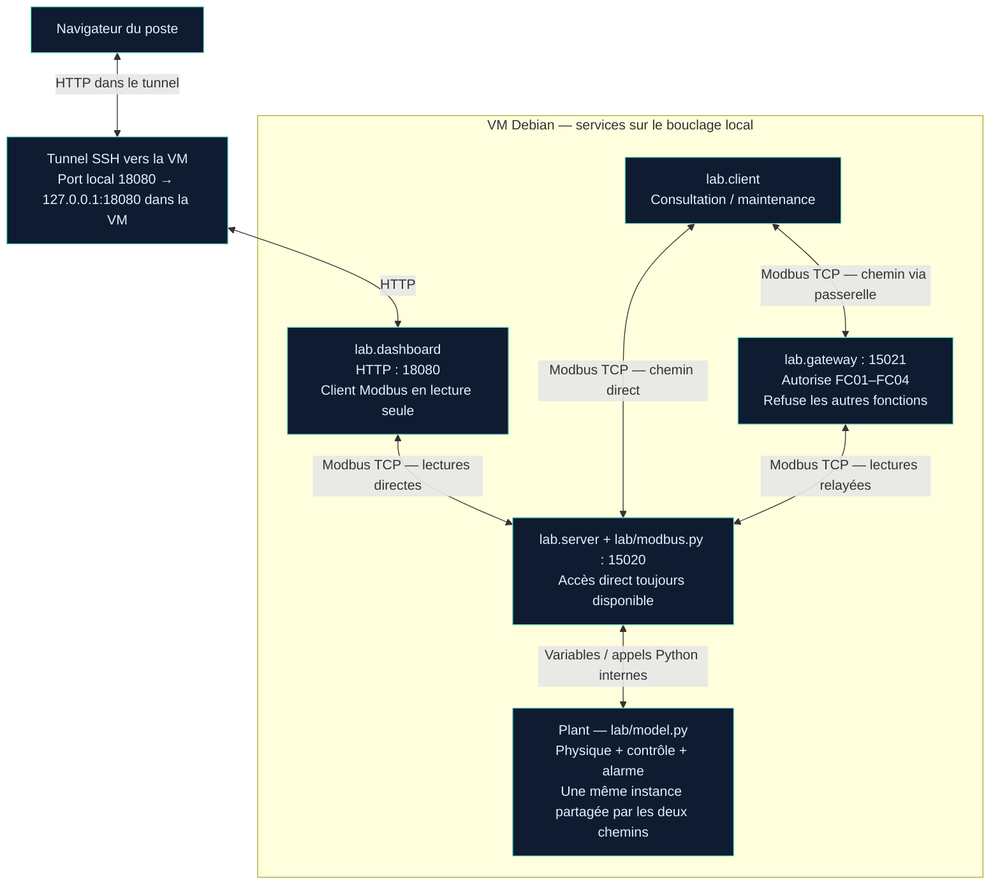

# 2.5 — Atelier 5 | Assembler les composants du jumeau numérique

**Itération 1 · Journée 2 · TP accompagné en binôme.**

## Objectif et statut

**Mettre en place les différents composants de la représentation numérique de l’installation et vérifier leurs échanges.** Environnement : modèle Python/Modbus, supervision web et passerelle Modbus fournis.

La procédure et le schéma sont renseignés sur le code. Un test local sur serveurs temporaires est documenté séparément ; **15 captures utilisateur et le fichier `assemblage-j2.pcap` analysé** documentent désormais l’assemblage, la visibilité web et les échanges direct/passerelle. La participation du formateur et les étapes de démarrage des trois services ne sont pas déduites de ces seules preuves. Le procédé est fictif, sans synchronisation avec une installation réelle.

## 1 — Identifier les composants logiciels et les chemins

| Fichier | Fonction | Communications |
| --- | --- | --- |
| `lab/model.py` | État physique simulé, régulation et alarme dans `Plant`. | Variables et appels internes ; aucune connexion réseau autonome. |
| `lab/server.py` | Lance le modèle, sa boucle et le serveur de communication. | Modbus TCP **127.0.0.1:15020** par défaut, via `lab/modbus.py`. |
| `lab/client.py` | Consultation et commandes de maintenance. | Client Modbus TCP vers **15020** par défaut, ou **15021** avec `--port`. |
| `lab/dashboard.py` | Supervision en lecture seule. | Client Modbus du serveur **15020** ; serveur HTTP **18080** pour le navigateur. |
| `lab/gateway.py` | Proxy applicatif à liste de fonctions autorisées. | Écoute Modbus TCP **15021**, relaie les lectures vers **15020**, refuse les autres fonctions. |

### Schéma fonctionnel complété



**Point important : la supervision ne passe pas par la passerelle dans son lancement par défaut.** Elle lit directement le serveur 15020, mais sans accéder à l’objet Python : elle interroge réellement Modbus. Les deux ports Modbus exposent des chemins vers le **même modèle**, pas deux simulations distinctes.

Le tunnel représente l’accès adapté à la VM sans interface graphique ; il ne s’agit pas d’un équipement OT supplémentaire. Le bastion du schéma cible Isoflow reste une proposition et n’est pas installé par cet assemblage. OpenPLC et FUXA restent des explorations séparées, sans liaison attestée à ce procédé.

## 2 — Démarrer les services

Ouvrir quatre terminaux SSH dans la VM, tous placés dans le répertoire du laboratoire, celui qui contient `lab/`, `docs/` et `tests/`. Identifier les services déjà lancés avant d’en créer d’autres : un message d’adresse utilisée ne justifie pas d’arrêter un processus non identifié.

| Terminal | Commande | Service attendu |
| --- | --- | --- |
| 1 | `python3 -m lab.server` | Modbus direct sur 127.0.0.1:15020. |
| 2 | `python3 -m lab.dashboard` | Supervision HTTP sur 127.0.0.1:18080 ; lectures vers 15020. |
| 3 | `python3 -m lab.gateway` | Proxy sur 127.0.0.1:15021, amont 127.0.0.1:15020. |
| 4 | `python3 -m lab.client status` | État lu directement sur le serveur. |

Vérifier les écoutes dans le terminal 4 :

```bash
ss -ltn '( sport = :15020 or sport = :15021 or sport = :18080 )'
```

Les trois adresses locales attendues commencent par **127.0.0.1**.

### Supervision depuis le poste graphique

Depuis **le poste**, dans un terminal séparé, garder ouvert :

```bash
ssh -N -L 127.0.0.1:18080:127.0.0.1:18080 oliv@192.168.122.106
```

Ouvrir **http://127.0.0.1:18080** dans le navigateur du poste. Si ce tunnel existe déjà, le réutiliser. Ne pas confondre ce port avec **1881 pour FUXA** ou **1313 pour le développement de l’Editor OpenPLC**.

Comparer température, consigne, compresseur, porte et alarme avec `status`. Les lectures sont successives et le navigateur se rafraîchit chaque seconde : un petit écart thermique ne prouve pas une incohérence. `sensor_fault` et `auto` sont visibles en CLI, pas dans cette vue web.

## 3 — Vérifier les lectures et l’écriture directe

### Deux lectures du même état

```bash
python3 -m lab.client status
python3 -m lab.client status --port 15021
```

`status` utilise **FC03, FC04 et FC01**, autorisées par la passerelle. Comparer les valeurs, en tenant compte du temps écoulé entre les commandes. Une consigne ou un état identique ne signifie pas que le client a utilisé le même chemin : le port de destination est le critère distinctif.

### Modification directe et visibilité en supervision

Vérifier les conditions de départ : consigne 4 °C, porte fermée, absence de défaut injecté et mode automatique connu. Noter la version d’hystérésis utilisée.

```bash
python3 -m lab.client setpoint 6 --port 15020
python3 -m lab.client status --port 15020
python3 -m lab.client status --port 15021
```

Attendu : écriture acceptée, puis consigne **6.0 °C** par les deux chemins et dans le navigateur après son actualisation. Le port direct a accepté **FC06, holding 0, valeur 60**. La température réelle du modèle n’est pas remplacée par 6 °C.

Restaurer :

```bash
python3 -m lab.client setpoint 4 --port 15020
python3 -m lab.client status --port 15021
```

Vérifier aussi le retour de la consigne à **4 °C** dans la supervision. Ces observations utilisateur restent à capturer pour cet assemblage, même si des écritures directes avaient déjà été documentées en 2.2.

## 4 — Examiner le rôle de la passerelle

Après restauration à 4 °C :

```bash
python3 -m lab.client setpoint 6 --port 15021
python3 -m lab.client status --port 15021
python3 -m lab.client status --port 15020
```

Résultat attendu de la tentative :

```text
Modbus operation failed: Modbus exception code 1
```

Le CLI intercepte `ProtocolError` et termine avec un code de sortie **2**. Ce refus est une **réponse applicative**, pas une absence de serveur. La consigne doit rester **4 °C** si aucun autre client ne l’a modifiée.

### Réponses aux quatre questions

1. **Pourquoi la lecture fonctionne-t-elle ?** `lab/gateway.py` autorise explicitement les fonctions **1, 2, 3 et 4**, puis transmet la demande au serveur amont. Elle relaie sa réponse après des contrôles de cohérence du MBAP. Sa présence seule ne garantit pas le succès : l’amont doit être disponible et l’adresse demandée valide.
2. **Pourquoi l’écriture est-elle rejetée ?** FC06 n’appartient pas à cette liste. Le proxy construit localement une réponse d’exception **01 — Illegal Function** ; il ne transmet pas cette écriture à l’amont. Pour FC06, la PDU de refus attendue est **`86 01`**. FC05 et les autres fonctions hors liste sont également refusées. Ce n’est pas une exception 02 d’adresse invalide.
3. **Le serveur direct accepte-t-il toujours les écritures ? Oui**, dans la plage et aux adresses implémentées. L’essai direct à 6 °C illustre ce chemin. Le proxy ne modifie pas les droits du serveur 15020 ; il ne vérifie pas non plus une identité humaine.
4. **Est-ce une segmentation efficace à lui seul ? Non.** Un client capable de joindre 15020 contourne le refus appliqué sur 15021. Ce laboratoire montre un filtrage applicatif sur un chemin, pas l’impossibilité d’utiliser l’autre. L’isolation des zones et les règles limitant l’accès au serveur seront étudiées plus tard. Les adresses de bouclage limitent ici la portée réseau par défaut, sans séparer les clients locaux en zones de confiance.

`docs/NETWORK.md` présente une topologie et un pseudocode de règles à adapter lors des activités ultérieures ; ils ne sont pas des configurations déjà appliquées. La passerelle pédagogique n’est ni un pare-feu industriel complet ni un bastion de session de maintenance.

### Observer les deux chemins si une capture est demandée

Dans la VM :

```bash
sudo tcpdump -i lo -nn -s 0 -w assemblage-j2.pcap 'tcp port 15020 or tcp port 15021'
```

Après décodage des deux ports serveur dans Wireshark, distinguer le client vers 15021, le proxy vers 15020 pour une lecture relayée, et l’écriture directe vers 15020. Pour un refus FC06 via passerelle, la réponse **86 01** revient sur la connexion du client à 15021 ; aucune écriture amont correspondante n’est attendue.

L’absence de relais doit être vérifiée dans une capture complète de l’intervalle et des deux ports, pas déduite d’un filtre ne montrant que 15021. Cette capture reste une procédure proposée, pas une preuve déjà recueillie.

## Vérification locale réalisée le 27 octobre 2026

Un serveur et une passerelle temporaires ont été lancés sur **deux ports libres du bouclage**, à partir du code fourni. Le client Python a réalisé les opérations ci-dessous, puis les deux services ont été arrêtés. La supervision HTTP n’a pas été démarrée dans ce test ciblé ; ses captures antérieures ne sont pas attribuées à cette session.

| Test local | Résultat observé |
| --- | --- |
| FC03 direct, holding 0, quantité 3 | **[40, 80, 1]** : consigne, limite conseillée, mode auto. |
| Même lecture par la passerelle | **[40, 80, 1]**. |
| FC06 direct : consigne 60 | Écho validé **True** ; lecture via passerelle **[60]**. |
| FC06 via passerelle : tentative à 40 | **ProtocolError Modbus exception code 1**. |
| Lecture directe après refus | **[60]** : la tentative refusée n’a pas restauré la consigne. |
| FC06 direct : restauration à 40 | Écho validé **True** ; lecture via passerelle **[40]**. |

Le test confirme lecture relayée, refus d’écriture via proxy et écriture directe toujours disponible. Il ne démontre ni une segmentation ni une interdiction d’accès au port direct. Le scénario local de refus utilise une valeur différente de la procédure utilisateur afin de contrôler explicitement l’absence de modification.

## Preuves utilisateur — assemblage et filtrage observés

Les heures des images proviennent des noms des fichiers. Les numéros de paquets concernent **`assemblage-j2.pcap`**, pas les captures des ateliers précédents. Un recadrage supplémentaire de commandes, sans information nouvelle par rapport à la première capture et au récapitulatif, a été écarté et supprimé : `10-37-07`.

### Repères dans le PCAP analysé

Le fichier fourni a été lu pour identifier les échanges ; son empreinte SHA-256 est :

```text
02cc2db1c138ec8389a8e79196bfc7ea24a6a21d6dbb9581d269ad190d345988
```

| Essai | Requête → réponse | Port client / serveur | Contenu confirmé | Délai de réponse |
| --- | --- | --- | --- | --- |
| Lecture via passerelle | **2554 → 2564** | **47576 / 15021** | FC03, adresse 0, quantité 3 ; réponse **40, 80, 1**. | **793 µs** |
| Écriture directe à 6 °C | **2734 → 2736** | **58330 / 15020** | FC06, holding 0, **60 / 0x003C**, écho normal. | **494 µs** |
| Restauration directe à 4 °C | **8204 → 8206** | **55040 / 15020** | FC06, holding 0, **40 / 0x0028**, écho normal. | **473 µs** |
| Tentative d’écriture via passerelle | **11574 → 11576** | **56566 / 15021** | FC06, holding 0, valeur 60 ; réponse **86 01 — Illegal Function**. | **394 µs**, calculé sur les horodatages du PCAP. |

Toutes ces adresses IP sont **127.0.0.1**. Les délais sont ceux des échanges applicatifs, pas ceux de la réponse thermique. Les réponses normales portent transaction 1, protocole 0, unité 1 ; la réponse d’exception a une longueur MBAP de **3**, contre **6** pour FC06 normal et **9** pour la réponse FC03 de trois registres.

### Filtre ciblé à copier dans Wireshark

La syntaxe confirmée dans la session utilise des **virgules entre les numéros** :

```text
frame.number in {2554,2564,2734,2736,8204,8206,11574,11576}
```

Développer **TCP**, **Modbus/TCP**, puis **Modbus**. Les numéros sont propres à ce fichier. La réponse d’exception 11576 est identifiable par **Exception: Yes**, **Illegal function (1)** et les octets **`86 01`**, même si le champ de fonction Wireshark l’affiche sous le nom de FC06.

### 10:33:42 — Lectures directe et via passerelle, puis consigne à 6 °C


Le terminal montre `status` direct, `status --port 15021`, puis une écriture **`setpoint 6 --port 15020`** acceptée. Les lectures suivantes sur les deux ports indiquent **setpoint=6.0**, température **4,5 °C**, porte fermée, défaut inactif et mode automatique actif. L’état `compressor=1` est celui des lectures à cet instant ; il ne fixe pas le délai de réévaluation de la commande.

### 10:36:23 — Supervision : la consigne écrite apparaît


La supervision affiche **6,4 °C**, **consigne 6 °C**, compresseur **OFF**, porte fermée et aucune alarme. La valeur est visible par la chaîne HTTP/Modbus du dashboard, sans accès direct de celui-ci à `Plant`. La température n’est pas égale à la consigne et évolue avec le procédé simulé.

### 10:36:44 — Supervision : retour de consigne à 4 °C


La page affiche **6,1 °C**, **consigne 4 °C**, compresseur **ON**, porte fermée et aucune alarme. La consigne restaurée ne remet pas instantanément la température à 4 °C.

### 10:36:52 — Restauration directe et relecture via 15021


La commande **`setpoint 4 --port 15020`** est acceptée ; **`status --port 15021`** lit **setpoint=4.0**, température **6,2 °C**, compresseur actif, porte fermée, défaut inactif et automatique actif. Le proxy relit l’état modifié sur l’accès direct.

### 10:37:54 — Écriture via passerelle refusée, valeur inchangée


La commande **`setpoint 6 --port 15021`** renvoie **`Modbus operation failed: Modbus exception code 1`**. Les lectures via passerelle puis directes indiquent encore **setpoint=4.0**, température **4,2 °C**, porte fermée, défaut inactif et mode automatique actif. Le refus est applicatif, pas un timeout.

### 10:44:53 — Récapitulatif des chemins et état final


La capture rassemble les lectures sur les deux accès, une écriture directe à 6 °C acceptée, sa restauration directe à 4 °C, puis une tentative via 15021 refusée. Les deux dernières lectures montrent **setpoint=4.0**, **door=0**, **sensor_fault=0**, **auto=1**, compresseur arrêté et température **3,7 °C**. L’état final est documenté ; l’arrêt des services ne l’est pas.

### 10:53:13 — Paquet 2554 : lecture par la passerelle


Requête FC03, **Reference Number 0**, **Word Count 3**, MBAP **1 / 0 / 6 / 1**. Le PCAP identifie la destination **15021** et le port client **47576** ; les valeurs demandées sont consigne, limite conseillée et mode automatique.

### 10:53:33 — Paquet 2734 : écriture directe à 6 °C


Requête **FC06**, adresse **0**, valeur **60**, MBAP **1 / 0 / 6 / 1**. Les octets applicatifs terminent par **`06 00 00 00 3c`**. Le PCAP confirme le chemin client **58330 → 15020**.

### 10:53:42 — Paquet 2564 : réponse à la lecture via passerelle


La réponse FC03 est liée à la requête **2554** et affiche **793 µs**. Les trois valeurs sont **40**, **80**, **1** : consigne **4 °C**, limite conseillée **8 °C** et mode automatique actif. Le MBAP a une longueur de **9**, avec six octets de données de registres.

### 10:53:49 — Paquet 2736 : écriture directe acceptée


Réponse liée à **2734**, après **494 µs**, reprenant **FC06, adresse 0, valeur 60**, sans exception. L’acceptation technique de l’écriture à 6 °C est établie ; elle ne vaut pas autorisation métier.

### 10:54:00 — Paquet 8204 : restauration directe


Requête **FC06**, registre **0**, valeur **40** ; MBAP **1 / 0 / 6 / 1**. Le PCAP établit le chemin **55040 → 15020** et le codage **`00 28`**, soit 4 °C selon le mapping.

### 10:54:23 — Paquet 11574 : tentative sur le port filtré


Requête **FC06**, registre **0**, valeur **60**, MBAP **1 / 0 / 6 / 1**. Le PCAP identifie la destination **15021** et le port client **56566**. La requête a la même intention de changement à 6 °C que l’écriture directe, mais emprunte l’autre chemin.

### 10:54:32 — Paquet 8206 : restauration acceptée


Réponse FC06 liée à **8204**, après **473 µs**, registre **0**, valeur **40**, sans exception. L’écho confirme l’acceptation de la restauration directe.

### 10:54:37 — Paquet 11576 : refus applicatif par la passerelle


Wireshark affiche **Exception: Yes**, **Write Single Register** et **Exception Code: Illegal function (1)**. Le MBAP indique longueur **3** et les octets applicatifs finissent par **`86 01`**. La notification de capture masque une partie supérieure de l’image, sans masquer le code d’exception. Le PCAP confirme la réponse **15021 → 56566** à la requête **11574**.

### 10:55:18 — Vue synthétique avec le filtre corrigé


Le filtre à virgules regroupe les **huit paquets** : lecture via passerelle, deux écritures directes acceptées et tentative via passerelle avec **Exception returned**. Cette vue permet de présenter les résultats sans parcourir toutes les lectures périodiques du dashboard.

### Conclusion sur l’assemblage observé

**Établi :** lectures sur les deux accès, modification directe visible en supervision et par le proxy, restauration à 4 °C, refus de FC06 via passerelle avec valeur inchangée, état final porte fermée / défaut inactif / auto actif.

**Portée :** la passerelle filtre le chemin 15021, alors que les écritures directes sur 15020 restent possibles. La capture ne valide donc pas une segmentation réseau. Les 15 images et le PCAP n’attestent pas une installation OpenPLC/FUXA raccordée, une synchronisation avec une enceinte réelle ou la présence effective du formateur.

## Tableau des preuves utilisateur

| Essai | Observation attendue / preuve |
| --- | --- |
| Trois services et écoutes locales | Services utilisables attestés par les échanges et la page ; commande de lancement et vue `ss` des trois écoutes non capturées ici. |
| Lecture directe | Sorties CLI conservées, notamment 10:33:42 et 10:44:53. |
| Lecture via 15021 | CLI et lecture PCAP 2554/2564 attestées. |
| Écriture directe à 6 °C | CLI et PCAP 2734/2736 attestés ; consigne 6 °C visible par les deux accès. |
| Supervision | Captures de supervision 10:36:23 à 6 °C et 10:36:44 à 4 °C. |
| Écriture via 15021 | CLI et PCAP 11574/11576 attestés ; lectures CLI toujours à 4 °C. |
| Restauration finale | 10:44:53 : consigne 4 °C, porte fermée, défaut inactif, auto actif. |

En fin d’essai, restaurer si nécessaire :

```bash
python3 -m lab.client setpoint 4 --port 15020
python3 -m lab.client door 0 --port 15020
python3 -m lab.client status --port 15021
```

Arrêter les services par Ctrl + C dans leurs terminaux si le TP est terminé. Si un essai thermique suit, conserver et annoncer explicitement l’état du processus plutôt que le réinitialiser sans le noter.

## Ressources

`README.md`, `docs/REGISTER_MAP.md`, `docs/NETWORK.md`, `lab/gateway.py`, `lab/dashboard.py` et `lab/modbus.py` dans le laboratoire fourni.

[Retour à l’itération 1](index.md) · [Atelier précédent — Débrief Modbus](mettre-en-commun-observations-modbus.md)
