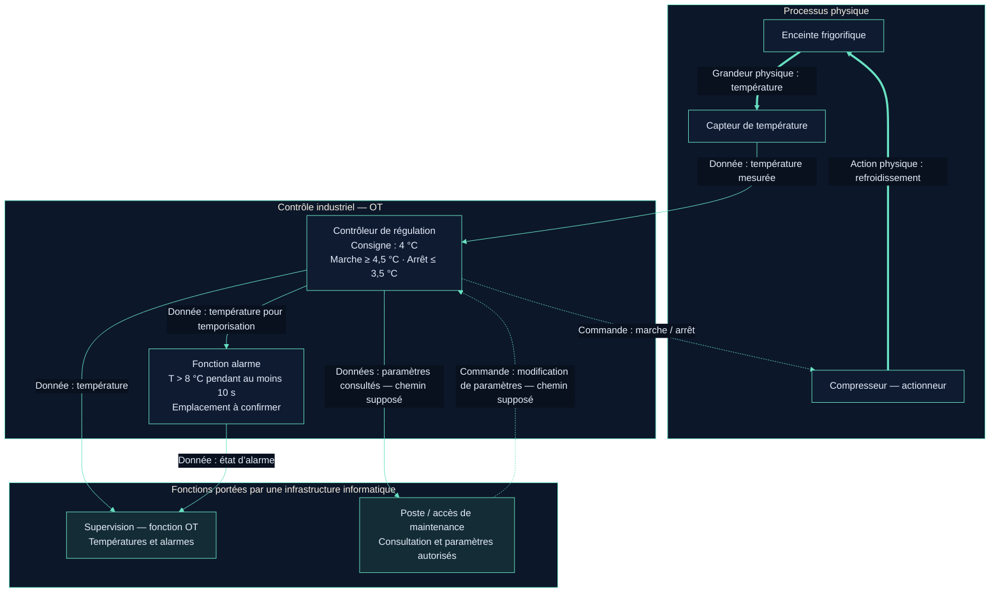

# 1.2 — Atelier 2 | Étudier une installation frigorifique

## Objectif et modalité

**Identifier les composants, les échanges et les fonctions de contrôle d’une installation industrielle à partir d’une documentation technique.**

Analyse en binôme, production d’un schéma, puis mise en commun. Cette fiche constitue une **proposition de livrable renseignée à partir du scénario fourni**. Aucun fonctionnement du logiciel ni échange en binôme n’est attesté ici.

## 1 — Scénario et fonctionnement général

Vous intervenez sur l’infrastructure informatique d’une **grande surface disposant d’une installation frigorifique automatisée**. Elle comprend une enceinte frigorifique, un capteur de température, un compresseur, un contrôleur exécutant la régulation, une supervision des températures et alarmes, et un accès de maintenance permettant de consulter et modifier certains paramètres.

L’objectif est de maintenir la température proche de **4 °C**, selon la régulation simplifiée fournie.

| Paramètre ou condition | Valeur / comportement du scénario |
| --- | --- |
| Consigne | **4 °C** |
| Démarrage du compresseur | Température **≥ 4,5 °C** : consigne + 0,5 °C. |
| Arrêt du compresseur | Température **≤ 3,5 °C** : consigne − 0,5 °C. |
| Entre les seuils : **3,5 °C < T < 4,5 °C** | Conservation de l’état précédent du compresseur, selon le principe d’hystérésis décrit. |
| Alarme haute température | Température **strictement > 8 °C pendant au moins 10 secondes** dans le modèle de démonstration. |

À **4 °C**, le compresseur peut donc être en marche ou à l’arrêt selon l’historique. L’état initial au lancement du modèle reste à vérifier. À **8 °C exactement**, la condition « dépasse 8 °C » n’est pas satisfaite.

**Hypothèse de lecture de la temporisation :** les 10 secondes sont consécutives au-dessus de 8 °C ; le compteur repart à zéro si cette condition cesse avant le déclenchement. La consigne ne précise pas la mémorisation, l’acquittement ni la disparition d’une alarme déjà déclenchée : ces comportements restent à vérifier dans le modèle.

Ce fonctionnement est une **hypothèse pédagogique simplifiée**. Il ne définit ni les exigences complètes d’une installation réelle, ni des seuils réglementaires de conservation des produits.

!!! info "Complément après examen du laboratoire — atelier 1.3"
    Le [modèle fourni a désormais été examiné](prendre-en-main-modele-frigorifique.md#informations-desormais-etablies-pour-le-schema-ot) : le serveur Python héberge la régulation et le calcul d’alarme, la supervision consulte en Modbus, le client de maintenance écrit directement sur le serveur. Le compresseur est initialement arrêté, puis évalué au premier pas. Le schéma ci-dessous conserve la proposition fonctionnelle initiale de l’atelier 1.2 ; ses mentions « à confirmer » sont précisées par ces résultats.

## 2 — Schéma fonctionnel annoté

Le schéma représente les fonctions et les échanges utiles à l’analyse. Les liaisons sont **logiques** : aucun protocole, câblage, VLAN ou accès Internet n’est imposé par la consigne.

**Légende :** flèches pleines fines = **données** ; flèches pointillées = **commandes** ; flèches épaisses = **interactions physiques**. Le libellé précise le sens de chaque échange.

### Périmètres et hypothèses du schéma

| Élément | Classification et limites |
| --- | --- |
| Enceinte | Procédé physique à maintenir autour de la température cible. |
| Capteur, compresseur et contrôleur | Équipements de terrain et de contrôle industriel, relevant de l’OT. Le contrôleur n’est pas explicitement identifié comme un PLC matériel dans la consigne. |
| Supervision | Fonction OT de consultation des températures et alarmes, pouvant reposer sur un poste ou serveur informatique. Son hébergement n’est pas décrit. |
| Poste de maintenance | Moyen informatique d’intervention sur l’OT. Sa localisation, ses droits et son chemin d’accès restent à préciser. |
| Alarme | Fonction du scénario, représentée séparément pour ne pas lui attribuer un emplacement non documenté : contrôleur, supervision ou autre composant logiciel à vérifier. |

Le scénario confirme les fonctions mais ne décrit pas leurs interfaces. Le schéma **suppose** que le contrôleur transmet la température à la supervision et à la fonction d’alarme. Les accès de maintenance sont représentés directement vers le contrôleur pour rendre leur finalité visible ; un passage par une interface intermédiaire reste possible.

Aucune commande depuis la supervision n’est ajoutée : la consigne précise ici un rôle de consultation. La présence de sécurités indépendantes, d’un historian ou d’une redondance n’est pas établie.

## 3 — Analyse du fonctionnement : réponses

### 1. Quel composant décide de démarrer ou d’arrêter le compresseur ?

Le **contrôleur**, qui exécute la logique de régulation. Il utilise la température mesurée et la consigne : marche à partir de **4,5 °C**, arrêt à **3,5 °C ou moins**, conservation de l’état précédent entre les deux seuils.

### 2. Quel composant mesure la température ?

Le **capteur de température**. Il fournit la mesure utilisée par la régulation ; le contrôleur prend la décision et le compresseur réalise l’action physique.

### 3. Pourquoi utilise-t-on deux seuils différents ?

L’**hystérésis** évite de basculer marche/arrêt à chaque petite variation autour d’un seuil unique. La décision dépend aussi de l’état précédent. La bande entre les deux seuils vaut **1 °C**.

Exemple déduit de la règle : à 4,5 °C, le compresseur démarre ; à 4 °C pendant le refroidissement, il reste en marche ; à 3,5 °C, il s’arrête ; à 4 °C pendant le réchauffement, il reste arrêté. Cet exemple n’est pas une trace d’exécution. Les éventuelles durées minimales de marche et d’arrêt ne sont pas définies dans le scénario.

### 4. Quel est le rôle de la supervision ?

Permettre à l’opérateur de **consulter les températures et les alarmes**. La régulation est attribuée au contrôleur par le scénario. L’historisation, les notifications externes et la modification des consignes depuis la supervision ne sont pas précisées.

### 5. Que pourrait-il se passer si la supervision devenait indisponible ?

La consultation qu’elle assure devient indisponible. **Si le contrôleur fonctionne de manière autonome**, avec accès à son capteur et au compresseur, la régulation peut continuer. L’opérateur perd toutefois la visibilité fournie par cette supervision.

L’effet sur les alarmes dépend de leur emplacement : si elles sont calculées dans le contrôleur, elles peuvent continuer à être produites sans être affichées sur la supervision ; si leur calcul est hébergé avec celle-ci, ce calcul peut cesser. Un autre afficheur ou canal d’alerte n’est pas documenté.

Il faut vérifier les dépendances réelles du modèle : hébergement commun, échanges nécessaires à la commande et éventuel mode de repli. La poursuite du refroidissement ne prouve pas à elle seule que toutes les fonctions restent disponibles.

### 6. Quelles actions un technicien pourrait-il réaliser à distance ?

| Besoin possible | Ce que le scénario permet d’affirmer / hypothèses |
| --- | --- |
| Consulter les paramètres | Fonction explicitement prévue ; liste et droits à préciser. |
| Modifier une consigne | Exemple plausible de paramètre modifiable, à confirmer dans l’interface. Cela décalerait les seuils de marche/arrêt si les écarts restent fixés à ±0,5 °C. |
| Consulter température, état et alarmes pour diagnostiquer | Besoin cohérent avec la maintenance ; disponibilité de ces données sur cet accès à vérifier. |
| Ajuster un seuil ou une temporisation d’alarme | Possibilité à vérifier : ces paramètres ne sont pas explicitement déclarés modifiables. |

Une modification de programme, un forçage du compresseur, un redémarrage ou une mise à jour ne sont pas établis comme fonctions disponibles. Les modifications de paramètres proposées doivent être autorisées, tracées et coordonnées avec l’exploitation ; ces dispositions ne sont pas présentées comme déjà configurées.

## 📦 Livrable — Description courte de l’installation

> L’installation frigorifique automatisée de la grande surface vise une température proche de 4 °C. Un capteur mesure la température de l’enceinte et transmet l’information à un contrôleur. Celui-ci commande le compresseur selon une hystérésis : démarrage à partir de 4,5 °C, arrêt à 3,5 °C ou moins et maintien de l’état précédent entre les seuils. Le compresseur refroidit l’enceinte, ce qui modifie la température mesurée. La supervision permet de consulter les températures et les alarmes. Une alarme est prévue après au moins 10 secondes au-dessus de 8 °C dans le modèle pédagogique. Un accès de maintenance permet de consulter et modifier certains paramètres ; leur liste et le chemin d’accès restent à confirmer. Si la commande est autonome, une perte de supervision n’entraîne pas nécessairement l’arrêt du refroidissement.

Le **schéma annoté ci-dessus et cette description** constituent la base documentaire à compléter pendant l’itération 1 pour le schéma d’architecture OT final.

**Convention de nommage demandée :** `[Nom]-[Prénom]-[Site]-Iteration1-Atelier2`. Le site et le format de remise restent à confirmer avant l’export ; le fichier Markdown du mémo conserve son nom thématique.

### Informations et preuves à ajouter

- Identification réelle des composants logiciels ou matériels, interfaces et sens des échanges.
- Emplacement du calcul d’alarme, comportement de sa temporisation et conditions de réinitialisation.
- Paramètres accessibles en maintenance, droits associés et chemin de connexion.
- État initial du compresseur et comportement lors de la perte de supervision.
- Lors d’essais ultérieurs : mesures horodatées, état du compresseur, état d’alarme et comparaison aux règles attendues.

**État :** analyse rédigée sur le scénario ; modèle non exécuté ici, hypothèses identifiées, mise en commun à confirmer.

[Retour à l’itération](index.md) · [Atelier précédent — Découvrir l’OT](decouvrir-ot-systemes-industriels.md)
