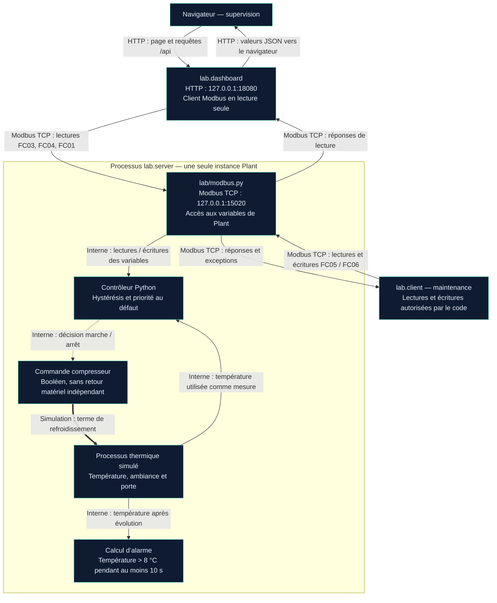

# 1.6 — Atelier 6 | Préparer la construction du jumeau numérique

## Objectif et modalité

**Identifier les composants et les informations nécessaires pour représenter numériquement une installation industrielle.** Travail en binôme et restitution collective.

Cette fiche complète le [schéma fonctionnel de l’atelier 1.2](etudier-installation-frigorifique.md) à partir du code fourni et des essais documentés aux ateliers 1.3 à 1.5. Elle prépare le J2, sans anticiper son analyse détaillée des trames. La restitution collective reste à confirmer.

## 1 — Identifier les éléments déjà simulés

Racine du laboratoire : `livrables/informatique-industrielle/it-1/ot-refrigeration-poc/`.

| Fonction | Fichier / élément | Représentation et limite |
| --- | --- | --- |
| Processus physique | `lab/model.py`, `Plant.advance()` | Température unique, apport de chaleur depuis l’ambiance, refroidissement commandé, effet de porte. Modèle simplifié, sans enceinte matérielle. |
| Mesure du capteur | `Plant.temp`, `Plant.read()` | Température calculée publiée en dixièmes de degré ; pas de capteur physique distinct ni de bruit de mesure. |
| Contrôleur | `Plant.advance()` | Priorité au défaut, mode automatique et hystérésis. Logique Python, pas un runtime PLC. |
| Commande de l’actionneur | `Plant.compressor` | Booléen marche/arrêt qui active le terme de refroidissement ; aucun retour mécanique indépendant. |
| Porte et défaut injecté | `Plant.door_open`, `Plant.sensor_fault`, `write_coil()` | Variables simulant une perturbation physique ou un défaut, modifiables par le client. |
| Alarme | `Plant.alarm_seconds`, `Plant.alarm` | Température > 8 °C pendant au moins 10 s calculées ; pas d’acquittement ni de mémorisation indépendante. |
| Exécution du modèle | `lab/server.py`, `start_lab()` et `simulation_loop()` dans `lab/modbus.py` | Une instance `Plant`, avec pas nominal de 0,1 s et serveur Modbus dans le même processus. |
| Communications Modbus | `lab/modbus.py`, `handle_pdu()`, `Client` | Sous-ensemble de Modbus TCP, lectures et écritures, sur bouclage local par défaut. |
| Supervision | `lab/dashboard.py` | Serveur HTTP, client Modbus et page navigateur en lecture seule. |
| Maintenance | `lab/client.py` | Commandes de consultation, consigne, porte, défaut et mode automatique. |
| Vérification | `tests/test_lab.py`, `tests/test_integration.py` | Tests du modèle et des échanges ; ils ne constituent pas une validation sur équipement réel. |

### Schéma d’architecture numérique complété

**Lecture du schéma :** flèches fines = données/requêtes, flèche pointillée = commande d’actionneur, flèche épaisse = effet physique **simulé**. Les libellés distinguent réseau et échanges internes. La représentation des accès aux variables est fonctionnelle : les registres, l’état physique, le défaut, la porte et l’alarme appartiennent tous à `Plant`, pas à des équipements réseau séparés.

Le navigateur ne parle pas directement Modbus : il interroge le service HTTP, qui joue le rôle de client Modbus. La régulation, la mesure simulée et l’actionneur communiquent par variables Python ; il n’y a pas de trames capteur–PLC ni PLC–compresseur entre matériels dans ce laboratoire.

La passerelle `lab/gateway.py` sur le port 15021 existe comme composant facultatif. Elle ne fait pas partie du chemin direct utilisé ici ; aucun déploiement de segmentation ni utilisation utilisateur de cette passerelle n’est déduit des captures.

### Complément du 27 octobre — Architecture cible sécurisée proposée

Schéma isométrique réalisé par l’apprenant avec Isoflow. La zone bleue est explicitement nommée **« Enceinte frigorifique »** et représente l’enceinte, avec le capteur et le compresseur.

| Élément visible | Intention représentée |
| --- | --- |
| Poste de maintenance, routeur, pare-feu et bastion | Accès de maintenance proposé via le bastion avant d’atteindre le contrôleur ; flux bleus annotés « maintenance /other ». |
| Poste superviseur et chemin vers le contrôleur | Chemin de supervision distinct de celui de maintenance, passant par le pare-feu ; flux rouges « superviseur only ». |
| Contrôleur et capteur | Échanges verts annotés « lecture », représentant l’acquisition de température dans la cible. |
| Contrôleur et compresseur | Commande verte « on/off » et flèche de retour proposée. |
| Zone bleue « Enceinte frigorifique » | Procédé physique dont la température est surveillée et sur lequel agit le compresseur. |

**Portée de la capture :** elle atteste la conception du schéma, pas le déploiement des équipements ni l’efficacité d’un filtrage. Les libellés « superviseur only » expriment une intention ; ils ne prouvent pas des règles de lecture seule appliquées. Dans une réalisation, il faudrait préciser les flux et fonctions autorisés et empêcher le contournement du bastion pour la maintenance.

Le retour du compresseur est une fonction envisagée dans la cible : le modèle Python ne possède pas de retour matériel indépendant. Ses fonctions de capteur, de contrôle et d’actionneur restent dans la même instance `Plant`. Les liaisons dessinées ne constituent donc pas des captures de communications entre ces équipements matériels.

Ce complément distingue **l’architecture observée du laboratoire**, décrite au-dessus et dans le PDF J1, de **l’architecture cible sécurisée proposée** par l’apprenant.

## 2 — Distinguer modèle, simulation et jumeau numérique

Dans cette fiche, on distingue :

- **Modèle :** représentation du système par des états, équations et règles, ici la classe `Plant`.
- **Simulation :** exécution du modèle dans le temps pour calculer ses réactions à des conditions initiales et à des événements.
- **Jumeau numérique relié à une installation réelle :** représentation dont la correspondance avec un système identifié et l’actualisation par ses données doivent être définies et vérifiées.

Le README présente ce laboratoire comme un **prototype de jumeau numérique de la spécification fictive**, sans équipement réel ni synchronisation avec celui-ci. Les termes du module ne doivent pas transformer les essais logiciels en validation d’une installation physique.

### Réponses aux cinq questions

#### 1. Quelles caractéristiques sont représentées ?

La température de l’enceinte, une ambiance constante à 22 °C par défaut, l’effet simplifié d’une porte ouverte, un refroidissement commandé par booléen, la consigne, l’hystérésis, le mode automatique, un défaut capteur injecté et l’alarme haute temporisée. Le modèle inclut aussi l’accès réseau aux variables et leur présentation dans la supervision.

#### 2. Quelles caractéristiques physiques manquent ?

Le code ne représente pas explicitement le cycle thermodynamique du fluide, les pressions, les échangeurs, le dégivrage, l’humidité, les gradients de température dans l’enceinte, la masse et la nature des produits ou leurs températures propres. Il ne modélise pas non plus les délais et protections mécaniques du compresseur, ses pannes de puissance, une consommation électrique mesurée, le bruit et la calibration d’un capteur, ni l’ensemble des protections d’une installation réelle.

Le modèle possède une évolution thermique simplifiée ; cela ne signifie pas que son inertie corresponde à celle d’une enceinte réelle. La valeur d’ambiance et les coefficients sont des paramètres du scénario, sans calibration physique démontrée.

#### 3. Quelles données permettent de vérifier le comportement attendu ?

| Données / preuves | Vérification possible |
| --- | --- |
| Programme, consigne et version des seuils | Relier le résultat à la règle effectivement utilisée. |
| Température horodatée, commande compresseur, porte, défaut et mode automatique | Vérifier les trajectoires, bascules et réponses aux perturbations. |
| État initial, pas de calcul et temps mural | Reproduire une simulation et distinguer temps calculé et durée réelle. |
| Durée au-dessus de 8 °C et état d’alarme | Vérifier le seuil strict et la temporisation, puis le retour sous seuil. |
| Lectures CLI / HTTP et table des registres | Contrôler les correspondances de valeurs, unités et états entre interfaces. |
| Captures, résultats de tests et essais reproductibles | Conserver la preuve du périmètre réellement vérifié. |
| Pour une future référence physique : mesures indépendantes et conditions d’essai connues | Comparer le modèle à l’installation selon des tolérances définies. |

Les données de comparaison doivent être accompagnées de critères d’acceptation : écart thermique toléré, délai de réaction, décalage temporel acceptable, domaines de fonctionnement et conditions d’échec. Ces critères restent à définir, sans inventer de tolérances.

#### 4. Pourquoi une simulation validée ne garantit-elle pas l’installation réelle ?

Les tests vérifient des hypothèses et des cas programmés. Ils ne prouvent pas que les équations décrivent une installation réelle, que les coefficients sont calibrés ou que toutes les défaillances sont représentées. Le matériel peut présenter des délais, des erreurs de mesure et des pannes absents du modèle. Il faut comparer à une référence indépendante, analyser les écarts et borner le domaine d’utilisation avant toute conclusion sur le réel.

#### 5. Quelles communications faut-il comprendre ?

- **Navigateur ↔ supervision :** HTTP sur le port 18080, avec consultation de `/api` et affichage des données JSON.
- **Supervision ↔ serveur de contrôle :** requêtes/réponses Modbus TCP sur le port 15020, en lecture seule pour ce client.
- **Maintenance ↔ serveur de contrôle :** mêmes échanges Modbus TCP, avec lectures et écritures selon les opérations du client.
- **Contrôle ↔ processus simulé :** variables et appels internes, sans réseau matériel distinct dans ce modèle.

Une future connexion à d’autres composants imposera de préciser sens des flux, variables, formats, adresses, unités, rythme de mise à jour, gestion des erreurs et droits. L’analyse détaillée des trames reste réservée au **J2**.

## 3 — Préparer l’analyse des communications

Référence examinée : `docs/REGISTER_MAP.md`, confrontée à `Plant.read()`, `write_register()` et `write_coil()`.

Les adresses sont celles des **PDU Modbus, à partir de zéro**. Le type de table fait partie de l’identification : l’adresse 0 des holding registers n’est pas l’adresse 0 des input registers ou des coils. Les codes fonction ci-dessous désignent les opérations implémentées, sans détailler les trames.

| Variable | Table / adresse PDU | Lecture | Modification par Modbus | Valeur / interprétation |
| --- | --- | --- | --- | --- |
| **Consigne** | Holding register **0** | FC03 | **Oui, FC06** | Entier en dixièmes de °C : 40 → 4 °C, 60 → 6 °C. Le serveur accepte 0 à 500, soit 0 à 50 °C. |
| **Température mesurée simulée** | Input register **0** | FC04 | **Non** | Entier en dixièmes de °C, arrondi par le modèle. |
| **Commande du compresseur** | Input register **1** ; aussi discrete input **0** | FC04 ; aussi FC02 | **Non directement** | 1 = marche, 0 = arrêt. Décision du contrôle, pas retour physique indépendant. |
| **Porte** | Coil **0** | FC01 | **Oui, FC05** | 1 / vrai = ouverte, 0 / faux = fermée ; l’écriture injecte une perturbation simulée. |
| **Alarme haute température** | Input register **2** ; aussi discrete input **1** | FC04 ; aussi FC02 | **Non directement** | 1 = alarme active, 0 = inactive. Calculée à partir de la température et de la durée. |

Pour FC05, l’écriture « vrai » est codée `0xFF00` et « faux » `0x0000`. Le client effectue cette conversion lorsque l’on saisit `door 1` ou `door 0`.

### Variables complémentaires utiles au diagnostic

| Variable | Adresse et opérations | Limite à retenir |
| --- | --- | --- |
| Défaut capteur | Coil **1**, FC01/FC05 ; état également dans input register **3**, FC04 | Injecté par `sensor-fault`. Non affiché dans le tableau de bord fourni. |
| Mode automatique | Holding register **2**, FC03/FC06 | 1 = automatique, 0 = suspension de la régulation automatique ; ce n’est pas une garantie d’arrêt du compresseur. |
| Limite conseillée | Holding register **1**, FC03 uniquement | 80 = 8 °C ; valeur informative, pas une borne imposée aux écritures de consigne. |

L’absence d’écriture directe de la température, du compresseur ou de l’alarme ne signifie pas qu’ils sont indépendants des écritures : une consigne, une porte ou un défaut modifiés peuvent changer leur évolution.

La température est encodée en registre non signé dans cette implémentation. Le modèle peut pourtant calculer des valeurs négatives : leur transmission nécessiterait un traitement adapté qui n’est pas correctement couvert ici. Les essais décrits restent au-dessus de 0 °C ; ne pas étendre cette validation à toute la plage interne du modèle.

## 📦 Livrable — Synthèse pour préparer le J2

> Le laboratoire représente une enceinte frigorifique fictive par une température calculée, des échanges thermiques simplifiés et un refroidissement commandé par une régulation Python. Il inclut une consigne, une hystérésis, une porte virtuelle, un défaut capteur et une alarme haute temporisée. La supervision consulte les variables par Modbus TCP via un serveur HTTP ; le client de maintenance peut écrire certains paramètres. Les fonctions de capteur, de contrôle et d’actionneur partagent le même modèle logiciel, sans équipements physiques séparés.
>
> Les captures de l’atelier 1.3 attestent les consultations CLI/navigateur, les changements de consigne, la porte et les 12 tests réussis. À l’atelier 1.4, le compresseur est arrêté à 5 °C après injection du défaut, puis en marche à 5,2 °C après son retrait. À l’atelier 1.5, les deux seuils sont modifiés de ±0,5 à ±1 °C ; le compresseur reste notamment arrêté à 4,7 °C, en cohérence avec le nouveau seuil haut de 5 °C. Les durées de cycle calculées séparément ne sont pas des chronométrages issus de ces captures.
>
> Le modèle ne décrit ni l’ensemble de la physique frigorifique ni toutes les défaillances et protections réelles. Aucun équipement réel ne lui transmet de données. Pour le valider dans son périmètre pédagogique, il faut conserver version, conditions initiales, paramètres, trajectoires horodatées et critères d’acceptation, puis comparer les observations aux règles attendues. Une validation face à une installation physique demanderait en plus des mesures indépendantes et une calibration, absentes de ce scénario fictif.

### État de préparation et informations à compléter

| Élément | État |
| --- | --- |
| Fonctions repérées dans les fichiers | Renseigné à partir du code fourni. |
| Schéma numérique et chemins des échanges | Complétés dans cette fiche ; réseau et échanges internes distingués. |
| Variables, unités et possibilités de modification | Renseignées à partir de la table et du code. |
| Observations utilisateur disponibles | Captures commentées aux ateliers 1.3, 1.4 et 1.5. |
| Version utilisée pour la suite | **À confirmer** : la modification ±1 °C est capturée, la restauration à ±0,5 °C ne l’est pas encore. |
| Chronométrages et critères d’acceptation | À définir / compléter selon les prochaines consignes. |
| Analyse détaillée des trames | Prévue au J2, non réalisée dans cette fiche. |
| Restitution collective | À confirmer. |

**Convention de nommage :** `[Nom]-[Prénom]-[Site]-Iteration1-Atelier6`. Site et format de remise à confirmer ; le schéma et la synthèse ci-dessus constituent la proposition de livrable.

[Retour à l’itération](index.md) · [Atelier précédent — Logique de contrôle](etudier-modifier-logique-controle.md)
