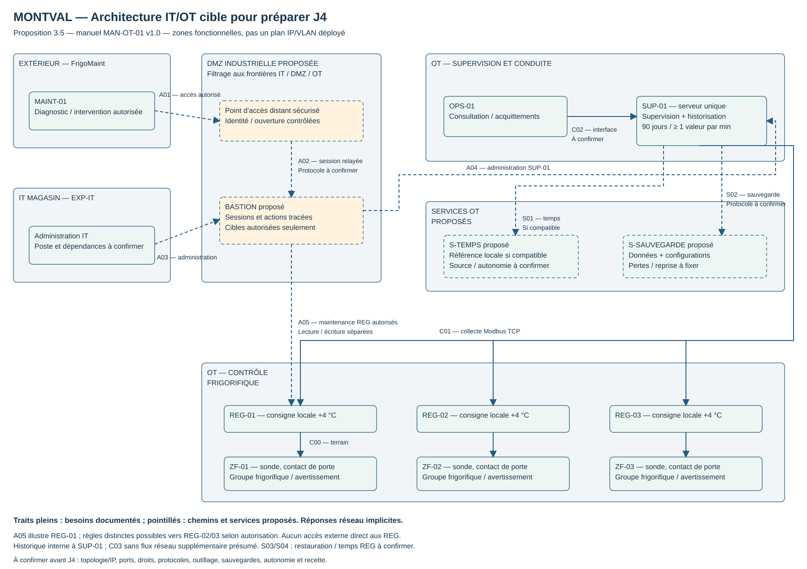

# 3.5 — Atelier 5 | Concevoir l’architecture IT/OT de Montval

## 🎯 Objectif et modalités

Proposer une architecture et des flux de communication adaptés aux exigences d’exploitation de l’installation frigorifique.

**Modalité :** atelier de conception en binôme avec le formateur. Partir des exigences 3.1, de leur traduction IT 3.2 et du schéma Purdue 3.3 ; intégrer les arbitrages réellement recueillis pendant 3.4.

!!! info "Statut : proposition de référence pour J4"
    Conception préparée à partir de **MAN-OT-01 v1.0 du 14 octobre 2022**, et non relevé d’une architecture déployée. **DMZ, bastion, accès distant sécurisé, services de temps et de sauvegarde sont proposés.** Aucune validation du binôme/formateur, configuration réseau ou disponibilité mesurée n’est attestée. Les fonctions prescrites sont distinguées des choix techniques et des informations à confirmer.

## 1 — Zones fonctionnelles et composants

Les zones regroupent des fonctions et des besoins d’accès ; leurs frontières devront être traduites en réseaux et contrôles adaptés après inventaire. Elles ne fixent ni VLAN, ni sous-réseau, ni produit.

| Zone proposée | Composants ou fonctions | Justification par le manuel et contraintes |
| --- | --- | --- |
| **Contrôle frigorifique OT** | REG-01, REG-02, REG-03 ; sondes, contacts de porte, groupes et avertissements des ZF-01 à ZF-03. | Préserver les boucles locales et consignes sans SUP-01/OPS-01 (**EXP-01–03**). Aucun composant DMZ ou IT ne doit être ajouté comme dépendance du contrôle local. Besoin de sous-zones par enceinte à évaluer, sans imposer trois réseaux à partir du seul manuel. |
| **Supervision et conduite OT** | SUP-01, OPS-01 ; collecte, vue opérateur, alarmes et historique. | Accès aux mesures, fraîcheur visible et reprise sans écrasement des paramètres (**EXP-04–05, EXP-08–10**). SUP-01 reste un serveur unique : fonction de supervision N2 et fonction d’historisation N3. |
| **Services d’exploitation OT proposés** | `S-TEMPS` : référence horaire locale ; `S-SAUVEGARDE` : sauvegarde des données/configurations et moyens de restauration. | Répondre à **EXP-05–06, MAI-05** sans rendre les boucles locales dépendantes de l’IT général. Ces noms sont des repères de conception, pas des actifs du manuel. Existence, implantation et capacités à vérifier ; ce ne sont pas des serveurs nécessairement distincts. |
| **DMZ industrielle proposée** | Point d’accès distant sécurisé et **bastion**, filtrage côté extérieur/IT et côté OT. | Médiatiser les accès de diagnostic et d’administration ; limiter cibles, droits et durées (**MAI-01–04, ORG-01**). La DMZ est une zone, le bastion un service ; leur présence graphique ne démontre pas une protection effective. |
| **IT du magasin** | EXP-IT ; poste d’administration autorisé à identifier. | Distinguer usages informatiques généraux et conduite OT. Une panne d’EXP-IT ne doit pas interrompre les boucles locales. L’autonomie de la supervision par rapport aux services IT communs est un objectif à vérifier. |
| **Prestataire externe** | FrigoMaint ; MAINT-01 représenté comme poste d’intervention distant. | Accès autorisé quand nécessaire (**MAI-03–04**), sans nécessité permanente pour la régulation. Implantation réelle, outillage et gestion de MAINT-01 à confirmer. |

### Principes d’accès retenus pour la cible

- Refuser les échanges interzones qui n’ont pas de besoin identifié ; autoriser des origines, cibles et services précis après confirmation technique. Les réponses aux sessions autorisées ne constituent pas une ouverture générale dans l’autre sens.
- Séparer la **collecte courante** de la **maintenance permettant des modifications** : le compte ou chemin de collecte ne doit pas acquérir un droit d’écriture par défaut.
- Faire passer les accès extérieurs et l’administration depuis l’IT par les points d’accès autorisés et le bastion ; ne pas publier directement les régulateurs ou SUP-01 sur Internet.
- Préserver les communications terrain ; le bastion ne s’insère pas dans les boucles locales ni dans la collecte normale SUP-01 → REG.
- Vérifier les capacités réelles avant de compter sur un contrôle : un pare-feu réseau ne distingue pas nécessairement lecture et écriture Modbus. Si l’équipement ne le permet pas, étudier une restriction applicative, un relais adapté ou un outillage de maintenance dédié ; la solution devra être testée.

Ces principes décrivent la cible proposée. Le port direct du PoC et sa passerelle de lecture ne sont pas la preuve d’un filtrage réseau déjà installé à Montval.

## 2 — Schéma annoté de référence pour J4

[Ouvrir le schéma SVG](../../assets/files/informatique-industrielle/it-2/Montval-architecture-IT-OT-J4.svg) · [Source modifiable draw.io](../../assets/files/informatique-industrielle/it-2/Montval-architecture-IT-OT-J4.drawio)

Les traits pleins représentent les besoins documentés ; les pointillés montrent des chemins/services proposés. Les flèches réseau indiquent l’initiateur logique et les réponses sont implicites. Les liaisons terrain regroupent mesures remontantes et commandes descendantes, sans présumer leur technologie. Les frontières sont fonctionnelles : le dessin n’indique pas encore les équipements de filtrage ni les interfaces physiques.

Le chemin de maintenance illustré atteint REG-01 ; des règles séparées pourront viser REG-02/03 si l’intervention le justifie. Ce chemin ne doit pas donner automatiquement accès aux trois zones. Le poste distant n’est pas supposé pouvoir ouvrir une session interactive sur un régulateur : station ou outil compatible derrière le bastion à déterminer.

## 3 — Matrice de flux proposée

**Légende des droits :** consultation = lecture des informations ; modification = changement de paramètre, configuration, acquittement ou écriture technique. Un acquittement modifie l’état de prise en compte d’une alarme, sans modifier consigne ou commande (**EXP-09**). Même une lecture réseau peut être suivie d’une écriture locale de journal ; ces opérations ne doivent pas être confondues.

Les conditions ci-dessous sont proposées pour la cible. Les seules communications industrielles explicitement nommées par le manuel sont en **Modbus TCP** (§2.3). Ses ports configurés, adresses PDU, fonctions et droits par registre sont à obtenir : ne pas appliquer les ports ou adresses du PoC à Montval.

### Flux de contrôle, consultation et maintenance

| ID | Source | Destination | Service / protocole | Fonction et droits | Condition d’accès proposée / confirmation nécessaire |
| --- | --- | --- | --- | --- | --- |
| **C00** | Sondes/contacts et régulateur | REG et groupe associés de la même zone | Liaison terrain **à confirmer**. | Mesures en lecture et commandes du groupe ; boucle locale. | Disponible pour le contrôle local ; ne pas filtrer/reconfigurer avant de connaître câblage et interfaces. EXP-01. |
| **C01** | SUP-01 | REG-01 à REG-03 | **Modbus TCP documenté** ; paramètres réseau et fonctions à confirmer. | Collecte de mesures, consignes, états et alarmes ; **lecture seule** dans ce chemin proposé. | Accès permanent pour les lectures périodiques ; cibles et variables précisées après obtention de la table. Rafraîchissement écran souhaité 5 s, sans contrainte temps réel sur la boucle. |
| **C02-L** | OPS-01 | SUP-01 | Interface de supervision, protocole **à confirmer**. | Consultation températures, états et alarmes. | Accès courant limité au rôle opérateur ; afficher date de mesure et péremption. EXP-04. |
| **C02-A** | OPS-01 / opérateur autorisé | SUP-01 | Même interface si prise en charge ; protocole et droits **à confirmer**. | **Acquittement**, distinct de la consultation et d’une commande frigorifique. | Rôle autorisé, événement journalisé ; aucun effet sur consigne ou compresseur. EXP-05, EXP-09. |
| **C03** | Fonction de collecte de SUP-01 | Historique de SUP-01 | Mécanisme applicatif / stockage **à confirmer**. | Écriture locale des mesures et événements ; lecture historique. | Au moins une température/minute et événements, 90 jours. Aucun flux réseau additionnel supposé tant que le stockage n’est pas décrit. |
| **A01** | FrigoMaint sur MAINT-01 | Point d’accès distant en DMZ | Accès sécurisé **à définir** ; ne pas présumer le support d’un protocole particulier. | Authentification et ouverture d’une session ; **ne confère pas encore de droit d’écriture OT**. | Intervention autorisée et enregistrée, y compris urgence sollicitée par l’exploitation. Identité, durée et fermeture à définir. MAI-01–04. |
| **A02** | Session MAINT-01 via le point d’accès | Bastion en DMZ | Protocole de session **à confirmer**. | Session de diagnostic ou de maintenance selon le rôle accordé. | Traçabilité de l’intervenant et rattachement à l’autorisation ; pas de transit général vers l’OT. |
| **A03** | Poste IT d’administration identifié | Bastion en DMZ | Accès d’administration **à confirmer**. | Administration des cibles autorisées ; **modification possible** selon rôle. | Compte et poste autorisés, opération coordonnée ; pas d’accès aux régulateurs accordé du seul fait d’être administrateur IT. ORG-01. |
| **A04** | Outil/session autorisé via bastion | SUP-01 | Administration serveur/applicative **à confirmer** ; OS inconnu, ni SSH ni RDP imposés. | Diagnostic en lecture ; changements système/applicatifs **distinctement autorisés**. | Changement préparé, sauvegarde et vérifications ; ne pas imposer une consigne au redémarrage. EXP-10, MAI-05–08. |
| **A05-L** | Outil de FrigoMaint via bastion | REG concernés | Variables Modbus TCP documentées ; outil, connexion et fonctions de diagnostic **à confirmer**. | **Lecture** de diagnostic. | Cibles utiles à l’intervention seulement ; pas de droit d’écriture implicite. |
| **A05-E** | Outil de FrigoMaint via bastion | REG concernés | Méthode d’écriture / configuration **à confirmer** avec le mainteneur ; ne pas supposer que tout passe par Modbus. | **Modification** de consigne ou configuration autorisée. | Motif, autorisation et heure tracés, contrôle avant/après. Dérogation de consigne approuvée par exploitation et mainteneur. EXP-02, MAI-01–02. |

### Flux des services d’exploitation proposés

| ID | Source logique | Destination | Protocole / sens à confirmer | Fonction et droits | Conditions et points ouverts |
| --- | --- | --- | --- | --- | --- |
| **S01** | SUP-01 ; OPS-01 si compatible | S-TEMPS | Service de temps **à choisir** selon les clients. | Consultation d’une référence ; ajustement technique de l’horloge du client. | Référence et fonctionnement local proposés ; mesurer écarts et perte de référence. Pas de sortie Internet directe implicite. EXP-06. Le dessin montre SUP-01 seulement. |
| **S02** | Agent SUP-01 → S-SAUVEGARDE **ou** collecteur → SUP-01 | Cible de sauvegarde **ou** source à lire, selon le mode retenu | Protocole et sens réel **à choisir** ; un seul mode à traduire en règles après décision. | Lecture des données/configurations sources ; **écriture** d’une sauvegarde sur le dépôt. | Planifier sans perturber la collecte, protéger les accès, tester la restauration ; définir périmètre, rétention, perte acceptable et temps de reprise. Le schéma illustre un mode poussé, proposé seulement. |
| **S03** | Dépôt et opérateur de restauration autorisé | Cible de restauration isolée puis SUP-01 après validation | Chemin, protocole et initiateur **à confirmer** selon l’outil. | **Écriture** des données/configurations restaurées ; pas une simple consultation. | Opération exceptionnelle, coordonnée ; préserver les consignes locales et vérifier les états après reprise. EXP-10–11, MAI-05, MAI-08. Non représenté comme liaison permanente. |
| **S04** | Régulateur compatible | Référence de temps adaptée | **Support non établi** ; aucun protocole ni règle à autoriser à ce stade. | Synchronisation si nécessaire et supportée ; sinon préciser l’origine des horodatages collectés. | Ne pas ajouter une dépendance de contrôle au temps réseau ; consulter les notices et la précision requise. EXP-06. |

**Conservation et traces complémentaires :** identifier aussi la sauvegarde des configurations de régulateurs et des équipements d’accès, ainsi que l’export des traces de maintenance. Leurs méthodes, destinations et initiateurs restent inconnus ; ils ne doivent pas être couverts par une règle générale « DMZ vers OT ». Ajouter des lignes dédiées à la matrice une fois la méthode choisie.

**Flux sans besoin établi :** pas d’accès général EXP-IT → REG, extérieur → REG ou extérieur → SUP-01 dans cette cible. Une mise à jour ne justifie pas un accès Internet libre depuis tout l’OT. Les éventuels relais de correctifs et dépendances d’authentification, résolution de noms ou journalisation sont à documenter avant d’ajouter leurs flux.

## 4 — Examiner les dépendances et les modes dégradés

| Situation | Fonctions à préserver | Dégradation possible | Mesures et vérifications pour la cible | Références et limites |
| --- | --- | --- | --- | --- |
| **Réseau IT du magasin indisponible** | Boucles locales, paramètres et avertissements locaux. Objectif proposé : conserver SUP/OPS, collecte et services OT si leurs dépendances locales restent disponibles. | Administration depuis EXP-IT ; éventuellement accès externe si l’entrée DMZ partage un lien/équipement IT ; services reposant réellement sur l’IT. | Relever dépendances d’alimentation, commutation, accès externe, identité et temps ; éviter de rendre le contrôle dépendant du bastion ou d’un service IT. Prévoir surveillance locale si la vue centrale est touchée. | **EXP-01, EXP-04, MAI-03**. L’isolement graphique ne prouve ni autonomie d’alimentation ni disponibilité de la DMZ. |
| **SUP-01 doit être redémarré** | Régulation et alarmes locales ; consignes conservées dans REG. | Vue OPS, collecte, historique et alarmes centrales pendant l’arrêt ; risque de trou de données sans tampon confirmé. | Autoriser l’impact, organiser la relève locale ; à la reprise, lire les états courants, signaler les données périmées et vérifier absence d’écriture de paramètres. Identifier les mesures perdues sans inventer leur reconstitution. | **EXP-01, EXP-04–05, EXP-08, EXP-10–11**, MAI-05–08. |
| **Lien SUP-01 / REG-02 interrompu** | Contrôle local et avertissement de ZF-02 si les composants locaux restent fonctionnels ; service des autres zones si la panne est limitée à ce lien. | Données ZF-02 périmées et lacunes d’historique ; alarmes de cette zone non remontées. | Indiquer l’âge/perte de communication sur OPS ; faire contrôler ZF-02 sur place ; après retour, relire état et paramètres et vérifier la zone. Ne pas confondre température inchangée à l’écran et température réelle stable. | **EXP-01, EXP-04, EXP-10–11**, §4. Le périmètre de panne dépend de la topologie réelle. |
| **FrigoMaint intervient en urgence depuis l’extérieur** | Contrôle et collecte courants ; alerte et coordination avec l’exploitation. | Pas d’intervention distante si point d’entrée, bastion, lien ou identité indisponible ; une réponse sur place peut être nécessaire. | Appel/autorisation selon astreinte, ouverture ciblée, rôle lecture puis écriture si justifié, traçabilité et contrôle de remise en service ; fermer l’accès accordé. Définir un recours autorisé sur place plutôt qu’un contournement libre de la DMZ. | **MAI-01–04, MAI-08, ORG-01–02**. La disponibilité de l’accès urgent et ses dépendances restent à qualifier ; la régulation n’en dépend pas (**MAI-03**). |
| **Service d’horodatage indisponible** | Contrôle local et signalement local ; viser la poursuite de collecte et supervision tant que les applications le permettent. | Dérive des horloges, incertitude sur fraîcheur des mesures et ordre des événements ; certains services d’accès/validation peuvent également dépendre du temps. | Détecter la perte de référence, conserver les événements avec leur qualité temporelle, mesurer les écarts ; à la reprise vérifier l’ordre des données et le comportement d’ajustement. Confirmer la génération locale de l’alarme temporisée et les mécanismes de temps des équipements. | **EXP-04, EXP-06**, §2.1 et §8. Aucune autonomie ou précision d’horloge chiffrée n’est fournie. La régulation ne doit pas être rendue dépendante de ce nouveau service. |

La régulation autonome attendue ne garantit pas la sécurité des denrées pendant une panne : contrôler les températures réelles et appliquer les décisions de l’exploitation (**EXP-11–12**). Une panne de temps ne doit pas être traitée par une remise à l’heure improvisée sans vérifier les effets sur journaux et applications.

## 5 — Dossier à confirmer avant la configuration J4

| Point à préciser | Source / interlocuteur proposé | Effet sur la configuration et la recette |
| --- | --- | --- |
| Topologie, adressage, interfaces et équipements de filtrage | IT, responsable SUP-01 et FrigoMaint ; plans réels (§8). | Définir les frontières techniques, sous-réseaux, chemins et règles ; vérifier les services partagés. |
| Registres, fonctions et capacités de lecture/écriture | FrigoMaint et notices de chaque REG. | Renseigner C01/A05 ; choisir un contrôle réellement capable de séparer les opérations. |
| Interface opérateur et administration SUP | Responsable supervision et IT. | Définir services, identités, protocoles et modes de reprise de SUP-01 ; renseigner C02/A04. |
| Outillage de maintenance et accès urgent | FrigoMaint, IT et exploitation. | Compatibilité bastion, ouverture/fermeture, cibles, trace et procédure de recours ; renseigner A01–A05. |
| Temps, sauvegarde et restauration | IT, responsable supervision, FrigoMaint et exploitation. | Préciser S01–S04, perte acceptable, durée de reprise, sources d’heure et règles dédiées aux configurations/traces. |
| Fenêtre, surveillance compensatoire et recette | Exploitation et FrigoMaint avec IT. | Accord de changement, contrôles des trois zones et retour arrière si réalisable ; mardi 06 h–08 h à confirmer, sans autorisation automatique de coupure. |

### Critères de recette proposés pour J4 — non exécutés

- Chaque chemin autorisé fonctionne avec son droit prévu ; une consultation ne permet pas une modification non autorisée. Vérifier les accès interdits avec des essais limités et convenus, sans commandes perturbatrices sur une installation réelle.
- Une coupure de SUP-01 ou du chemin IT, dans un environnement d’essai adapté, préserve le contrôle local attendu ; les alarmes locales et la signalisation de péremption sont vérifiées.
- La reprise de SUP-01 récupère les états courants sans écraser les paramètres des régulateurs.
- Les accès urgents sont possibles par le chemin prévu avec autorisation, traçabilité et fermeture ; aucune dépendance du contrôle au bastion n’est introduite.
- La collecte, l’historique, la cohérence temporelle et la restauration sont vérifiés selon des critères mesurables fixés avec les responsables ; les lacunes et écarts sont consignés.

**Production préparée :** schéma annoté SVG/draw.io, zones et justifications, matrice des droits/flux, cinq analyses de dépendance et liste des points ouverts. **Référence de conception pour J4**, à valider en binôme et avec le formateur avant traduction en configuration. Aucun test de panne ou règle réseau appliquée n’est déclaré dans cette fiche.

## Ressources

- [Manuel MAN-OT-01](MAN-OT-01_Manuel_exploitation_installation_frigorifique.md), §2–6 et §8.
- [3.2 — Besoins IT](traduire-exigences-ot-besoins-informatiques.md), [3.3 — Purdue](organiser-installation-modele-purdue.md), [3.4 — Débrief](mettre-en-commun-exigences-consequences-it.md).

[Retour à l’itération 2](index.md) · [Pense-bête](../../pense-bete/glossaire/informatique-industrielle/it-2.md)
