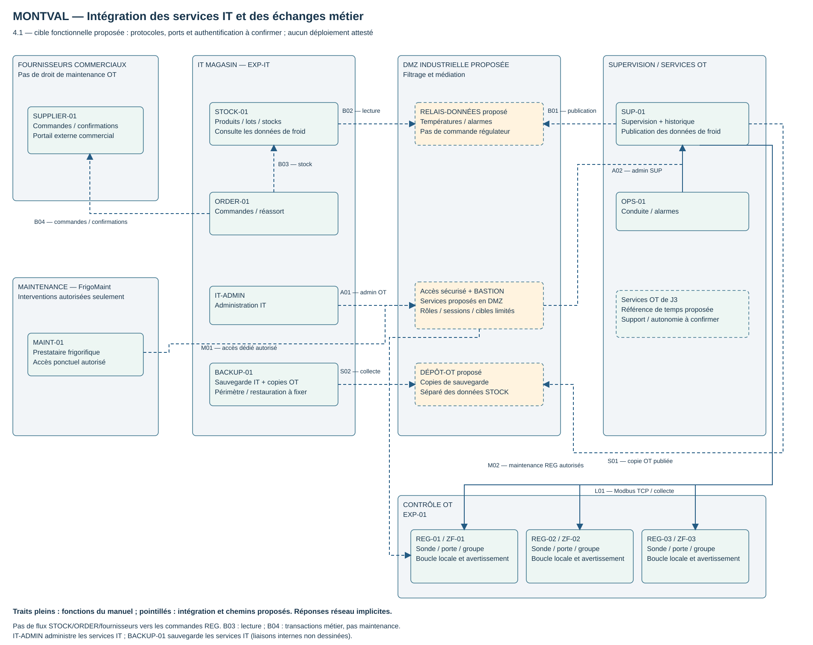

# 4.1 — Atelier 1 | Intégrer les services informatiques du magasin

## 🎯 Objectif et modalités

Identifier les interactions nécessaires entre une installation industrielle et les applications informatiques de gestion.

**Modalité :** analyse et conception en binôme, avec le formateur. **Supports :** manuel MAN-OT-01 et architecture Montval produite en J3.

!!! info "Origine et statut des éléments"
    Les fonctions frigorifiques viennent du manuel **MAN-OT-01 v1.0 du 14 octobre 2022**. STOCK-01, ORDER-01, SUPPLIER-01, IT-ADMIN et BACKUP-01 sont ajoutés par la consigne 4.1. DMZ, bastion, relais de données et dépôt de copies OT restent des propositions de conception. Protocoles non documentés, ports, authentification et capacités sont à confirmer. Aucun déploiement, test ou accord collectif n’est attesté ici.

## 1 — Découvrir les nouveaux composants

| Composant | Fonction fournie | Positionnement proposé et droits utiles |
| --- | --- | --- |
| **STOCK-01** | Gestion des stocks, produits et lots. | Zone IT métier ; reçoit des données de conservation, sans commande des REG. Le rapprochement lot/zone relève de la gestion des stocks. |
| **ORDER-01** | Gestion des commandes et réapprovisionnements. | Zone IT métier ; lit les données de stock nécessaires et échange des transactions commerciales avec le portail externe. |
| **SUPPLIER-01** | Portail externe d’échanges avec les fournisseurs. | Extérieur commercial, distinct de la maintenance FrigoMaint. Aucun droit sur les systèmes de contrôle. |
| **IT-ADMIN** | Poste d’administration informatique. | IT du magasin ; administration des seuls services autorisés. Pour SUP-01, chemin spécifique via bastion proposé, distinct d’un accès général aux REG. |
| **BACKUP-01** | Sauvegarde des données et configurations. | Service IT de sauvegarde, avec périmètre et droits dédiés ; copies OT médiatisées dans la cible. Ne remplace pas à lui seul l’historique de SUP-01. |

Le besoin fonctionnel est de rendre les conditions de conservation consultables par STOCK-01 **sans accès direct aux commandes des régulateurs**. Il n’implique ni écriture de consigne par l’ERP, ni accès industriel du fournisseur commercial.

## 2 — Analyser les besoins et les initiateurs

La matrice ci-dessous choisit des initiateurs pour une **cible envisageable**. Les mécanismes applicatifs réels doivent être confirmés avant toute règle réseau. « Régulier » signifie échanges périodiques ou à la demande selon le service, pas connexion TCP obligatoirement maintenue.

| ID / besoin | Systèmes et initiateur proposé | Données et droits | Périodicité | Effet possible d’une interruption sur la régulation | À confirmer |
| --- | --- | --- | --- | --- | --- |
| **B01 — Publier les données de froid** | SUP-01 initie une publication vers un **RELAIS-DONNÉES proposé en DMZ**. | Température, zone, horodatage de mesure, état/heure d’alarme et qualité/fraîcheur ; alimentation du relais, aucun ordre REG. | Publication régulière et événements selon les capacités. | Pas d’effet sur la boucle locale si la publication est découplée ; perte de fraîcheur côté métier. Un export bloquant/saturant SUP pourrait dégrader la supervision : charge à maîtriser. | Export disponible, fréquence métier utile, protocole/port, identité d’export, tampon et reprise. |
| **B02 — STOCK reçoit les données** | STOCK-01 initie la lecture du relais ; SUP publie en amont par B01. | Consultation des seules données publiées. Pas d’écriture sur SUP/REG ; association aux lots côté STOCK. | Lecture périodique ou à la demande. | Régulation préservée ; suivi des conditions de conservation et décisions logistiques éventuellement dégradés. Signaler donnée absente/périmée. | Interface de lecture, authentification, mapping zone/stock/lot, délai acceptable, qualité et droits exacts. |
| **B03 — Réapprovisionnement** | ORDER-01 initie une consultation de STOCK-01. | Quantités/disponibilités et informations produits nécessaires ; droit de lecture adapté, pas commande frigorifique. | Courant, à la demande ou par lots selon le processus métier. | Aucun effet direct prévu sur les REG ; réapprovisionnement retardé ou fondé sur des données périmées si non signalées. | API/interface, protocole/port, données minimales, fréquence, authentification et cohérence transactionnelle. |
| **B04 — Échanges fournisseurs** | ORDER-01 initie les échanges vers SUPPLIER-01 dans cette proposition ; confirmations en réponse ou relevées par ORDER. | Commandes et confirmations ; **écritures commerciales**, sans modification OT. | Transactions ponctuelles selon les besoins, service disponible en exploitation. | Pas d’effet direct sur le contrôle ; commandes retardées ou ambiguës. Éviter les doublons à la reprise. | API/portail, contrat d’échange, protocole/port, identité, reprise et dédoublonnage. Des notifications entrantes, si requises, imposeraient une analyse distincte. |
| **A01 — Administrer les services** | IT-ADMIN initie vers STOCK, ORDER et BACKUP selon ses rôles ; pour SUP, IT-ADMIN → bastion → SUP. | Lecture de diagnostic et **modifications d’administration** autorisées, distinctes des écritures REG. | Pendant les interventions ; sessions bornées selon le mécanisme retenu. | Perte d’accès sans arrêt local prévu ; une intervention peut arrêter un service ou toucher une dépendance commune. | OS, protocoles/ports, rôles, validation des changements et services partagés. Aucun SSH/RDP supposé. |
| **S00 — Sauvegarder l’IT** | BACKUP-01 initie une collecte des sources STOCK/ORDER dans le mode proposé. | Lecture par compte de sauvegarde et écriture dans le dépôt ; données cohérentes et configurations. | Planifié selon objectifs métier à définir. | Pas de dépendance de régulation à BACKUP ; risque indirect si la sauvegarde sature une ressource commune. Sans copies exploitables, reprise des services dégradée. | Support du mode tiré, cohérence des applications, protocole/port, périmètre, charge, rétention et tests de restauration. |
| **S01–S02 — Copies OT** | SUP-01 publie une copie vers un **DÉPÔT-OT proposé en DMZ** ; BACKUP-01 initie la récupération de cette copie. | Copie cohérente des données/configurations de SUP ; droits séparés d’écriture du dépôt puis de collecte. Aucun accès BACKUP → commande REG. | Planifié et après changements selon politique à définir. | Boucle locale préservée ; en cas d’échec, fraîcheur des copies et capacité de reprise dégradées. Les deux étapes ne doivent pas bloquer la collecte OT. | Export/restauration SUP, capacités du dépôt, sécurisation, quota/charge, rétention, protocole/port et authentification de chaque étape. |
| **M01–M02 — FrigoMaint** | MAINT-01 → point d’accès sécurisé/bastion proposé → outils et équipements autorisés. | Lecture de diagnostic ; **modification de consigne/configuration seulement autorisée et tracée**. | Intervention normale ou urgente, non nécessaire en permanence pour réguler. | Perte de l’accès distant ne doit pas arrêter le contrôle ; dépannage retardé. Les modifications peuvent affecter le froid, donc coordination et recette. | Outils, protocoles/ports, identité, périmètre, astreinte, ouverture/fermeture et traces. |

### Données de conservation : sens et limites

Transmettre la **date de la mesure**, pas uniquement la date d’envoi, avec l’identifiant de zone et un état de qualité. Une température ancienne ne doit pas devenir « actuelle » lorsqu’elle est relue sur le relais (**EXP-04**). Les sources d’heure doivent permettre le rapprochement des événements (**EXP-06**), sans inventer une précision absente du manuel.

Le manuel ne décrit pas les déplacements des lots. STOCK-01 doit donc fournir un rattachement lot/zone/période fiable avant toute analyse des conditions de conservation d’un lot. Une température d’enceinte n’est pas une mesure au cœur du produit ; l’exploitation reste responsable des décisions sur les denrées (**EXP-12**).

L’alarme Montval repose sur **T > +8 °C pendant 10 minutes** (**EXP-07**). Le relais transmet l’information d’alarme existante ; il ne remplace pas l’avertissement local ou la conduite OPS-01 et ne modifie pas cette règle. Les 10 secondes du PoC restent un comportement accéléré distinct.

## 3 — Compléter l’architecture J3

[Ouvrir le SVG](../../assets/files/informatique-industrielle/it-3/Montval-J4-integration-services.svg) · [Source modifiable draw.io](../../assets/files/informatique-industrielle/it-3/Montval-J4-integration-services.drawio)

Les flèches réseau indiquent l’initiateur logique ; les réponses sont implicites. Le dessin reprend les fonctions du J3 et ajoute les services métier. Les pointillés désignent les chemins d’intégration proposés. Les flux internes d’administration IT et de sauvegarde IT ne sont pas tous dessinés ; ils figurent dans la matrice. La traversée graphique d’une zone par une ligne ne constitue pas une autorisation d’accès à ses composants.

| Ensemble / frontière | Éléments à préserver ou séparer |
| --- | --- |
| **Contrôle OT** | REG-01/02/03, sondes, contacts de porte, groupes et avertissements locaux. Continuité conditionnée aux composants locaux opérationnels (**EXP-01**). Aucun flux métier n’entre dans la boucle locale. |
| **Supervision et services industriels OT** | SUP-01, OPS-01 et services locaux proposés en J3, dont la référence de temps si compatible. SUP reste le serveur de supervision et d’historisation ; pas de nouvel historian inventé. |
| **IT magasin** | STOCK-01, ORDER-01, IT-ADMIN et BACKUP-01. Les applications métier ne reçoivent pas les droits du mainteneur frigorifique. |
| **DMZ industrielle proposée** | Bastion/point d’entrée distincts fonctionnellement du relais de données et du dépôt de sauvegarde OT. Des rôles et droits distincts sont nécessaires ; le dessin ne tranche pas le nombre de machines. STOCK ne lit pas les sauvegardes. |
| **Fournisseurs commerciaux** | SUPPLIER-01 échange avec ORDER-01 ; aucun accès général à EXP-IT, SUP, bastion ou REG ne se déduit de ce besoin. |
| **Maintenance externe** | FrigoMaint/MAINT-01 utilise un chemin d’intervention autorisé et tracé vers ses cibles, pas les échanges de commande commerciale. |

### Communications traversant les frontières IT/OT

- **SUP → relais DMZ → lecture par STOCK** : publication limitée des températures/alarmes, sans commande en retour. Ce découpage en sessions applicatives proposées n’est **pas** une preuve de liaison physiquement unidirectionnelle ; filtrage et droits doivent être vérifiés.
- **SUP → dépôt DMZ → collecte par BACKUP** : copies OT exportées, sans ouverture générale BACKUP → REG. Le dépôt de copies et le relais métier ont des fonctions et autorisations séparées.
- **IT-ADMIN → bastion DMZ → SUP** : administration OT spécifique, distincte de l’administration des applications métier.
- **FrigoMaint → accès contrôlé/bastion → cibles OT** : diagnostic/écriture selon intervention autorisée ; les deux droits sont distincts.

**ORDER ↔ STOCK** reste interne à l’IT dans cette cible. **ORDER → SUPPLIER** franchit la frontière IT/extérieur commercial, pas la frontière de commande OT. Une réponse fournisseur n’autorise pas une nouvelle session entrante vers Montval. Si des notifications entrantes sont nécessaires, leur point d’entrée, traitement et droits devront être définis séparément.

## 4 — Sauvegarde et dépendances à ne pas masquer

Dans le J3, `S-SAUVEGARDE` était une fonction proposée sans implantation arrêtée. La consigne J4 nomme maintenant **BACKUP-01**. La cible proposée place ce service dans l’IT et médiatise ses copies OT par un dépôt en DMZ ; il ne s’agit pas d’un second service réputé déjà présent.

- La conservation de l’historique **90 jours** et la cadence d’au moins une température/minute (**EXP-05**) ne fixent pas la fréquence des sauvegardes, leur rétention ni la perte de données acceptable.
- Une copie doit permettre une restauration cohérente, notamment pour les données applicatives. La restauration est une opération **d’écriture exceptionnelle**, avec son propre chemin et autorisation ; elle n’est pas couverte par une permission de lecture B02 ou S02.
- Les configurations REG doivent aussi être sauvegardées si la méthode le permet. Celle-ci reste à obtenir auprès de FrigoMaint : aucun accès automatique BACKUP → REG n’est supposé. Un export contrôlé par le mainteneur pourra être étudié.
- Si le réseau IT, STOCK, ORDER, le portail ou BACKUP est indisponible, la régulation locale doit rester active sous les conditions d’EXP-01. Vérifier les alimentations, équipements réseau, services d’identité et autres dépendances partagés avant de conclure à l’autonomie effective.
- Une publication bloquée, un dépôt plein ou une collecte métier excessive ne doit pas bloquer SUP-01 ; mécanismes de découplage, limitation et comportement en erreur restent à qualifier avec le fournisseur de supervision.

## 5 — Points à confirmer et production attendue

| Information manquante | Interlocuteurs proposés | Décision influencée |
| --- | --- | --- |
| Export des températures/alarmes, horodatages et qualité depuis SUP-01. | Responsable supervision, FrigoMaint et IT. | Relais pertinent, fréquence, mécanisme de reprise et protocoles B01/B02. |
| Mapping lots/produits/zones et délai d’information métier acceptable. | Exploitation et responsables STOCK/ORDER. | Données à publier, péremption et traitement des informations absentes. |
| Interfaces STOCK/ORDER et contrat fournisseur. | Responsables applicatifs, IT et fournisseur commercial. | Initiateurs, transactions, confirmations, authentification, ports et reprise sans doublons. |
| Périmètre, cohérence et restauration des sauvegardes. | IT, responsable supervision, FrigoMaint et exploitation. | Mode de collecte, export OT, rétention, objectifs de reprise et droits. |
| Accès administrateurs/FrigoMaint et dépendances réelles. | IT, exploitation et FrigoMaint. | Bastion, rôles, astreinte, fenêtres, filtrage et tests autorisés. |

**Production de l’atelier :** schéma étendu, matrice des besoins/initiateurs/fréquences, frontières identifiées et liste d’inconnues. Analyse documentaire et proposition renseignées ; travail en binôme, arbitrages du formateur et configurations restent à attester. Les règles de pare-feu et les protections du régulateur obsolète seront traitées lorsque leurs consignes seront fournies.

## Ressources

- [Manuel MAN-OT-01](../it-2/MAN-OT-01_Manuel_exploitation_installation_frigorifique.md), §2–6 et §8.
- [Architecture J3 et matrice de flux](../it-2/concevoir-architecture-it-ot-montval.md).
- [Dossier de clôture J3](../it-2/finaliser-dossier-analyse-it-ot.md).
- Consigne 4.1 fournie : source des cinq nouveaux composants et de leurs besoins fonctionnels.

[Retour à l’itération 3](index.md) · [Pense-bête](../../pense-bete/glossaire/informatique-industrielle/it-3.md)
