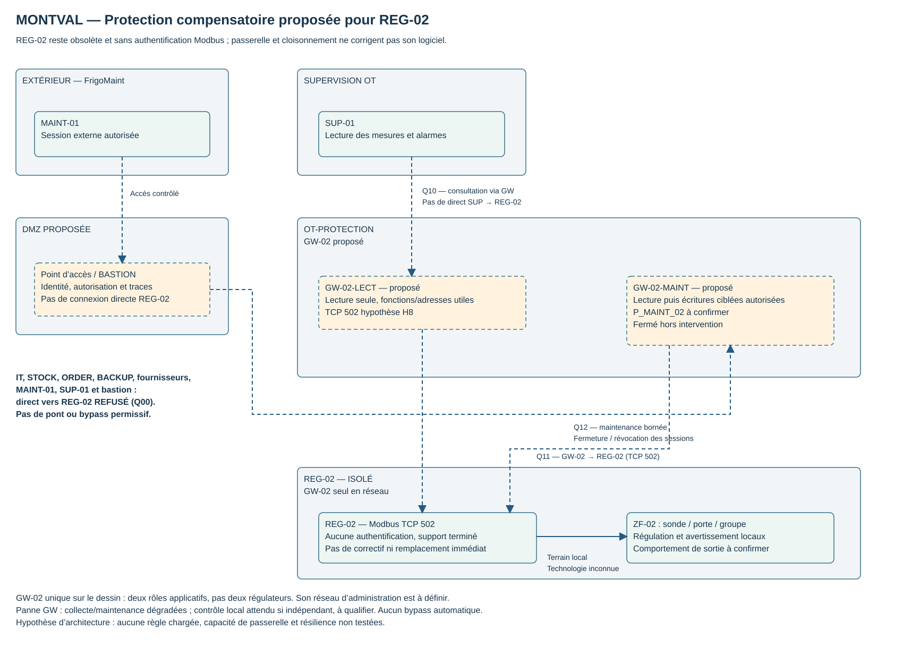

# 4.3 — Atelier 3 | Protéger un régulateur industriel obsolète

## 🎯 Objectif et modalités

Concevoir des mesures de protection compensatoires pour un équipement industriel qui ne peut plus être mis à jour ni remplacé immédiatement.

**Modalité :** étude de cas et conception technique en binôme. **Durée :** à compléter, non précisée.

!!! info "Statut des travaux"
    La fiche REG-02 ci-dessous est une **nouvelle contrainte du scénario 4.3**. Les mesures, la passerelle GW-02 et le cloisonnement sont proposés ; aucune installation ni recette n’est attestée. Les capacités inconnues restent à confirmer. Le maintien en service imposé ne prouve pas que le risque résiduel est acceptable.

## 1 — Nouvelle fiche REG-02

| Caractéristique | Situation fournie |
| --- | --- |
| Fonction | Régulation frigorifique ZF-02. |
| Protocole | Modbus TCP. |
| Support constructeur | Terminé. |
| Mises à jour | Aucun nouveau correctif disponible ; logiciel non modifiable dans l’exercice. |
| Authentification Modbus | Absente. |
| Remplacement | Recommandé par le fournisseur, mais non financé pour l’année en cours. |
| Exploitation | Maintien du fonctionnement obligatoire dans son état actuel. |

**Évolution par rapport à J3 :** SIT-03 envisageait un correctif à installer sur REG-02. L’état fourni en 4.3 ne permet plus de retenir cette option. L’analyse et le PDF J3 restent des documents de l’étape antérieure ; la présente fiche traite le maintien temporaire de l’équipement obsolète.

Aucun constructeur, modèle, version ou CVE n’est communiqué. L’absence de support ne permet pas d’attribuer une vulnérabilité précise ni de prétendre avoir testé son exploitation.

## 2 — Protections possibles et limites

| Mesure proposée | Ce qu’elle protège / réduit | Ce qu’elle ne protège pas ; prérequis |
| --- | --- | --- |
| **Segment dédié et filtrage au point de passage** | Réduit les sources capables d’atteindre REG-02 ; limite les chemins depuis IT, DMZ et autres équipements OT. | Ne corrige pas son logiciel ; un pair dans le même segment peut contourner un routeur. Vérifier câblage, interfaces, chemins latéraux et accès physiques. Ne pas couper une liaison terrain indispensable. |
| **Restriction des adresses sources** | Seule l’interface aval de GW-02 est admise en réseau vers REG-02. | Une IP n’est pas une identité humaine ; compromission de GW-02, usurpation sur segment accessible ou accès local restent possibles. Le filtrage doit être sur un chemin obligatoire. |
| **Accès FrigoMaint par entrée contrôlée et bastion** | Identité, périmètre, durée et traces ; pas d’accès distant direct aux REG. | Le bastion seul ne filtre pas les fonctions Modbus et ne rend pas fiables tous les postes/outils. Qualifier le chemin et fermer sessions/droits à la fin. |
| **Passerelle applicative GW-02** | Endpoint de collecte strictement lecteur ; endpoint de maintenance séparé avec opérations autorisées, contrôle de requêtes et politique explicite. | Doit réellement comprendre les messages et appliquer les limites utiles ; un simple proxy TCP ou un port distinct ne suffit pas. Un défaut du filtre ou une requête de lecture exploitant un bogue reste possible. |
| **Surveillance passive des communications** | Détecte nouvelles sources, écritures inattendues, volumes, refus, perte de collecte et dérives de comportement ; aide au diagnostic. | Ne bloque pas automatiquement une commande ni ne prouve l’état réel du groupe. Un capteur ne voit que le trafic reçu ; point d’observation et pertes à vérifier. Pas de scan agressif du REG. |
| **Sauvegarde/export de configuration si supporté** | Facilite le retour à une référence et le futur remplacement. | Ne rend pas sain un appareil compromis et ne restaure pas un matériel indisponible. Confirmer méthode, intégrité, version, secret éventuel et procédure de restauration avec FrigoMaint. |
| **Procédure d’intervention et retour arrière** | Évite des changements non préparés et fixe les contrôles de température, consigne, commandes, alarmes et reprise. | Ne crée pas de capacité technique de restauration inexistante. Un retour arrière ne doit pas réouvrir un chemin dangereux par réflexe. |
| **Préparation du remplacement** | Organise inventaire, compatibilité, interfaces, migration, budget et recette du successeur. | N’apporte pas de correctif immédiat ; financement, calendrier et accord futurs restent à obtenir. Aucun engagement d’achat n’est pris ici. |

Le guide ANSSI recommande un plan de gestion de l’obsolescence (**R59**, §3.3.8). Cette référence soutient la préparation du remplacement ; elle ne constitue pas une certification des mesures proposées. [ANSSI — Mesures détaillées, §3.3.8](https://messervices.cyber.gouv.fr/documents-guides/Guide_Systemes_industriels__Mesures_detaillees_v2.pdf)

## 3 — Modèle de protection proposé

[SVG](../../assets/files/informatique-industrielle/it-3/Montval-REG02-protection-compensatoire.svg) · [Source draw.io](../../assets/files/informatique-industrielle/it-3/Montval-REG02-protection-compensatoire.drawio)

GW-02 représente **un dispositif de protection avec deux rôles applicatifs** :

- **GW-02-LECT :** SUP-01 lit les données autorisées ; aucun droit d’écriture. TCP 502 pour son écoute est une **hypothèse H8**, à qualifier.
- **GW-02-MAINT :** outil de FrigoMaint via bastion, session et tâches autorisées ; lecture de diagnostic et écritures **séparément accordées**. Protocole/port **P_MAINT_02**, hypothèse H9 à confirmer ; endpoint fermé par défaut hors intervention.
- **Administration de GW-02 :** chemin distinct, protocole/port **P_ADMIN_GW02** à confirmer (**H10**), identité et changement autorisés. Administrer la passerelle ne donne pas automatiquement le droit de commander REG-02.
- **Vers REG-02 :** seule l’interface aval de GW-02 ouvre les échanges sur le TCP 502 retenu dans la consigne 4.2, sous réserve de la configuration réelle. REG-02 reste sans authentification ; il voit GW-02 comme source réseau, pas l’identité humaine d’origine.

La passerelle se place **sur le chemin des communications de supervision/maintenance**, pas entre la sonde et la logique locale de commande. Le segment du REG ne doit pas offrir un autre accès depuis SUP, bastion, IT, autres appareils OT ou un pont réseau non contrôlé. Si une même machine héberge plusieurs fonctions, vérifier qu’aucun processus ou chemin local ne contourne le filtre.

### Réponses aux sept questions de conception

| Question | Réponse proposée |
| --- | --- |
| **1. Qui communique avec REG-02 ?** | GW-02 seul en réseau industriel ; les interactions physiques de ZF-02 restent locales. Les autres composants parlent aux points d’entrée filtrés, pas directement au REG. |
| **2. Qui lit seulement ?** | SUP-01 via GW-02-LECT. STOCK lit le relais métier alimenté par SUP, sans accès à GW ni REG. OPS consulte SUP ; BACKUP récupère les copies prévues, sans accès direct au REG. |
| **3. Qui modifie les paramètres ?** | FrigoMaint avec outil/session autorisé via bastion puis GW-02-MAINT, pour la tâche approuvée ; pas SUP, STOCK, ORDER, fournisseur commercial ou IT-ADMIN par défaut. La capacité de modification de l’exploitation locale doit suivre la notice et les autorisations, non inventées ici. |
| **4. Comment limiter le prestataire ?** | Identité, cibles, fonctions, plages de registres et valeurs autorisées selon la tâche, horaire et expiration ; journaliser motif/autorisation/opérations et vérifier après changement. Prévoir l’urgence sans ouvrir un accès général permanent. |
| **5. Comment bloquer un poste IT quelconque ?** | Filtrage IT/OT et segment REG dédié avec une seule source aval GW admise ; refuser les accès directs y compris depuis le bastion. Vérifier réellement routage, voisinage, IPv4/IPv6 éventuel et accès physiques/locaux. |
| **6. Quoi surveiller ?** | Sources vers REG et GW, fonctions/adresses/quantités utiles, écritures accordées ou refusées, répétitions, variations de consigne, latence/absence de réponse, état des sessions et qualité/fraîcheur des mesures. Rapprocher avec les contrôles physiques et les heures. |
| **7. Que se passe-t-il si GW/filtrage tombe ?** | Lecture SUP et maintenance peuvent devenir indisponibles ; la boucle locale doit continuer sous les conditions d’EXP-01, **à confirmer sur la notice et par essais adaptés**. Prévoir surveillance locale et signalement de donnée périmée. Pas de bypass réseau permissif automatique. |

Une panne de protection doit donc être traitée aussi comme une perte de visibilité et de capacité d’intervention. Une redondance éventuelle doit conserver les mêmes restrictions et être qualifiée ; un seul GW sur le dessin ne démontre aucune haute disponibilité.

### Politique applicative à qualifier

Autoriser uniquement les lectures réellement nécessaires (par exemple les fonctions 01–04 si utilisées) avec les adresses, longueurs et cadences attendues. **Les plages exactes ne sont pas fournies pour REG-02.** Rejeter les autres opérations sur le rôle lecteur ; ne pas laisser une modification de fonction, un message fragmenté ou une erreur de décodage déclencher un simple transfert TCP non filtré.

Pour la maintenance, l’autorisation doit décrire la tâche : fonctions nécessaires, registres/paramètres et valeurs permises, sauvegarde si possible, contrôles après écriture. Les fonctions de lecture peuvent aussi présenter une surface d’attaque ; ne pas qualifier la passerelle de protection exhaustive contre les vulnérabilités du REG.

Le `lab/gateway.py` fourni ne relaie que les fonctions 01–04 et refuse les autres ; il ne restreint pas les plages/adresses, n’authentifie pas l’utilisateur et ne réalise pas un contrôle industriel qualifié. Il ne fournit **pas** un endpoint d’écriture autorisée. Il illustre une partie du mécanisme, sans prouver GW-02 de production ni sa résistance aux erreurs de protocole. Le port direct du serveur PoC doit être rendu injoignable depuis les sources interdites pour tester réellement le non-contournement.

## 4 — Compléter la politique de pare-feu

Les règles spécifiques ci-dessous sont insérées dans la [politique 4.2 mise à jour](definir-acces-regles-pare-feu.md). **R10 et R22 ne visent désormais que REG-01 et REG-03** ; elles ne doivent plus réautoriser SUP → REG-02 ou bastion → REG-02. Les huit lignes Q portent la liste consolidée à **32 règles proposées**.

[CSV spécifique REG-02](../../assets/files/informatique-industrielle/it-3/Montval-4.3-regles-REG02.csv) · [CSV consolidé 4.2 + 4.3](../../assets/files/informatique-industrielle/it-3/Montval-4.2-regles-filtrage-proposees.csv)

| ID | Source → destination | Protocole / port | Action / activation | Justification |
| --- | --- | --- | --- | --- |
| **Q00** | Toute source sauf interface aval autorisée de GW-02 → REG-02 | Tous protocoles / ports | **REFUSER** ; Tous états ; avant established ; supprime le direct SUP et BASTION vers REG-02. | REG-02 accessible uniquement par la passerelle contrôlée. |
| **Q01** | Sources des accès temporaires à GW-02 → GW-02-MAINT et administration GW-02 | P_MAINT_02 / P_ADMIN_GW02 ; flux expirés ou révoqués | **REFUSER** ; Vérifier autorisation avant established ; fermer sessions et droits de façon ciblée. | Ne pas laisser persister une session de maintenance retirée. |
| **Q02** | Origines non autorisées pour chaque point d’entrée GW-02 → GW-02-LECT, GW-02-MAINT et administration | Tous protocoles / ports | **REFUSER** ; GW-LECT : SUP-01 seul ; MAINT/admin : outil BASTION autorisé seulement, aux ports définis ; tous états. | Éviter le passage de SUP du rôle lecture vers le rôle écriture. |
| **Q10** | OT-SUP : SUP-01 → OT-PROTECTION : GW-02-LECT | TCP / 502 (H8 : écoute de passerelle proposée) | **AUTORISER SOUS CONDITION** ; Pas d’accès direct ; fonctions et plages de lecture utiles qualifiées ; aucune écriture via ce rôle. | Consultation des données REG-02 par un endpoint sans écriture. |
| **Q11** | Interface aval GW-02 → REG-02 | TCP / 502 (consigne 4.2, configuration à vérifier) | **AUTORISER SOUS CONDITION** ; Seule source réseau admise ; la règle IP ne distingue pas lectures/écritures ; politique applicative indispensable. | Transport des opérations validées par GW-02. |
| **Q12** | Station ou outil autorisé via BASTION → GW-02-MAINT | P_MAINT_02 / protocole à confirmer (H9) | **AUTORISER SOUS CONDITION** ; Inactive sans protocole/outillage qualifiés ; cibles/fonctions/registres/valeurs et durée bornés ; traces puis révocation. | Diagnostic ou écritures spécifiquement accordées par intervention. |
| **Q13** | Station d’administration autorisée via BASTION → Administration de GW-02 | P_ADMIN_GW02 / protocole à confirmer (H10) | **AUTORISER SOUS CONDITION** ; Inactive sans protocole qualifié ; identité et changement autorisés ; sauvegarde de sa politique. | Administrer le dispositif de protection sans ouvrir son rôle industriel. |
| **Q90** | Sources ou services non couverts par Q10/Q12/Q13 → GW-02 | Tous protocoles / ports restants | **REFUSER** ; Après les seules autorisations valides ; journalisation limitée et compteur. | Refus par défaut des autres services de passerelle. |

**Ordre :** Q00–Q02 sont évaluées avant l’acceptation `established` (R05). Les autorisations Q10–Q13 restent conditionnelles ; Q90 refuse le reste pour GW et R99 reste le refus par défaut aux frontières. La fermeture d’une intervention doit aussi empêcher la poursuite de ses sessions existantes, sans couper les lectures SUP normales. L’expiration doit aussi être appliquée par GW-02 aux opérations de maintenance : la session aval GW → REG ne doit pas prolonger un droit retiré. Ne pas supprimer indistinctement le transport partagé avec les lectures légitimes. Les adresses, interfaces et ports symboliques doivent être précisés avant toute application.

**TCP 502 autorisé ≠ écriture interdite.** Q11 autorise le transport GW → REG pour les opérations filtrées en amont ; la politique applicative doit empêcher une écriture provenant du rôle SUP. Le port de maintenance distinct n’apporte à lui seul ni authentification ni contrôle de commande. La compromission de GW reste une limite majeure : REG-02 n’authentifie pas la source humaine et ne peut pas distinguer un GW compromis.

## 5 — Panne du dispositif, recette et limites résiduelles

### Essais à définir avant un déploiement réel — non exécutés

| Test proposé | Résultat attendu / preuve à conserver |
| --- | --- |
| Lecture normale via GW | SUP reçoit températures/états/alarmes avec une fraîcheur acceptable ; charge et délai compatibles ; relever requêtes, réponses et états. |
| Écriture depuis le rôle lecteur | Refus par le contrôle applicatif ; aucune modification. Tester uniquement sur modèle/équipement d’essai et paramètres autorisés, pas en perturbant une enceinte en service. |
| Contournement direct | SUP, bastion, poste IT, autre hôte OT et chemin latéral/alternatif non autorisés ne joignent pas REG-02 directement ; documenter le point de refus et les règles réellement traversées. |
| Maintenance autorisée puis révoquée | Seules opérations/cibles convenues possibles ; ensuite nouvelles connexions **et sessions existantes** fermées/refusées ; lecture SUP toujours disponible. |
| Passerelle arrêtée, en erreur ou surchargée | Pas de transfert TCP permissif ; données périmées visibles ; boucle locale et avertissement disponibles selon configuration ; relève locale organisée. Vérifier en environnement représentatif. |
| Reprise protection/supervision | Paramètres inchangés ; états courants relus sans écrasement des consignes ; fraîcheur et alarmes vérifiées. |
| Sauvegarde/retour arrière | Export exploitable si supporté ; contrôle d’intégrité et exercice de restauration sur cible adaptée ; configuration de protection restaurable sans accès direct général. |
| Surveillance | Événements utiles effectivement reçus et horodatés ; écritures, refus et perte de visibilité détectables ; journalisation ne saturant pas les équipements. |

**Immédiatement préparables sans modifier REG :** inventaire et références, relevé des chemins et règles, procédure d’autorisation/astreinte, liste des tâches de maintenance, définition des observations et dossier de remplacement. Des restrictions sur des contrôles déjà disponibles peuvent être mises en œuvre rapidement **après vérification d’impact et accord d’exploitation**, pas aveuglément en production.

**Dépendances matérielles/logicielles :** séparation réelle du segment et absence de pont, GW avec fonctions applicatives et durcissement adéquats, bastion compatible, point d’observation passif, moyens de sauvegarde et référence de temps. Leur existence, leur capacité et leur financement ne sont pas déduits du schéma.

**Problèmes persistants :** fin de support, défauts logiciels inconnus/non corrigés, absence d’authentification native, accès physique/local, compromission de GW ou des outils autorisés, défaut de configuration, perte de visibilité en panne et difficulté de restauration matérielle. La disponibilité des produits, la sûreté des sorties et le retour de la température restent des sujets d’exploitation.

**Conclusion proposée :** maintien temporaire avec exposition réduite et limites documentées, contrôle périodique des mesures et suivi des incidents ; responsable d’exploitation/direction informés du risque résiduel et de la nécessité du remplacement. Préparer le cahier des besoins, compatibilité des interfaces, essais et demande budgétaire à moyen terme. Aucun budget, délai ou acceptation de risque n’est considéré acquis.

Les mesures compensatoires ne rendent pas REG-02 équivalent à un équipement maintenu. La surveillance complète la segmentation, mais ne suffit pas à empêcher les accès indus : voir le [guide CISA sur la défense en profondeur, section 2.7](https://www.cisa.gov/sites/default/files/2023-01/NCCIC_ICS-CERT_Defense_in_Depth_2016_S508C.pdf).

## Production et sources

Architecture SVG/draw.io, mesures avec limites, huit règles Q et politique 4.2 amendée, réponses de conception et recette proposée. Travail documentaire, sans application de règles, modification du régulateur ni test de panne réalisé. Retour du binôme et du formateur à renseigner.

- Fiche d’équipement **REG-02, consigne 4.3** : source de la fin de support et des contraintes budgétaires.
- [MAN-OT-01](../it-2/MAN-OT-01_Manuel_exploitation_installation_frigorifique.md), notamment EXP-01, EXP-04, EXP-08, EXP-10–12, MAI-01–08 ; notices et configuration REG toujours à obtenir.
- [4.1 — Architecture étendue](integrer-services-informatiques-magasin.md), [4.2 — Politique consolidée](definir-acces-regles-pare-feu.md).
- [ANSSI — Mesures détaillées](https://messervices.cyber.gouv.fr/guides/la-cybersecurite-des-systemes-industriels-mesures-detaillees), §3.3.8 et R59 ; [CISA — Defense in Depth](https://www.cisa.gov/sites/default/files/2023-01/NCCIC_ICS-CERT_Defense_in_Depth_2016_S508C.pdf), section 2.7. Sources consultées le 29 octobre 2026, sans inférer d’obligation réglementaire propre à Montval.

[Retour à l’itération 3](index.md) · [Pense-bête](../../pense-bete/glossaire/informatique-industrielle/it-3.md)
