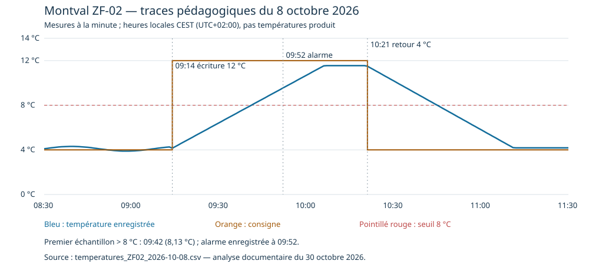
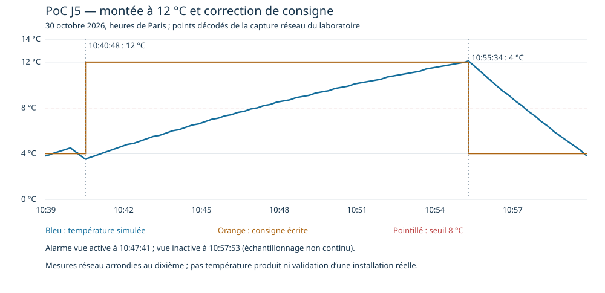

# 5.7 — Atelier 7 | Finaliser le compte-rendu d’investigation et de remédiation

**Document unique : J5-investigation-remediation-OT**

**Auteur : Olivier HIMBLOT — AIS — 30 octobre 2026.** Travail préparé pour la restitution en binôme et le bilan collectif ; aucun avis du formateur ni accord d’exploitation n’est supposé obtenu.

**Objectif :** documenter l’investigation, les décisions techniques et la validation des corrections.

**Compétence C5 — Analyser un incident OT et valider les mesures correctives.** Preuve de travail : compte-rendu d’investigation et de remédiation OT.

**Critères :** Reconstitue les événements. Distingue faits et hypothèses. Propose et teste des corrections adaptées aux contraintes d’exploitation.

**Preuve de travail : J5 — Compte-rendu d’investigation et de remédiation OT.**

[PDF pour la formatrice](../../assets/files/informatique-industrielle/it-4/J5-investigation-remediation-OT-Olivier-HIMBLOT.pdf) · [Télécharger le livrable complet — Markdown, PDF et annexes](../../assets/files/informatique-industrielle/it-4/J5-investigation-remediation-OT.zip) · [Inventaire des annexes et SHA-256](../../assets/files/informatique-industrielle/it-4/J5-investigation-remediation-OT-inventaire.json).

La convention fournie est **[Nom]-[Prénom]-[Site]-Iteration3-Atelier7**. Le site n’est pas renseigné ; il reste à compléter avant remise selon la convention. Dans le mémo, **J5 est classé en itération 4**. Le nom du dossier demandé est conservé sans inventer de site ni modifier la convention de la consigne.

## Portée et synthèse

| Ensemble | Statut et périmètre |
| --- | --- |
| Incident Montval du **8 octobre 2026** | Scénario fictif fourni : CSV, tickets, journaux VPN/SUP et PCAP synthétique partiel de 18 trames. Les conclusions portent sur ces sources, pas sur un site réel. |
| Reproduction PoC du **30 octobre** | Échanges TCP et filtrage réellement exécutés sur la VM Debian 192.168.122.105 ; processus, capteurs et commandes simulés. Un seul modèle représente ZF-02 simplifiée. |
| Correction **C01** | Table nftables supplémentaire appliquée dans ais45-fw, collecte NFLOG prouvée, tests positifs/négatifs et export après correction reçus. |
| Réserves | Auteur humain, intention, état réel des produits et autorisation de remise en service non établis. Contrôle local continu après C01, cycle complet et retour arrière non attestés. |

**Conclusion technique :** une écriture de 12 °C depuis MAINT-01 à 09:14 est confirmée dans les sources du scénario, sans justification fournie pour cette fenêtre. Le PoC reproduit l’acceptation de 12 °C, la hausse jusqu’à 12,1 °C et l’alarme, puis la correction à 4 °C et une baisse à 3,8 °C. C01 apporte une journalisation effective du chemin IT direct interdit, avec maintien des flux utiles testés. **Elle ne supprime pas la capacité d’écriture d’une origine GW autorisée et ne corrige pas le logiciel de REG-02.**

## 1 — Description de l’incident

ZF-02 est la réserve « produits laitiers » de Montval, normalement régulée à **4 °C par REG-02**. Chaque zone possède un contrôle local ; SUP-01 collecte les mesures/états et OPS-01 permet la conduite. FrigoMaint intervient en maintenance, notamment à distance via MAINT-01. REG-02 est en fin de support, sans correctif disponible et sans remplacement financé cette année.

Les sources rapportent une consigne passée à **12 °C à 09:14**, une hausse de température, une alarme à **09:52** et sa prise en compte à **10:04**. Le retour à 4 °C est autorisé dans INC-881 à **10:18**, réalisé à **10:21** selon ticket, PCAP et SUP, puis suivi d’une baisse et d’un effacement d’alarme à **10:46**.

| Conséquence | Observation / portée |
| --- | --- |
| Paramètre de contrôle modifié | FC06 PDU 0 = 120 acceptée ; nominal 40 = 4 °C. |
| Commande et température | Export d’enceinte : hausse, commande du compresseur à 0 pendant la phase haute, puis commande à 1 lors du retour à 4 °C. Une commande n’est pas un retour mécanique. |
| Température haute | Premier maximum enregistré **11,55 °C à 10:07** dans l’export fictif. Pas température à cœur des produits. |
| Alarmes et intervention | Alarme, acquittement, appel et action corrective documentés ; acquitter ne corrige pas la température ni la consigne. |
| Marchandises / exploitation | Évaluation des lots évoquée ; aucune décision de conformité, destruction ou remise en vente n’est fournie. |

Le manuel prévoit **> 8 °C pendant 10 minutes** pour l’alarme du scénario. Le PoC pédagogique utilise **10 secondes**. Les deux temporisations ne sont pas interchangeables.

## 2 — Sources, horloges et chronologie

### Fiabilité des pièces

[Dossier original fourni](../../assets/files/informatique-industrielle/it-4/Montval-J5-Incident_dossier.zip) · [Inventaire et empreintes de réception](../../assets/files/informatique-industrielle/it-4/Montval-J5-inventaire-sources.json)

| Source | Ce qu’elle apporte | Réserve |
| --- | --- | --- |
| Mission et inventaire des horloges | Périmètre ZF-02/REG-02, limites de la trace et adresses. | Scénario pédagogique, pas mission sur installation réelle. |
| Mesures SUP | 181 mesures par minute de 08:30 à 11:30. | Qualité OK déclarée, pas étalonnage indépendant ; pas de données hors fenêtre ni de température produit. |
| Événements SUP | Changements, alarme, acquittement et suivi. | Origine technique, pas identité humaine authentifiée. |
| Tickets FrigoMaint | Autorisation FM-426 08:30–09:00, déclarations et correction INC-881. | Déclarations et pièces éventuellement incomplètes ; portée de la réécriture d’essai à 08:46 à confirmer. |
| VPN | Sessions vers MAINT-01 et compte utilisé. | Horloge en avance de **2 min 10 s** ; compte partagé pour les deux premières sessions. |
| PCAP synthétique | 18 trames, FC03/FC06 et réponses du REG. | Partiel ; quantités FC03 incohérentes. Aucune absence de trafic global déduite. |

**Référence temporelle :** heures locales CEST **UTC+02:00 le 8 octobre**. Soustraire 00:02:10 au VPN ; conserver brut et corrigé. Les paquets PCAP sont datés en UTC. Les essais du 30 octobre sont en **UTC+01:00, heure de Paris**. Les fichiers de fin et les captures d’écran ne datent pas automatiquement toutes les commandes qu’ils contiennent.

Les sessions VPN corrigées sont **08:39–08:52**, **09:12–09:19** et **10:19–10:26**. La session du milieu couvre l’écriture de 09:14 ; cela ne prouve pas l’identité de la personne ou du processus à l’origine de la commande.

### Chronologie de l’incident fictif

| Heure locale du 8 octobre | Événement | Source | Statut / limite |
| --- | --- | --- | --- |
| 08:22 | FM-426 ouvert ; lecture paramètres autorisée 08:30–09:00 | maintenance ligne 2 | Autorisation consignée |
| 08:39–08:52 | Session maint-shared ; source 198.51.100.44 | VPN lignes 2–3 corrigées ; maintenance lignes 3–5 | Session enregistrée ; identité humaine déclarée dans ticket |
| 08:46:00 | FC06 PDU 0 = 40, réponse normale ; réécriture à 4 °C | PCAP 3/4 ; maintenance ligne 4 ; SUP ligne 3 | Échange établi dans la trace ; portée exacte de l’autorisation à confirmer |
| 09:11:00 | Réponse FC03 contenant 40 (4 °C) | PCAP 7/8 | Valeur encodée ; incohérence quantité FC03 |
| 09:12–09:19 | Session maint-shared ; source 203.30.113.77, ticket non fourni | VPN lignes 4–5 corrigées | Session enregistrée ; auteur et autorisation non établis |
| 09:14:00 | MAINT-01 écrit PDU 0 = 120 ; réponse identique +30 ms | PCAP 9/10 ; SUP ligne 4 ; mesures ligne 46 | Modification confirmée par sources du scénario |
| 09:15:00 | Réponse de lecture SUP contenant 120 | PCAP 11/12 | Corroboration de valeur ; incohérence quantité FC03 |
| 09:42 | Premier échantillon > 8 °C : 8,13 °C | Mesures ligne 74 | Premier échantillon disponible ; instant exact de franchissement inconnu |
| 09:45 | 8,55 °C et régulation locale déclarée active | SUP ligne 5 ; mesures ligne 77 | Valeur et événement enregistrés |
| 09:50 | INC-881 ouvert pour anomalie de température | Maintenance ligne 6 | Signalement consigné |
| 09:52 | Alarme haute active ; mesure 9,55 °C | SUP ligne 6 ; mesures ligne 84 | Déclenchement enregistré, cohérent avec 10 minutes depuis premier échantillon haut |
| 10:04 | Acquittement OPS-01 et sollicitation IT | SUP ligne 7 ; mission | Prise en compte, pas correction de consigne |
| 10:07 | Premier maximum enregistré : 11,55 °C | Mesures ligne 99 | Mesure d’enceinte ; pas température produit |
| 10:11 | FrigoMaint ne déclare pas de changement à 12 °C | Maintenance ligne 7 | Déclaration à confronter aux traces |
| 10:18 | Retour à 4 °C autorisé, contrôle sur place requis | Maintenance ligne 8 | Autorisation consignée |
| 10:19–10:26 | Session maint-oncall ; source 198.51.100.51 | VPN lignes 6–7 corrigées | Session enregistrée, correspondance INC-881 |
| 10:21:00 | MAINT-01 écrit 40 ; réponse normale +30 ms ; commande compresseur = 1 | PCAP 15/16 ; SUP ligne 8 ; maintenance ligne 9 ; mesures ligne 113 | Retour à 4 °C confirmé dans sources ; contrôle terrain à vérifier |
| 10:22:00 | Réponse de lecture SUP contenant 40 | PCAP 17/18 | Valeur encodée ; incohérence quantité FC03 |
| 10:45 | Mesure 8,00 °C ; alarme encore active dans export | Mesures ligne 137 | Observation ; règle de disparition non détaillée |
| 10:46 | Alarme effacée ; mesure 7,85 °C | SUP ligne 9 ; mesures ligne 138 | Fin d’alarme enregistrée ; pas décision de conformité des produits |
| 11:15 | Mesures en baisse et consigne à 4 °C | SUP ligne 10 | Suivi enregistré |
| 11:30 | Dernière mesure disponible : 4,18 °C | Mesures ligne 182 | Fin de l’export, pas fin de toute investigation |

[VPN brut et normalisé](../../assets/files/informatique-industrielle/it-4/Montval-5.2-vpn-normalise.csv) · [Chronologie CSV](../../assets/files/informatique-industrielle/it-4/Montval-5.2-chronologie.csv) · [Décodage des 18 trames](../../assets/files/informatique-industrielle/it-4/Montval-5.2-modbus-decode.csv)

### Étendue thermique documentable



Le critère **> 8 °C** donne **63 échantillons**, de 09:42 (8,13 °C) à 10:44 (8,14 °C). Les extrémités sont séparées de **62 minutes**, pas une durée exacte de 63 minutes d’exposition. À 09:41 la mesure est 7,98 °C, à 10:45 elle est 8,00 °C. Les franchissements entre relevés ne sont pas résolus. La consigne à 12 °C de 09:14 à 10:21 représente **67 minutes entre événements**, encore un indicateur différent.

[Calcul des échantillons et limites](../../assets/files/informatique-industrielle/it-4/Montval-5.6-periode-haute-scenario.json)

## 3 — Analyse technique et diagnostic provisoire

### Échanges déterminants de l’incident

| Trames / heure locale | Opération | Conclusion et réserve |
| --- | --- | --- |
| **3/4 à 08:46** | MAINT-01:41001 → REG-02:502 ; FC06 PDU 0 = 40 ; réponse normale, transaction 2/unité1. | Réécriture à 4 °C ; cohérente avec la note FM-426, mais portée exacte de l’autorisation de lecture à confirmer. |
| **9/10 à 09:14** | MAINT-01 **10.30.20.15:41002 → REG-02 10.30.10.22:502**, FC06 PDU 0 = **120** ; réponse normale à +30 ms, transaction 5/unité1. | Modification technique confirmée à **12 °C**, corroborée par SUP et mesures. |
| **15/16 à 10:21** | Même origine technique, port 41004 ; FC06 PDU 0 = **40**, réponse normale à +30 ms, transaction 9. | Correction à 4 °C corroborée par ticket et export. |

Les six requêtes FC03 demandent **40 ou 120 registres**, mais les réponses ne contiennent qu’**un registre**. Les valeurs encodées correspondent aux consignes attendues, mais les transactions de lecture ne sont pas conformes en quantité : cette anomalie du jeu synthétique est conservée et signalée. Elle n’affecte pas la correspondance adresse/valeur des trois FC06 analysées.

**Établi dans les sources :** modification, origine réseau MAINT-01, réponse du REG, hausse et alarme, correction documentée. **Autorisation non retrouvée :** la modification à 09:14 est hors FM-426 connu et n’est pas déclarée par le magasin ou le prestataire. **Non établi :** auteur humain, intention, processus sur MAINT-01, absence exhaustive d’une autre autorisation, compromission ou exploitation d’une CVE.

Erreurs d’outil/saisie, usage non autorisé d’un accès légitime, automatisation, autorisation non transmise et compromission restent des hypothèses à départager. Une IP publique, un compte partagé ou une session proche ne suffisent pas à attribuer la commande.

### Chemins et protections

La capture documente SUP-01 et MAINT-01 communiquant directement avec REG-02. La cible J4 prévoit pour REG-02 une source aval GW-02 obligatoire et des rôles distincts de collecte/maintenance. **La topologie réellement déployée le 8 octobre n’est pas fournie** : aucune conclusion de contournement d’un bastion ou de GW-02 déjà installé n’est étayée.

Sur le **PoC réellement testé**, IT direct est bloqué et le proxy 15021 refuse les écritures. Toutefois, un autre client lancé dans GW peut écrire directement vers OT 15020. C’est une limite prouvée du montage : l’autorisation d’une IP source n’assure pas l’identité ni la légitimité des opérations de tous ses processus.

## 4 — Décisions d’intervention et contraintes OT

| Action / décision | Statut | Justification et coordination |
| --- | --- | --- |
| Vérifier le froid, les lots et les autres zones | Proposé pour Montval, pas contrôle terrain réalisé par l’AIS. | Exploitation et FrigoMaint vérifient mesure indépendante, porte, sonde, groupe, alimentation et alarmes ; exploitation décide des denrées. |
| Préserver sources, horloges, états et autorisations | Archives/empreintes des pièces reçues réalisées ; compléments poste/REG à obtenir. | Collecter dans le périmètre autorisé et en parallèle de l’urgence, sans retarder une mesure nécessaire de protection. |
| Restreindre le chemin de maintenance suspect | Proposition coordonnée, aucune suspension de VPN de production exécutée. | Identifier sessions, droits et moyens alternatifs ; une suspension n’arrête pas forcément les sessions existantes. Conserver l’intervention utile. |
| Corriger la consigne | Historique : autorisé à 10:18 et documenté à 10:21 ; PoC : exécuté à 10:55:34. | Lire avant, tracer l’autorisation et après, observer le froid ; ne pas réécrire une consigne déjà correcte pour la seule analyse. |
| Redémarrer REG-02 ou couper toute communication | Non retenu par défaut ; pas réalisé sur équipement réel. | Risque pour commande locale et preuves ; notice, état et plan de reprise nécessaires avec exploitation/maintenance. |
| Journaliser un refus dans le pare-feu du TP | **C01 appliquée** dans ais45-fw. | Ajouter une table dédiée, sans modifier le modèle ni fermer collecte et chemin d’intervention pédagogique ; tests de non-régression ci-dessous. |

Le manuel EXP-01 attend la continuité locale si régulateur, capteurs, groupe et alimentation fonctionnent. La perte de SUP n’arrête donc pas nécessairement le froid mais peut supprimer la visibilité. EXP-04/08/11, MAI-01/02/05/08 et ORG-01/02 imposent vérifications et coordination. Les interventions urgentes restent possibles selon les procédures, pas par réouverture générale d’un compte partagé.

**Validation collective ou autorisation réelle non reçue :** les propositions d’intervention ne sont pas des décisions déjà acceptées par l’exploitation, le prestataire ou le formateur.

## 5 — Mesures correctives proposées et appliquées

### C01 effectivement appliquée : journalisation du refus IT direct

Dans **ais45-fw**, ajout de **inet ais55_trace**, hook forward à priorité **−5**. La table J4 **inet ais45**, priorité 0 et policy DROP, reste présente. Le chemin IT 10.77.10.2 → OT 10.77.30.2:15020 est compté intégralement, journalisé en **NFLOG groupe 55**, au rythme limité de **2/s, burst 5**, puis rejeté par un drop distinct et inconditionnel.

La limite de logs ne limite pas le refus. Les autres flux continuent dans la politique J4 ; l’accept de la première chaîne ne contourne pas les refus de la seconde. Le collecteur NFLOG doit être actif pour enregistrer les messages ; aucune collecte durable ou rétention industrielle n’est démontrée.

**Configuration appliquée reçue :**

[Source C01](../../assets/files/informatique-industrielle/it-4/Montval-5.5-journalisation.nft) · [Export réel complet après C01](../../assets/files/informatique-industrielle/it-4/Montval-5.5-regles-apres-c01.nft) · [Inventaire des preuves C01](../../assets/files/informatique-industrielle/it-4/Montval-5.5-inventaire-preuves.json)

La source fournie par l’utilisateur est identique à celle préparée. L’export réel contient les deux tables et le compteur C01 à **3 paquets/180 octets**. Le compteur direct J4 reste à 18 : les paquets C01 sont désormais rejetés plus tôt et ne doivent pas forcément incrémenter l’ancien compteur. Le vérificateur J4 peut donc échouer à son ancien contrôle de delta ; la recette C01 utilise le nouveau compteur.

L’export C01 n’a pas de date interne. Les anciens `fin.txt`, `etat-final.txt` et `regles-apres.nft` à 10:26 restent des pièces antérieures, conservées séparément ; aucune heure exacte n’est reconstruite artificiellement.

### Protections restant proposées

| Mesure | But et conditions | État / limite |
| --- | --- | --- |
| Séparation collecte et maintenance | Origines/environnements distincts, source aval obligatoire et contrôle applicatif qualifié des opérations. | Non déployée ; C01 ne ferme pas les écritures GW. Bloquer GW entier couperait aussi la collecte actuelle. |
| Accès maintenance nominatif/temporaire | Autorisations, cibles, fonctions, durée, urgence et fermeture des sessions ; journal d’intervention. | Non déployé dans le PoC ; aucun bastion ou MFA de production qualifié. |
| Contrôle des valeurs et détection | Plages autorisées selon notice/intervention ; rapprochement avec autorisations et alertes sur changements. | Le registre 80 du PoC est indicatif ; aucun seuil métier universel inventé, aucun nouveau détecteur Suricata testé. |
| Sauvegarde/restauration et surveillance durable | Collecte fiable, droits, rétention, panne du collecteur et reprise qualifiée. | Possibilités réelles du REG à confirmer ; retour arrière C01 non exécuté dans les preuves. |
| Remplacement REG-02 | Matériel maintenu, qualification terrain/protocoles, planification et retour arrière. | Toujours nécessaire à terme ; aucun correctif interne ni budget de remplacement confirmé cette année. |

## 6 — Reproduction et tests de validation

### Reproduction réelle sur le PoC, processus simulé

La VM 192.168.122.105 héberge quatre namespaces : IT 10.77.10.2, FW 10.77.10/20/30.1, GW 10.77.20.2 et OT 10.77.30.2. Le modèle/serveur écoute sur 15020, le proxy lecteur sur 15021, le dashboard sur 18080 et consulte par le proxy. L’écriture pédagogique est réalisée par un client dans GW vers OT direct ; aucun poste dédié de maintenance ou bastion n’est déployé.



| Fenêtre du 30 octobre, heure de Paris | Preuve et résultat |
| --- | --- |
| Premier essai 10:14–10:20 | Recréation, API 200 ; passage 12 °C en CLI ; IT direct refusé compteur 3 → 6 ; proxy refuse 6 et conserve 12 ; retour consigne 4 visible avec 6,2 °C. Erreurs de droits empêchant certains exports. |
| PCAP long 10:39:16–11:00:08 | **2630 trames, 263 transactions**, lectures conformes en quantité et deux FC06. |
| **10:40:48**, trames **274/276** | FC06 PDU 0 = 120 acceptée ; réponse à 367 µs ; relecture 286 = 12 °C. |
| **10:47:41**, trame **1136** | Température 8,2 °C, compresseur 0, alarme 1. La temporisation exacte n’est pas mesurée par les relevés espacés. |
| **10:55:27**, trame **2066** | Température mesurée simulée 12,0 °C, compresseur 0, alarme 1. |
| **10:55:34**, trames **2084/2086** | FC06 PDU 0 = 40 acceptée, réponse à 210 µs ; relecture 2096 = 4 °C. |
| **10:55:35**, trame **2106** | Maximum 12,1 °C, compresseur 1, alarme 1 : la conséquence thermique persiste après changement du paramètre. |
| **10:57:53**, trame **2346** | Température 7,7 °C, compresseur 1, alarme 0. |
| **11:00:08**, trame **2616** | Température 3,8 °C, consigne 4 dans la relecture associée ; compresseur 1 compatible avec hystérésis ; pas de défaut. |

[PCAP long](../../assets/files/informatique-industrielle/it-4/Montval-5.4-reproduction-complete.pcap) · [Décodage du PoC](../../assets/files/informatique-industrielle/it-4/Montval-5.4-reproduction-complete-decode.csv) · [Analyse, heures et empreinte](../../assets/files/informatique-industrielle/it-4/Montval-5.4-reproduction-complete-analyse.json)

Ces essais ne reconstituent ni la session VPN ni une intrusion ; ils démontrent des effets du paramètre et du modèle. Les preuves du premier essai et du PCAP long sont séparées. Une capture intermédiaire de 130 trames ne montrait qu’une réécriture 4 → 4, et une première capture était vide : elles restent archivées sans être promues en preuves de toute la séquence.

### Validation après C01

| Test | Attendu | Observé / preuve |
| --- | --- | --- |
| V01 — IT direct | Timeout, OT disponible, compteur ais55_trace en hausse et trace NFLOG | Confirmé : timeout, OT disponible, compteur 0 → 3 et PCAP NFLOG trois SYN. |
| V02 — Consultation proxy | Lecture autorisée | Confirmé en capture 12:35:18 : lecture IT → proxy réussie. |
| V03 — Écriture proxy | Exception 01, consigne 4 inchangée | Confirmé : exception 01 et consigne 4 °C inchangée. |
| V04 — API supervision | HTTP 200 et données fraîches | Confirmé en capture 12:35:28 : HTTP 200, consigne 4 °C et mesures. |
| V05 — Contrôle local | Observations répétées cohérentes, sans défaut induit | Partiel : états locaux exposés disponibles, aucun défaut visible ; suivi continu et cycle complet non fournis. |
| V06 — Intervention pédagogique | Réécriture 4 °C depuis GW acceptée et relue | Confirmé : réécriture nominale 4 °C depuis GW acceptée puis relue. |
| V07 — État final | Paramètres nominaux et exports des deux tables | Configuration et paramètres attestés : nouvel export ais45 + ais55_trace, compteur C01 3/180 ; états nominaux visibles. Retour arrière non exécuté. |

**NFLOG récupéré en lecture seule sur la VM :** trois SYN **10.77.10.2:55196 → 10.77.30.2:15020** aux heures **12:33:22,183218**, **12:33:23,191399**, **12:33:24,215799**. Même séquence TCP ; répétitions d’une tentative, pas trois utilisateurs. Fichier 624 octets, liaison NFLOG 239, trois paquets ; relecture concordante avec la capture.

[PCAP NFLOG brut](../../assets/files/informatique-industrielle/it-4/Montval-5.5-nflog.pcap) · [Décodage NFLOG](../../assets/files/informatique-industrielle/it-4/Montval-5.5-nflog-decode.txt) · [Matrice de validation C01](../../assets/files/informatique-industrielle/it-4/Montval-5.5-plan-validation.csv) · [Liste de contrôle labo / Montval](../../assets/files/informatique-industrielle/it-4/Montval-5.6-liste-controle.csv)

**Bilan :** application et effet de traçabilité C01 établis ; lectures, refus proxy, API et réécriture nominale maintenus aux instants testés. Le contrôle local complet après C01 reste partiel, et le retrait de la table n’a pas été testé dans les preuves reçues. Cette recette n’est pas une déclaration de sécurité exhaustive.

## 7 — Limites, suites et remise en service

- **Attribution :** système émetteur observé mais auteur humain, intention et état de MAINT-01 non établis. Rechercher autorisations manquantes et traces poste/authentification.
- **Dossier synthétique :** trafic partiel et incohérence des quantités FC03 ; mesures de l’enceinte, pas produits ; pas d’historique hors 08:30–11:30.
- **PoC :** un processus simplifié sans lots, inertie réelle ni mécanique détaillée ; temporisation d’alarme 10s contre10min du manuel ; bit de commande sans preuve mécanique.
- **Contrôle local :** retour thermique démontré avant C01, puis états ponctuels après C01 ; cycle complet, continuité prolongée, panne/reprise de la passerelle et persistance de C01 non validés.
- **Protection résiduelle :** GW autorisé peut encore écrire ; séparation de rôles, autorisations et contrôles externes à qualifier. Aucun défaut interne du régulateur corrigé.
- **Traçabilité :** NFLOG observé, mais pérennité/rétention et comportement sous charge non démontrés. Export de configuration non horodaté intérieurement et erreurs initiales de sauvegarde explicites.
- **Exploitation :** contrôles terrain, produits et décision de reprise nécessitent responsable d’exploitation/FrigoMaint et acteurs qualité selon procédure. Aucun avis ou signature supposé ; retour à 4 °C ne libère pas les lots.
- **REG-02 :** remplacement à préparer malgré les mesures compensatoires, avec compatibilité et reprise qualifiées ; maintien en service imposé n’établit pas l’acceptabilité du risque résiduel.

**Transmission AIS :** état des services et paramètres, chronologie normalisée, seuil et fenêtre d’observation, maximum et incertitudes, actions réellement exécutées, configurations et résultats, accès encore possibles, réserves et besoins terrain. **Clôture proposée : volet technique du laboratoire documenté avec réserves ; aucune clôture opérationnelle de Montval prononcée.**

## Restitution courte proposée

« Les traces du scénario confirment une consigne portée à 12 °C à 09:14 depuis MAINT-01, sans autorisation fournie pour cette fenêtre. La température augmente, une alarme apparaît, puis un retour autorisé à 4 °C est enregistré à 10:21. L’auteur humain et l’intention restent inconnus. Nous avons reproduit les effets sur le PoC, jusqu’à 12,1 °C, puis observé le refroidissement à 3,8 °C après correction. C01 journalise effectivement le chemin IT direct interdit ; les lectures, le refus du proxy et l’API restent disponibles lors des tests. Cette mesure ne retire pas la capacité d’écriture de GW. La séparation des accès, les contrôles terrain, le suivi et le remplacement de REG-02 restent à traiter ; aucune décision sur les produits ne découle du laboratoire. »

## Bilan du module : compétences réutilisables

L’administration IT reste utile pour inventaire, adressage/routage, nftables, SSH, journaux, horodatage, empreintes, capture et analyse Modbus. Le contexte OT exige en plus d’identifier les dépendances physiques, de coordonner changements et reprises avec les responsables du processus et de maintenir contrôle et visibilité. Un reboot, un blocage global ou une restauration ne sont pas présumés anodins.

Compétences exercées : cartographier les flux, distinguer lecture/écriture, tester un chemin réel et ses refus, normaliser les horloges, corréler sans surattribuer, conserver les preuves, séparer restauration de paramètre et récupération thermique, définir des critères de recette et expliciter les limites. **Le bilan collectif n’est pas déclaré déjà tenu.**

## Annexe A — Export réel après C01

Le fichier ci-dessous est l’export reçu, conservé tel quel, distinct de la source proposée et des exports antérieurs. Il ne porte pas de date interne.

```nft
table inet ais45 { # handle 4
	counter it_direct_drop { # handle 2
		packets 18 bytes 1080
	}

	counter it_gateway_accept { # handle 3
		packets 2154 bytes 119521
	}

	counter gateway_ot_accept { # handle 4
		packets 2412 bytes 133464
	}

	counter replies_accept { # handle 5
		packets 3050 bytes 175933
	}

	counter other_drop { # handle 6
		packets 0 bytes 0
	}

	chain forward { # handle 1
		type filter hook forward priority filter; policy drop;
		ct state invalid counter packets 0 bytes 0 drop comment "Paquets invalides" # handle 7
		meta nfproto ipv6 counter name "other_drop" drop comment "TP IPv4 seulement" # handle 8
		iifname "fw-it" oifname "fw-ot" counter name "it_direct_drop" drop comment "Direct IT vers OT interdit, tous états" # handle 9
		iifname "fw-ot" oifname "fw-it" counter name "it_direct_drop" drop comment "Aucun retour direct OT vers IT" # handle 10
		iifname "fw-it" oifname "fw-dmz" ip saddr 10.77.10.2 ip daddr 10.77.20.2 tcp dport { 15021, 18080 } ct state { established, new } counter name "it_gateway_accept" accept comment "Consultation Modbus via GW et HTTP du TP" # handle 13
		iifname "fw-dmz" oifname "fw-it" ip saddr 10.77.20.2 ip daddr 10.77.10.2 tcp sport { 15021, 18080 } ct state established counter name "replies_accept" accept comment "Réponses GW vers IT seulement" # handle 15
		iifname "fw-dmz" oifname "fw-ot" ip saddr 10.77.20.2 ip daddr 10.77.30.2 tcp dport 15020 ct state { established, new } counter name "gateway_ot_accept" accept comment "Passerelle seule vers serveur OT" # handle 17
		iifname "fw-ot" oifname "fw-dmz" ip saddr 10.77.30.2 ip daddr 10.77.20.2 tcp sport 15020 ct state established counter name "replies_accept" accept comment "Réponses serveur vers GW" # handle 18
		ct state related icmp type { destination-unreachable, time-exceeded, parameter-problem } counter packets 0 bytes 0 accept comment "Erreurs liées aux connexions suivies" # handle 20
		counter name "other_drop" drop comment "Autres communications interzones refusées" # handle 21
	}
}
table inet ais55_trace { # handle 11
	counter it_ot_refus { # handle 2
		packets 3 bytes 180
	}

	chain forward_trace { # handle 1
		type filter hook forward priority filter - 5; policy accept;
		iifname "fw-it" oifname "fw-ot" ip saddr 10.77.10.2 ip daddr 10.77.30.2 tcp dport 15020 counter name "it_ot_refus" # handle 3
		iifname "fw-it" oifname "fw-ot" ip saddr 10.77.10.2 ip daddr 10.77.30.2 tcp dport 15020 limit rate 2/second burst 5 packets log prefix "AIS55_IT_OT " group 55 snaplen 128 queue-threshold 1 # handle 4
		iifname "fw-it" oifname "fw-ot" ip saddr 10.77.10.2 ip daddr 10.77.30.2 tcp dport 15020 drop # handle 5
	}
}
```

## Annexe B — Captures représentatives du laboratoire

### Écriture pédagogique et réponse, trames 274/276


### Maximum thermique encore présent après correction, trame 2106


### Retour thermique près de la consigne, trame 2616


### C01 : refus direct et compteur 0 → 3


### NFLOG : trois SYN enregistrés


### Non-régression : lecture, refus du proxy et réécriture nominale


### Non-régression : API HTTP 200


Les vues Wireshark ont été réalisées vers 11:05–11:06, sur des paquets de 10:39–11:00 ; les captures de C01 sont de 12:33–12:35. Les heures d’écran, de paquet et d’export ne sont pas fusionnées. Les huit images sont sélectionnées dans les fiches détaillées 5.4/5.5 ; l’ensemble des captures commentées reste disponible dans le mémo.

## Annexe C — Provenance, intégrité et ressources

- Manuel MAN-OT-01 (fichier joint), consignes des ateliers 5.1–5.7 et dossier fictif fourni ; les exigences sont une référence pédagogique, pas une notice constructeur physique.
- Les empreintes des sources reçues sont dans l’inventaire J5 ; les analyses dérivées et le manifeste du livrable sont joints. Une empreinte assure une référence de contenu, pas l’authenticité de faits antérieurs.
- Les scripts `analyser_traces_j5.py` et `analyser_capture_poc_54.py` sont joints comme sources pour reproduire les analyses hors ligne **dans l’arborescence du dépôt d’origine**, avec ses dépendances et chemins ; ils n’effectuent aucune connexion au modèle. Ils ne sont pas des exécutables autonomes du ZIP.
- Les temps de chaque essai et les réserves sont conservés. Les signatures de validation, autorisations opérationnelles et informations manquantes ne sont pas remplacées par des suppositions.

**État du livrable :** compte-rendu technique prêt pour restitution, avec ses preuves et réserves. **Validation C5 :** à apprécier par le formateur ; aucune validation n’est auto-attribuée.
