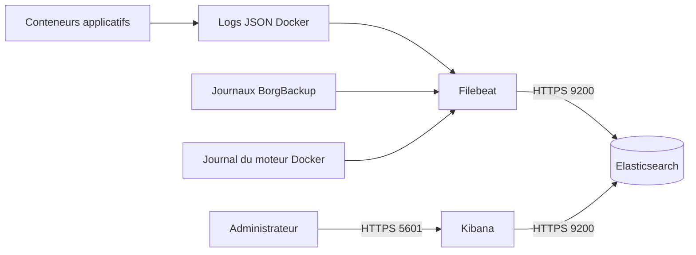

# Architecture de centralisation des journaux

> **Copie de livrable — import du 28 octobre 2026.** Source : `Modules/on-premise/documentation/logging-architecture.md`. Les résultats ci-dessous sont ceux rapportés dans le document à sa date, sans réexécution ni nouvelle validation. Des lignes sensibles potentielles ont été retirées ; consulter l’original local pour travailler.

## Périmètre

Cette conception appartient à l'itération 7 optionnelle et sert maintenant de
référence au déploiement Filebeat, Elasticsearch et Kibana du dossier
`monitoring-compose/`. `step-ca`, prévu à l'itération 6, reste inclus comme
source de journaux à raccorder complètement.

## Schéma

## Choix retenus

| Élément | Emplacement | Justification |
|---|---|---|
| Filebeat | Conteneur sur l'hôte Docker | Collecte locale des logs Docker, Borg et du système avec une position de lecture persistante. |
| Elasticsearch | Nœud unique de TP dans `monitoring-compose` | Indexation centralisée dans un volume `elasticsearch_data`, sans port public. |
| Kibana | Même pile, sur le réseau `monitoring` | Consultation et tableaux de bord ; seul le port Web est publié localement. |
| Réseau | Réseau Docker dédié `monitoring` | Isolation des flux de collecte et limitation de l'exposition d'Elasticsearch. |

En production, Elasticsearch et Kibana seraient placés sur un hôte distinct.
Le nœud unique du TP est un point de défaillance accepté pour limiter les
ressources consommées.

## Flux et index

| Source | Méthode | Index cible |
|---|---|---|
| OpenLDAP, Samba, step-ca | logs des conteneurs en lecture seule | `logs-auth-*` |
| Postfix, Dovecot, Roundcube | logs SMTP, IMAP et HTTP | `logs-mail-*` |
| Autres conteneurs | fichiers JSON Docker | `logs-docker-*` |
| BorgBackup | `backup/logs/*.log`, `last-run.status` | `logs-backup-*` |
| Moteur Docker | entrée Filebeat `journald` | `logs-system-*` |

Filebeat envoie les événements par lots à Elasticsearch sur le port `9200`.
Kibana interroge Elasticsearch sur le réseau interne. Dans la version validée
du TP, le socket Docker est monté en lecture seule afin d'enrichir les
événements avec `add_docker_metadata`. Cet accès reste très privilégié et doit
être remplacé ou fortement encadré avant production.

## Conservation

| Journaux | Conservation |
|---|---:|
| Débogage détaillé | 7 jours |
| Applications et conteneurs | 30 jours |
| Authentification, Samba et certificats | 90 jours |
| Sauvegardes, restaurations et PRA | 180 jours |

Les politiques ILM suppriment automatiquement les index à l'échéance. Une
alerte de capacité est prévue à 80 %, puis une alerte critique à 90 %.

## Sécurité

- TLS fourni ultérieurement par `step-ca` entre Filebeat, Elasticsearch et
  Kibana ;
- compte Filebeat limité à l'écriture des index attendus ;
- journaux et volumes montés en lecture seule dans l'agent ;
[LIGNE RETIRÉE : identifiant, secret ou référence sensible potentielle]
[LIGNE RETIRÉE : identifiant, secret ou référence sensible potentielle]
  dans Elasticsearch.

## Décision

L'architecture est adaptée au TP et a été mise en œuvre localement. Elle
centralise les preuves de fonctionnement tout en séparant la collecte, le
stockage et la consultation. Les alertes externes, TLS Elastic et les comptes
applicatifs limités restent à ajouter avant exposition réseau.
