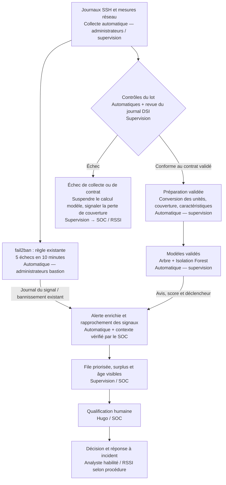

# Carnet J4 — Critiquer : ce que vaut votre modèle

**Olivier HIMBLOT — Données fictives Hexalp**

## Séquence 4.1 — 99 %

**22 octobre 2026 — Reconstitution après exploration, pas hypothèses initiales à l’aveugle.** Le notebook02 et ses sorties ont déjà été explorés pendant la panne Moodle le21 octobre. Le récit du lundi12 octobre est fictif ; ne pas le confondre avec la date de travail.

| Hypothèse | Vérification prévue | Conclusion au stade actuel |
| --- | --- | --- |
| H1 — Score mesuré sur octobre réentraîné, pas sur le futur du modèle de septembre ; accuracy masque certaines erreurs | Lire fit, découpage et étiquettes ; comparer rappel/FN et baseline toujours normal | Mécanisme confirmé dans la section3 du notebook02 ; sortie rapportée0,997 après correction. Ce n’est pas la généralisation septembre→octobre |
| H2 — Changement d’unité ou mauvaise préparation des volumes | Comparer Mo/Ko, manques et conversion ; contrôler précisément la ligne du9/10 à3h | Colonne Ko et changement de mesure observés. Premier essai avec1 024Mo fixes erroné ; conversion Ko/1024 corrigée,14 volumes réellement absents. Causalité pour les8,5Go non encore prouvée |
| H3 — Nouveaux comportements/profils mal couverts | Examiner nouvelles IP, règles et FN ; identifier le modèle et les caractéristiques exacts | Changements observés : nouvelles sources internes et mélange normal/attaque. Arbre J3 sans volume direct. Dernière branche interne différente du J3 : paramètres et ordre des variables à confirmer avant validation finale |

A2 du J3 : toujours normal =93,13% de justesse brute mais117 attaques manquées. Le99% n’est donc pas une preuve suffisante de détection. Le récit mentionne232 alertes dont une vingtaine lues : saturation de la file distincte d’une absence de signalement.

### Versions et limites des résultats anticipés

- Premier essai avec volume constant1 024Mo : erreur de préparation, ne pas retenir comme évaluation valide.
- Sorties corrigées rapportées :2 105 observations,211 attaques ; union259 alertes,53FP/5FN,114 puis145 par semaine. Ce ne sont pas les232 du récit.
- Dernière règle interne sur echecs_auth≤58,5 contre heure≤19,5 au J3 à42 : vérifier GRAINE, CARACTERISTIQUES dans leur ordre, profondeur, contamination et données préparées.
- Aucune preuve d’exécution indépendante du dernier protocole, ni qualification finale de la ligne8,5Go. Aucun chargement joblib ou attaque du modèle attesté.

Fiche détaillée : docs/ia-cybersecurite/it-4/99-pour-cent.md dans le dépôt. Les missions suivantes seront ajoutées à réception des consignes ; carnet commencé, rapport final non rédigé.

## Séquence 4.2 — Relancer et réparer

22 octobre 2026 — Consigne lue dans le PDF fourni. Missions renseignées à partir du journal DSI, des fichiers et des sorties de l’apprenant ; pas de nouvelle exécution des modèles par l’assistant.

## Mission 1 — Relancer et examiner le « 99 % »

### Essai de relance simple : préserver le script J3

Le PDF demande de changer le nom du fichier dans le script. Notre version dispose d'une option qui évite de modifier l'original. Dans la VM, depuis `~/ia01-j4`, après copie du script J3 :

```bash
source ~/ia01-j3/.venv/bin/activate
python detection_ssh.py --entree hexalp_ssh_oct2026.csv --sortie alertes_relance_simple.csv
```

**Cette relance précise n'est pas attestée par une sortie fournie.** Ne pas lui attribuer les chiffres de Sofia ni ceux d'un notebook déjà réparé. La lecture du script et le comptage du CSV montrent néanmoins son problème : sans conversion Ko→Mo, il retire les **1 953 valeurs vides de l'ancienne colonne**, même quand une mesure existe en Ko, et ne conserve que **166 lignes**, dont **9 attaques**. La couverture se limite alors à la première partie de la période ; aucune performance de cette relance n'est inventée.

### Pourquoi le score de Sofia n'est-il pas la bonne évaluation ?

La section 3 du notebook **réentraîne sur une partie d'octobre avec les étiquettes de Hugo**, puis teste sur une autre partie d'octobre. La dernière sortie transmise affiche **0,997** après la correction de préparation, contre **0,991** lors de l'essai erroné à volumes fixes. Ces valeurs correspondent à des versions différentes, pas à deux performances directement comparables.

**Le lundi matin, les nouvelles étiquettes qualifiées ne sont pas nécessairement disponibles.** Le protocole de Sofia ne répond donc pas à la question « comment le modèle de septembre se comporte-t-il sur la période suivante ? ». Le programme n'a pas besoin d'utiliser la colonne `etiquette` comme caractéristique pour que l'évaluation soit inadaptée : l'entraînement sur le mois à évaluer suffit à changer la question posée.

Le **99 % et les 232 alertes** du récit restent des éléments de contexte : les retrouver exactement n'est pas un critère de réussite si notre préparation, notre contamination ou nos paramètres diffèrent. Conserver la configuration précise de chaque essai.

## Mission 2 — Au moins cinq différences entre les périodes

Les comptes ci-dessous portent sur les **CSV bruts**, sauf mention contraire. Les colonnes statistiques de volume ne sont comparables qu'après harmonisation des unités.

| Ce qui a changé | Où je l'ai vu : cellule ou chiffre | Prévu au journal ? | Effet probable sur le modèle |
| --- | --- | --- | --- |
| **Nouvelle colonne `octets_sortants_ko`** | Section 1 : septembre **1 704 × 11**, octobre **2 119 × 12** ; aucune colonne disparue | **Oui**, sonde du 29/09 à 8 h | Ignorer la nouvelle mesure supprime des observations ou leur attribue un volume erroné ; conversion obligatoire |
| **La colonne Mo devient massivement vide** | **1 953** Mo absents en octobre ; seules **166** lignes ont des Mo renseignés. Les comptes par jour montrent le relais vers les Ko le 29/09 | **Oui**, même changement de sonde | Ne pas interpréter tous ces vides comme une panne ou du trafic nul ; risque d'échec silencieux malgré un tableau numérique complet |
| **Une panne réelle affecte les deux mesures** | Après rapprochement Mo/Ko : **14 lignes sans aucun volume**, le **04/10 aux heures 14 à 18 incluses** ; aucune ligne avec les deux volumes renseignés dans le fichier reçu | **Oui**, redémarrage du 04/10 | Perte réelle de couverture ; une conversion ne récupère pas une mesure jamais collectée. Les tranches horaires ne donnent pas à elles seules les instants précis de panne |
| **Nouveau proxy Zabbix `10.20.1.7`** | Cellule des IP nouvelles : **278 observations**, toutes étiquetées normal ; des pics d'essais sur plusieurs comptes apparaissent dans les sorties | **Oui**, mise en service du 30/09 à 10 h | Profil légitime non appris ; faux positifs possibles. Le journal mentionne deux comptes, mais certaines lignes affichent quatre comptes distincts : écart à investiguer, pas à effacer par une liste blanche |
| **Nouvelles adresses VPN `10.20.250.*`** | Nouvelles IP internes, normales et attaques, dans la cellule de comparaison | **Oui**, passerelle du 01/10 et plages attribuées | Une source classée interne peut correspondre à un accès VPN compromis ; ne pas confondre origine réseau et confiance |
| **Part d'attaques plus élevée** | Septembre **117/1 704 = 6,87 %** ; octobre **215/2 119 = 10,15 %** (affichage arrondi 0,101) | **Non** dans ce journal ; campagne signalée par Hugo en 4.1 | Changement de distribution et charge potentielle ; comparer rappel, FP/FN et alertes, pas seulement accuracy |
| **Attaques internes et accès externes légitimes** | Octobre : **17 attaques internes / 1 891 normales internes**, **198 attaques externes / 13 normales externes** | VPN prévu ; intentions et attaques **non déductibles du journal** | Un raccourci « interne = normal » ou « externe = attaque » se trompe |
| **Nouveau pic journalier d'attaques étiquetées** | Graphique : hausse à partir du **03/10**, maximum **31 observations** le 06/10 | **Pas de justification suffisante** dans le journal | Peut traduire des méthodes ou une activité différentes ; une observation IP/heure n'est pas un incident distinct et le total quotidien ne donne pas un taux sans dénominateur |
| **Scanner autorisé en octobre** | Journal du **06/10 à 21 h** ; sorties avec **10.20.1.250** et étiquettes normales | **Oui** | Ses essais peuvent ressembler à des attaques. L'autorisation n'exempte pas toute activité future de l'IP ; comparer au périmètre et à la fenêtre réellement prévus |

Les rôles du proxy et des plages VPN sont désormais documentés par le PDF, contrairement aux premières hypothèses d'exploration. La plage **.100–.200 n'est pas malveillante par définition** : elle désigne les autres salariés. Les comptes d'alertes du modèle ne sont pas utilisés pour déclarer un rôle ou une autorisation.

## Mission 3 — Adapter la préparation

### Conversion correcte et choix de nettoyage du J3

**Ne pas modifier le CSV d'octobre à la main.** Recharger les sources si une ancienne cellule a inséré du texte ou une constante, puis appliquer une transformation reproductible :

```python
septembre = pd.read_csv(FICHIER_SEPT)
octobre = pd.read_csv(FICHIER_OCT)

# Convention explicitement donnée dans le kit : 1 Mo = 1024 Ko.
octobre["octets_sortants_mo"] = octobre["octets_sortants_mo"].fillna(
    octobre["octets_sortants_ko"] / 1024
)

print("Volumes manquants septembre :", septembre["octets_sortants_mo"].isna().sum())
print("Volumes manquants octobre :", octobre["octets_sortants_mo"].isna().sum())

# Même stratégie que notre J3, pas celle du corrigé générique par médiane.
septembre = septembre.dropna(subset=["octets_sortants_mo"]).copy()
octobre = octobre.dropna(subset=["octets_sortants_mo"]).copy()

for jeu in [septembre, octobre]:
    if not jeu["origine"].isin(["interne", "externe"]).all():
        raise ValueError("Origine inconnue : codage à vérifier")
    jeu["externe"] = (jeu["origine"] == "externe").astype(int)
```

**Comptages de référence vérifiés en lecture seule sur les fichiers :** septembre perd 90 lignes, dont 9 attaques, et conserve **1 614 / 108 attaques** ; octobre perd 14 lignes, dont 4 attaques, et conserve **2 105 / 211 attaques**. Les sorties corrigées de l'apprenant concordent avec les effectifs d'octobre ; le code exact et l'identité du modèle devront rester traçables pour la suite.

Lors du premier essai, les **1 024 Mo constants** observés n'étaient pas une conversion : **671 Ko / 1 024 ≈ 0,655 Mo**, et **2 171 Ko / 1 024 ≈ 2,120 Mo**. Zéro case vide ne signifie donc pas automatiquement préparation correcte.

### 1. Que se passe-t-il sans adaptation ? Pourquoi pas d'erreur ?

**Dans le chemin générique par médiane du kit**, les nouvelles mesures Ko ne sont pas lues : les trous de la colonne Mo sont remplacés par une valeur centrale artificielle. Le tableau reste numérique et complet, donc le modèle peut prédire sans erreur Python ; la signification de ses entrées est pourtant fausse. Le volume d'une exfiltration peut disparaître dans ce remplacement.

**Dans notre script réellement produit au J3**, le choix était différent : suppression des volumes absents. Sans adaptation, **1 953 lignes sont exclues et seulement 166 conservées**, malgré les 1 939 mesures disponibles en Ko. Le programme peut poursuivre avec une couverture très insuffisante parce qu'il vérifie les colonnes requises et les valeurs, sans exiger une couverture minimale ni bloquer tout nouveau schéma. Il affiche le nombre de lignes exclues : le signal existe, mais aucune alerte bloquante de qualité n'est imposée.

Ces mécanismes ne sont pas interchangeables : écrire « notre script remplace les trous par la médiane » serait inexact. Un remplissage à zéro ou par une constante serait une troisième erreur de sens.

### 2. Quel contrôle ajouter pour s'arrêter plutôt que se tromper ?

Avant toute prédiction, contrôler **schéma et unités attendus**, présence du changement Ko, validité des mesures, chevauchement éventuel des deux unités et proportion/période de mesures réellement absentes. Le contrat doit distinguer un changement inconnu — arrêt — d'un changement reconnu avec conversion validée.

Exemple de **contrôle à ajouter à l'ancienne préparation J3**, pour empêcher une relance naïve ; il est illustratif et n'est pas encore une V2 :

```python
if "octets_sortants_ko" in df.columns:
    raise ValueError(
        "Nouveau format NetFlow : conversion Ko vers Mo à valider avant détection"
    )
```

Une fois la conversion intégrée, ce contrôle doit évoluer : ne pas continuer à refuser un format désormais pris en charge. Mesurer les volumes manquants **après conversion**, vérifier les types et plages, signaler les périodes hors couverture et arrêter selon un seuil convenu avec Nadia. Une limite de couverture arbitraire ne doit pas devenir une décision métier cachée dans le code.

Contrôler aussi les effectifs par jour et la période traitée : un fichier de sortie présent ne prouve pas que les deux semaines ont été analysées. Les mesures hors couverture restent visibles et suivies, pas classées normales.

### 3. Qui devait prévenir qui, quand ?

**Avant le remplacement du 29 septembre**, Sofia et le responsable du changement de collecte devaient informer l'équipe qui maintient le détecteur et l'astreinte, avec schéma, unité, heure de bascule et procédure de retour arrière. Les changements de proxy/VPN et les audits devaient également être communiqués avant leur mise en service ou leur fenêtre prévue, à la supervision et au SOC ; Nadia doit pouvoir arbitrer les impacts et conditions d'exploitation.

Il s'agit d'une responsabilité d'organisation et de coordination : la seule lecture du journal ne permet pas de conclure qui a effectivement reçu ou ignoré une information.

| À ajouter à la procédure de changement | Preuve attendue |
| --- | --- |
| Identifier les consommateurs des données et le responsable de chaque modèle | Liste des équipes dépendantes et propriétaire du détecteur |
| Décrire schéma, unités, plages d'adresses, comptes et dates d'effet | Contrat de données versionné, exemples et journal accessible |
| Tester la compatibilité avant bascule | Contrôles sur échantillon fictif/autorisé, conversion et couverture vérifiées |
| Décider arrêt, mode dégradé et retour arrière | Procédure validée, seuils et personnes habilitées |
| Vérifier après changement et conserver les traces | Comptages par période, traitement des pannes et revue des alertes |

**Le modèle ne lit pas le journal des changements. L'équipe, elle, doit le relier à la chaîne de préparation.** Une modification planifiée de l'infrastructure n'est pas automatiquement une raison de réentraîner : vérifier d'abord si la collecte ou l'unité est en cause.


## Séquence 4.3 — Évaluer en conditions réelles

22 octobre 2026. Dernier protocole J3 strict : ordre des caractéristiques, graine42, profondeur3, contamination0,03. Sorties de l’apprenant reproduites par le script V2 dans un environnement distinct. Les essais antérieurs263/259 alertes ne sont pas la référence.

## Mission 1 — Le script V2

### Fichiers et attribution

Dans **`livrables/ia-cybersecurite/it-4/IA_J4_ressources_apprenant/ia01-j4/`** :

- **`detection_ssh_v2.py`** : évolution commentée du script J3, rédigée avec assistance ; commentaires à relire, comprendre et reformuler personnellement si nécessaire.
- **`requirements.txt`** : dépendances du kit conservées.
- **`alertes_octobre.csv`** : **239 observations signalées**, réellement exportées par la V2 ; pas d'étiquette de référence dans la file analyste.
- **`preuves/execution_v2.txt`** : sortie du test de l'assistant.
- **`preuves/verification_v2.json`** : versions, résultats des contrôles et empreintes des sources/script/sortie.

Le script J3 et les CSV sources restent intacts. Aucune action sur le SI, aucun bannissement, aucun chargement du modèle `.joblib` et aucun cron n'ont été ajoutés.

### Exigences du PDF et réalisation

| Exigence | Réalisation dans la V2 |
| --- | --- |
| Apprendre seulement sur septembre | Arbre ajusté sur les mêmes 70 % stratifiés de septembre qu'au J3 ; Isolation Forest sur tout septembre préparé, sans étiquettes |
| Préparer octobre avec la nouvelle sonde | Compléter Mo par Ko/1024 selon la convention du kit, puis retirer seulement les volumes réellement absents |
| Garder caractéristiques, hyperparamètres et graine du J3 | Même ordre des sept variables, profondeur **3**, contamination **0,03**, graine **42** |
| Mesurer arbre, Isolation Forest et union sur octobre | Évaluation après prédiction, uniquement si les références d'octobre sont présentes ; fail2ban comparé sur les mêmes lignes |
| Exporter les plus atypiques et identifier les modèles | Tri croissant du score d'anomalie, départage date/heure/IP ; colonnes `avis_arbre`, `anomalie` et **`modeles_declencheurs`** |
| Arrêter sur préparation incompatible | Contrat de colonnes, types, origine, heures, valeurs négatives/infinies, double mesure Mo/Ko et couverture ; périodes successives contrôlées |
| Commenter les blocs modifiés | Commentaires sur conversion, entraînement temporel, exclusions, prédiction et export, explicitement proposés avec assistance |

Le seuil d'arrêt sur les manques est **10 % par défaut**, configurable par `--taux-manquants-max`. C'est une **valeur pédagogique provisoire à arbitrer avec Nadia**, pas une tolérance approuvée pour l'exploitation. Le contrôle ne prétend pas détecter toutes les dérives ou erreurs de sens : une constante numérique plausible peut encore passer. Les exclusions sont affichées et ne doivent pas disparaître du suivi de collecte.

### Lancer dans la VM

Copier le script V2 dans `~/ia01-j4`, puis :

```bash
source ~/ia01-j3/.venv/bin/activate
cd ~/ia01-j4
python detection_ssh_v2.py
```

Les chemins par défaut sont relatifs au script. Une option permet de conserver des essais séparés :

```bash
python detection_ssh_v2.py --sortie alertes_octobre_essai.csv
```

**Exécution dans la VM documentée le 22 octobre 2026.** Les captures montrent le lancement depuis `~/ia01-j4`, environnement activé, sous le nom `detection_sshv2.py`. Le fichier fourni dans le dépôt s'appelle `detection_ssh_v2.py` : adapter la commande au nom effectivement copié. Les résultats affichés concordent avec le notebook et les tests locaux de l'assistant.

Les deux captures sont intégrées à la fiche 4.3 du mémo. Elles montrent les 239 alertes annoncées (104 puis 135 par semaine), les 37 faux positifs et 9 faux négatifs de l'union. La répétabilité dans la VM et l'identité des fichiers par empreinte ne sont pas démontrées par ces images.

### Préparation et protocole figés

| Étape | Effectifs et décision |
| --- | --- |
| Septembre brut | **1 704 observations, 117 attaques**, du 14 au 27 septembre |
| Septembre préparé | **1 614, dont 108 attaques** ; 90 volumes manquants exclus, dont 9 attaques |
| Apprentissage de l'arbre | **1 129 lignes** ; contrôle sur **485** lignes de septembre ; mêmes règles que le J3 à graine 42 |
| Octobre brut | **2 119 observations, 215 attaques**, du 28 septembre au 11 octobre |
| Octobre préparé et évalué | **2 105, dont 211 attaques** ; 14 vrais manques exclus après conversion, dont 4 attaques |
| Prédiction | Aucun `fit` ni réglage des modèles sur octobre ; étiquettes utilisées seulement après prédiction pour compter les erreurs |

Les **14 observations exclues d'octobre**, dont quatre attaques, sont hors couverture des métriques : elles ne deviennent ni normales ni détectées. La stratégie de suppression est conservée du J3 ; ce n'est pas l'imputation par médiane du corrigé générique.

## Résultats validés pour cet essai

| Détection sur les mêmes 2 105 lignes d'octobre | VN | FP | FN | VP | Précision attaque | Rappel attaque |
| --- | --- | --- | --- | --- | --- | --- |
| **Arbre** | 1 868 | **26** | **17** | **194** | **88,18 %** | **91,94 %** |
| **Isolation Forest** | 1 883 | **11** | **175** | **36** | **76,60 %** | **17,06 %** |
| **Union — alerte finale** | 1 857 | **37** | **9** | **202** | **84,52 %** | **95,73 %** |
| **fail2ban historique** | 1 894 | **0** | **150** | **61** | **100 %** | **28,91 %** |

L'union ajoute **8 attaques repérées** par rapport à l'arbre, mais aussi **11 faux positifs**. Les étiquettes sont les références fictives de Hugo : les métriques ne prouvent pas une performance sur le SI réel ou en novembre.

[Capture de matrice disponible dans la fiche du mémo.]

**Capture fournie par l'apprenant, 09:23:59 :** matrice cohérente avec les résultats transmis et reproduits par la V2. Les lignes sont les références, les colonnes les prédictions. Les essais à mauvais volumes ou à ordre de caractéristiques différent ne sont pas mélangés à cette version.

## Mission 2 — Lire les erreurs

### Faux positifs : 37 observations sur trois sources

| Adresse/groupe | Nombre | Qui est-ce ? | Pourquoi le modèle s'inquiète | Faut-il l'ignorer ? |
| --- | --- | --- | --- | --- |
| **10.20.1.7** | **26** | Nouveau proxy Zabbix, journal DSI du 30/09 à 10 h | **Arbre seul** : quatre comptes distincts, origine interne, heure ≤19 ; profil appris comme attaque. Les lignes font aussi apparaître essais et succès | **Non globalement**. Vérifier le fonctionnement attendu et l'écart entre deux comptes annoncés au journal et quatre dans les agrégats ; contextualiser ou revoir l'apprentissage après validation |
| **10.20.8.30** | **10** | Profil de sauvegarde nocturne légitime du kit | **Isolation Forest seul** : gros volumes atypiques par rapport à septembre | Ne pas supprimer toutes les alertes de cette IP. Vérifier tâche, destination, fenêtre et évolution des volumes ; surveiller les écarts à ce contexte |
| **10.20.1.250** | **1** | Scanner autorisé ; scan prévu le 06/10 à 21 h | **Isolation Forest seul** ; ligne du 06/10 à22 h, 91 échecs et39 comptes | Rapprocher du scan autorisé et de sa durée réelle, sans présumer que toute activité à22 h est couverte par le seul horaire de début du journal |

Le proxy Zabbix est un cas de **nouvel usage légitime insuffisamment représenté**. Le scanner et la sauvegarde sont de vraies anomalies possibles mais de fausses alertes d'attaque selon les références. Une liste blanche générale masquerait une éventuelle compromission de ces machines.

### Faux négatifs : neuf attaques non signalées

| Profil observé | Nombre | Pourquoi le modèle ne le voit pas | Ce qui pourrait le révéler |
| --- | --- | --- | --- |
| **Accès VPN internes, un compte et un succès, transferts de 6 629 à7 617 Mo** : .112, .149, .184, .133 | **4** | Arbre : au plus3 comptes et durée entre0,5 et64 min → normal. Scores Isolation Forest positifs, très proches du seuil pour certaines lignes | Contexte VPN, destination et autorisation, historique du compte, volumes par rôle et séquences. Évaluer un contrôle complémentaire sans ajuster un seuil pour simplement effacer les erreurs d'octobre |
| **Activité interne sur trois comptes**, sources 10.20.3.50/.118/.57 | **3** | Même branche de durée ordinaire ; essais de faible volume, avec zéro ou un succès. Isolation Forest ne les juge pas assez atypiques | Corrélation sur plusieurs heures/hôtes, comptes concernés, posture du poste et liens entre échecs/succès ; type exact d'attaque à investiguer |
| **Connexions externes réussies sur un compte**, 198.51.100.67 et .131 | **2** | Durées26/48 min ordinaires ; volumes70,78 et653,23 Mo ; scores positifs dont un proche de zéro | Identité, nouvelle source, horaire habituel, destination des données et contexte métier ; pas de preuve de légitimité tirée du seul succès |

Ces neuf lignes sont étiquetées attaque ; le scénario complet de chacune n'est pas fourni. Leur somme ne comprend pas les quatre attaques retirées faute de mesure. L'identité « interne » et la réussite d'authentification ne suffisent pas à établir une activité sûre.

## Réponses aux quatre questions

### 1. Qu'est-ce qui a baissé depuis la fiche J3 ?

| Mesure | J3 à42 | Octobre, modèle figé | Lecture |
| --- | --- | --- | --- |
| **Arbre — précision** | 100 % sur test septembre | **88,18 %** | Baisse liée aux26 alertes normales du nouveau proxy |
| **Arbre — rappel** | 87,5 % sur32 attaques test | **91,94 %** sur211 attaques | Ne baisse pas dans cet essai ; effectifs et types de cas différents, pas preuve d'amélioration universelle |
| **IF — précision** | 89,80 % sur septembre d'ajustement | **76,60 %** | Plus de bruit relatif ; sauvegardes/scanner toujours à contextualiser |
| **IF — rappel** | 40,74 % sur septembre d'ajustement | **17,06 %** | Baisse descriptive ; ne pas oublier que la mesure J3 n'était pas sur de nouvelles données |
| **Union — précision / rappel** | 95,50 % /98,15 % sur jeu connu | **84,52 % /95,73 %** | Baisse descriptive ; la référence J3 inclut des données d'entraînement de l'arbre et ne donne pas une comparaison indépendante à périmètre égal |

Ne pas écrire que « tout a baissé » : le rappel de l'arbre est plus haut sur ce jeu. L'infrastructure et la population d'attaques changent ; la qualité doit être jugée avec **les erreurs, la couverture et la charge**, pas un seul pourcentage.

### 2. Combien seront lues avec une capacité de30 ?

| Semaine | Alertes produites | Capacité | Excédent si aucun renfort ni regroupement |
| --- | --- | --- | --- |
| **28/09–04/10, semaine40** | **104** | 30 | **74** |
| **05/10–11/10, semaine41** | **135** | 30 | **105** |
| **Total** | **239** | **60** | **179** |

Sans règle de priorité et retour réel de l'astreinte, on ne sait pas **quelles** lignes seront lues. La V2 trie les scores les plus bas en premier, mais un score d'anomalie n'est pas une gravité métier. Aucun plafond de30 n'a été ajouté et aucune des179 alertes excédentaires n'est considérée normale. Elles seraient non traitées dans cette fenêtre ou en attente, pas nécessairement « jamais lues » sans information sur les moyens et la gestion du retard.

Définir avec Nadia priorités, regroupement, escalade SOC et suivi du stock. Ne pas augmenter/réduire les hyperparamètres jusqu'à « réussir octobre » ; conserver cet essai et discuter les choix dans le rapport futur.

### 3. fail2ban apporte-t-il moins que le modèle ?

Son rappel vaut **61/211 =28,91 %**, avec zéro FP dans ces données. L’union détecte202 attaques, soit **141 de plus en compte brut**. Le rapprochement des lignes montre **60 détections communes**, **142 attaques trouvées par l’union sans fail2ban**, et **une attaque trouvée par fail2ban mais manquée par les modèles** : `10.20.3.118`, le05/10 à10 h. Le meilleur total ne signifie donc pas que le modèle remplace toutes les détections de la règle. Les contrôles ne sont pourtant pas interchangeables : bannissement par règle sur une fenêtre courte d'un côté, analyse horaire et qualification humaine de l'autre. Le modèle apporte une couverture complémentaire, au prix de37 faux positifs et d'une file surchargée.

### 4. L'exfiltration du9 octobre est-elle détectée ?

**Oui après conversion**, sur la ligne **index1813**, le **09/10 à3 h**, source **10.20.250.151** (plage VPN des autres salariés selon le journal). La nouvelle sonde donne **8 898 637 Ko**, soit **8 690,075195 Mo** avec la convention1024 du kit : ordre de grandeur du récit « 8,5 Go ».

| Avis et trace | Résultat V2 vérifié |
| --- | --- |
| Arbre | **0 — normal** : un compte, durée50 min, branche de durée ordinaire ; volume non utilisé dans cette branche |
| Isolation Forest | **Anomalie True**, score **−0,010177** environ |
| Modèle déclencheur exporté | **`isolation_forest`** |
| fail2ban du CSV | **0**, un échec seulement |

L'adaptation est la **récupération des Ko convertis en Mo**, au lieu de supprimer/remplacer à tort la mesure absente de l'ancienne colonne. Le modèle reçoit enfin le volume réel et Isolation Forest le signale. Cela ne signifie pas que tous les transferts VPN volumineux sont détectés : quatre autres lignes de ce profil restent parmi les FN.

## Vérifications du script et limites de preuve

La V2 a été exécutée par l'assistant dans un **venv séparé de la VM**, Python3.14.4, pandas3.0.6, Scikit-learn1.9.1, NumPy2.5.4. Les mêmes comptes que les dernières sorties de l'apprenant sont retrouvés. Contrôles réalisés :

1. **Deux exécutions : CSV identiques octet par octet.**
2. **Retrait des étiquettes d'octobre : mêmes prédictions et même export**, sans calcul des métriques ; les étiquettes de septembre restent nécessaires à l'entraînement de l'arbre.
3. **Schéma octobre inconnu : arrêt sans export.**
4. **Seuil de manques fixé à zéro pour l'essai : arrêt sans export**, puisque la mesure comporte de vrais trous.

Les fichiers de preuve sont conservés dans le sous-dossier `preuves/`. Aucun hyperparamètre n'a été ajusté pour améliorer les résultats d'octobre. Le notebook ayant déjà permis d'observer octobre, l'analyse reste exploratoire et ne garantit pas une performance sur novembre. La V2 **réentraîne à chaque lancement sur septembre** : elle reproduit le protocole demandé mais ne gère pas encore un artefact de modèle validé, persistant et gouverné.

Les agrégats SSH ne révèlent pas le contenu envoyé à un chatbot. Les pannes de mesure, les attaques proches du normal, les rôles machines et la dérive restent à traiter. L'exécution de la V2 dans la VM est désormais illustrée par deux captures ; la récupération des notebooks complets reste à documenter.


## Séquence 4.4 — Rapport d’évaluation

Rapport du matin rédigé dans **`rapport_evaluation.md`**, à partir du protocole et des sorties vérifiés de 4.3. Avis : différer la mise en service opérationnelle et poursuivre en observation supervisée. Les 37 faux positifs coûtent théoriquement **370 minutes (6 h 10)** ; toutes les 239 alertes, **2 390 minutes (39 h 50)**. Capacité : 30 par semaine, contre 104 puis 135 produites.

Les comptages hebdomadaires de l’arbre (93/127) et d’Isolation Forest (29/18) sont calculés dans le CSV exporté ; leur chevauchement explique pourquoi ils ne s’additionnent pas à l’union. Résistance aux attaques et conditions finales restent à compléter après 4.6/4.8. Aucun réentraînement supplémentaire n’a été exécuté pour le rapport.


# Séquence 4.5 — Le mur des matrices

**Séquence 4.5 — 30 min — Présentiel**

## Le problème à résoudre

Sofia compare trois versions dont les taux globaux sont proches. L’objectif est de choisir en fonction des attaques manquées et de la charge réelle, puis de confronter les résultats entre apprenants. Source : kit apprenant, section 4.5, lu le 22 octobre 2026.

**Deux périmètres distincts :** le tableau du cours ci-dessous est un cas pédagogique sur 2 119 observations et 215 attaques. Nos calculs V2 portent sur **2 105 observations et 211 attaques**, après exclusion de 14 volumes réellement manquants. De plus, notre V2 utilise une contamination de **0,03**, contre **0,05** pour la version C de l’énoncé. Les chiffres de l’un ne remplacent pas ceux de l’autre.

## Mission 1 — Notre matrice pour le tableau collectif

| Référence réelle / prédiction de l’union V2 à 0,03 | Normal | Alerte |
| --- | ---: | ---: |
| Normal | **1 857 VN** | **37 FP** |
| Attaque | **9 FN** | **202 VP** |

Précision : **84,52 %** ; rappel : **95,73 %** ; 239 alertes, réparties en 104 et 135 par semaine. Les quatre attaques exclues faute de volume ne figurent pas dans cette matrice.


La comparaison collective reste à réaliser : **aucun résultat des collègues n’a été fourni**. Pour expliquer un écart, comparer les fichiers/périodes, les exclusions ou imputations, la conversion Ko/Mo, les caractéristiques et leur ordre, la graine, le découpage d’entraînement et les hyperparamètres. Avec le même jeu et la même graine, changer l’ordre des caractéristiques peut modifier un choix de séparation en cas d’égalité. Vérifier aussi que tous entraînent sur septembre et prédisent octobre, sans réentraîner sur octobre.

## Mission 2 — Le tableau de Sofia, calculé

Les matrices sont reconstituées avec 1 904 normales et 215 attaques : VP = 215 − FN ; VN = 1 904 − FP. Une fausse alerte coûte **10 minutes**. Les valeurs hebdomadaires sont des **moyennes sur deux semaines**, pas une répartition observée.

| Version du cours | Accuracy | VN / FP / FN / VP | Précision | Rappel | Alertes / semaine en moyenne | Coût FP / semaine |
| --- | ---: | --- | ---: | ---: | ---: | --- |
| **A — arbre seul** | 94,2 % | 1 873 / 31 / 92 / 123 | 79,87 % | 57,21 % | 77 | **155 min = 2 h 35** |
| **B — Isolation Forest 0,10** | 93,9 % | 1 821 / 83 / 46 / 169 | 67,06 % | 78,60 % | 126 | **415 min = 6 h 55** |
| **C — union à 0,05** | 93,7 % | 1 852 / 52 / 82 / 133 | 71,89 % | 61,86 % | 92,5 | **260 min = 4 h 20** |
| **D — toujours normal** | 89,9 % | 1 904 / 0 / 215 / 0 | Non définie, aucune alerte | **0 %** | 0 | 0 |

Exemple : pour B, **83 × 10 / 2 = 415 minutes par semaine**. Le taux global de D est élevé uniquement parce que les normales sont majoritaires.

### Quelles attaques chaque version rate-t-elle sur nos fichiers ?

Le tableau agrégé du cours ne contient ni les prédictions ni les profils des attaques manquées. On ne peut donc pas attribuer ses 92/46/82 FN à des scénarios précis. Pour mener la mission, une **comparaison supplémentaire a été exécutée par l’assistant dans un environnement distinct de la VM**, en gardant le protocole V2 (septembre seul, profondeur 3, graine 42, mêmes sept variables). Seule la variante demandée change : arbre seul, IF à 0,10 ou union à 0,05. La V2 à 0,03 et son CSV restent conservés.

| Version rejouée localement | VN / FP / FN / VP | Alertes S40 / S41 | Attaques manquées internes / externes | Exfiltration du 09/10 à 3 h |
| --- | --- | --- | --- | --- |
| **A — arbre seul** | 1 868 / 26 / 17 / 194 | 93 / 127 | 12 / 5 | Manquée |
| **B — IF 0,10** | 1 839 / 55 / 48 / 163 | 96 / 122 | 5 / 43 | Repérée |
| **C — union 0,05** | 1 843 / 51 / 4 / 207 | 111 / 147 | 3 / 1 | Repérée |
| **D — toujours normal** | 1 894 / 0 / 211 / 0 | 0 / 0 | 16 / 195 | Manquée |

- **A** manque neuf observations VPN à un compte, trois activités internes sur trois comptes et cinq connexions externes sur un compte. Les neuf VPN incluent le transfert de 8 690 Mo : une durée et un nombre de comptes ordinaires suffisent à suivre la branche normale, même avec un gros volume.
- **B** manque 48 attaques, dont 43 externes : une attaque fréquente dans les données n’est pas nécessairement atypique pour Isolation Forest. L’origine seule ne permet pas de nommer leur méthode exacte ; les lignes détaillées sont conservées pour analyse.
- **C** manque les trois observations internes `10.20.3.50` (01/10 à 14 h), `.118` (05/10 à 10 h), `.57` (09/10 à 11 h), et la connexion externe `198.51.100.67` (05/10 à 8 h). Leur profil reste trop ordinaire pour les deux modèles ; leur étiquette du kit constitue la référence.

Les versions ne manquent donc pas seulement des quantités différentes, mais aussi **des profils différents**. Passer de notre union 0,03 à 0,05 fait passer de 9 à 4 FN, mais de 37 à 51 FP et de 239 à 258 alertes. C’est un résultat exploratoire sur un mois déjà consulté, pas la validation d’un nouveau réglage pour production.

**Preuves conservées dans le kit :** `preuves/comparaison_versions_45.json` et `preuves/comparaison_45_FN_A.csv` à `D.csv`. Le script de comparaison est `livrables/ia-cybersecurite/it-4/comparer_versions_45.py`. Ces essais n’ont pas été exécutés dans la VM de l’apprenant et ne modifient pas son protocole de remise.

## Réponses pour Nadia

### 1. Quel classement, et suit-il l’accuracy ?

**Sur le tableau du cours, si la priorité est de réduire les attaques manquées : B, puis C, puis A, puis D.** B manque 46 attaques contre 82 pour C et 92 pour A, mais coûte beaucoup plus de qualification. Ce classement ne suit pas l’accuracy, qui donnerait A, B, C, D.

**Sur nos essais locaux, la même priorité donne C, A, B, D.** Ce changement de classement vient des résultats mesurés avec notre préparation et nos réglages, pas d’une contradiction : les chiffres pédagogiques ne sont pas les sorties de notre V2.

Pour une exploitation limitée à **30 alertes par semaine**, aucune des versions A/B/C ne tient la capacité, dans les deux périmètres. Le classement technique ne vaut donc pas autorisation de mise en service. Proposer un pilote supervisé et travailler regroupement, enrichissement, moyens de qualification et priorités. D reste une référence de comparaison sans capacité de détection ; ne pas supprimer fail2ban.

### 2. Un FP et un FN ont-ils le même coût ?

**Non.** Un FP coûte ici environ **10 minutes** de qualification ; 6 FP représentent une heure. Un FN peut n’avoir aucun coût immédiat visible, puis permettre une interruption, une fuite ou une propagation. Son coût dépend du scénario, pas seulement de la case dans la matrice.

Ordre de grandeur **illustratif, non mesuré chez Hexalp** : un incident mobilisant deux techniciens pendant quatre heures représente déjà **8 heures de travail**, soit 48 qualifications de FP, avant même d’ajouter l’indisponibilité métier ou une fuite. Une attaque manquée ne coûte pas systématiquement huit heures : il faut chiffrer selon sa gravité réelle. Ne pas inventer une perte financière à partir des seuls logs.

### 3. Que devient l’astreinte après un mois avec B ?

Sur **quatre semaines au rythme moyen du tableau du cours**, B produit environ **504 alertes**, dont **166 FP**. Les seuls FP demandent **27 h 40** ; toute la file demanderait **84 heures** si chaque alerte prend dix minutes. Avec 30 lectures par semaine, la capacité est 120 : **384 alertes excédentaires** s’accumulent sans renfort ou réduction de la charge.

C’est le mécanisme de la **fatigue d’alerte** : trop de notifications répétées ou peu utiles usent l’attention, retardent la qualification et favorisent les signaux ignorés, y compris les vrais incidents. C’est une projection, pas un constat observé chez l’équipe. Avec nos résultats locaux de B, le calcul serait différent : 218 alertes sur deux semaines, pas 252.

### 4. Un seul chiffre chaque semaine ?

Je choisirais **le rappel des attaques qualifiées**, parce qu’il mesure ce qui échappe au dispositif : VP / (VP + FN). Mais il faut une référence indépendante et suffisamment complète, disponible souvent avec retard ; les alertes lues seules ne permettent pas de connaître les FN.

Un rappel élevé peut coûter une file ingérable, masquer l’absence de couverture de collecte ou ignorer la gravité des attaques manquées. Le tableau de bord minimal doit donc aussi suivre **précision, alertes et stock non qualifié, couverture des données, types et gravité des erreurs**. Lorsqu’on ne connaît pas encore les FN de la semaine, afficher « non encore mesurable », plutôt qu’un faux rappel de 100 %.

## À retenir pour le carnet et la remise

La comparaison collective est à renseigner après échange avec les collègues. Les calculs du tableau du cours et les résultats locaux restent séparés. Les versions B/C explorées ici ne remplacent pas la V2 figée à 0,03. Le PDF formateur est conservé comme version intermédiaire : **mise à jour et remise groupée à la fin**, selon le choix de l’apprenant.

- [Rapport du matin — 4.4](../../../../../docs/ia-cybersecurite/it-4/le-rapport-evaluation.md)
- [Résultats et captures de la V2 — 4.3](../../../../../docs/ia-cybersecurite/it-4/evaluer-en-conditions-reelles.md)


# Séquence 4.6 — Attaquer son modèle

**Séquence 4.6 — 1 h 30 — Présentiel**

## Objectif et périmètre des expériences

Un modèle peut divulguer ses règles, être contourné à la prédiction ou être empoisonné lors d’un prochain entraînement. La mission consiste à exécuter les parties A à D du notebook 03, répondre à A1–D4, puis compléter le rapport et le tableau de synthèse.

**Toutes les expériences décrites ici sont des simulations locales sur les données fictives du kit.** Aucun compte, bastion ou service réel n’a été attaqué. Le notebook a été complété et exécuté avec assistance dans un environnement distinct de la VM de l’apprenant, le 22 octobre 2026. Une démonstration sur un système réel nécessiterait l’autorisation écrite de son propriétaire.

### Deux modèles à ne pas confondre

| Paramètre | Variante pédagogique du notebook 03 | V2 retenue pour la remise |
| --- | --- | --- |
| Volumes manquants | Médiane en septembre ; conversion puis médiane en octobre | Conversion Ko/1 024 en octobre ; exclusion des vrais manques |
| Ordre des variables | Échecs, succès, comptes, durée, volume, heure, externe | Heure, externe, échecs, succès, comptes, durée, volume |
| Contamination | **0,05** | **0,03** |
| Arbre et graine | Profondeur 3, graine 42 | Profondeur 3, graine 42 |
| Septembre préparé | 1 704 lignes ; entraînement arbre 1 192, test 512 | 1 614 lignes ; entraînement arbre 1 129, test 485 |

L’affirmation du notebook source « exactement le modèle du J3 » ne s’applique donc pas à nos choix. Les missions initiales sont exécutées sur la **variante du kit** ; une vérification séparée de la **V2** est ajoutée en fin de notebook. Le script V2 et son CSV d’octobre ne sont pas remplacés, ni empoisonnés sur disque.

## Partie A — Interroger le modèle

### A1 — Seuils et nombre de requêtes

Sur le scénario précis de `sonde()` (10 échecs, aucun succès, origine externe, durée et volume nuls), la variante du kit signale **à partir de quatre comptes à 14 h**. Avec deux comptes, elle ne signale plus **à partir de 9 h**.

| Recherche | Valeurs interrogées, dans l’ordre | Conclusion |
| --- | --- | --- |
| Comptes à 14 h | 32, 16, 8, 4, 2, 3 | 4 repéré ; 3 non repéré — **6 requêtes** |
| Heure avec deux comptes | 12, 6, 9, 8 | 8 h repéré ; 9 h non repéré — **4 requêtes** |

Soit **10 appels enregistrés à `sonde()`** pour les deux recherches. L’export de l’arbre confirme ses coupures à 3,5 comptes et 8,5 h pour ce profil. Cela révèle une frontière locale, pas tout le fonctionnement de l’Isolation Forest. La dichotomie suppose une transition ordonnée dans l’intervalle étudié ; elle ne garantit pas la recherche d’une frontière arbitraire non monotone.

**V2 : le même spraying est signalé aux 24 heures testées.** Sa branche « durée ≤ 0,5 min et au plus trois comptes » classe ces observations en attaque. Les seuils 4 comptes/9 h du kit ne sont donc pas transposables à notre V2.

### A2 — Jusqu’à 1 000 comptes

Pour localiser une frontière monotone parmi environ 1 000 possibilités, une dichotomie nécessite **au plus 10 requêtes au pire cas**, car 2¹⁰ = 1 024. Ce n’est pas dix requêtes obligatoires pour chaque cas : une frontière favorable peut être trouvée plus vite. Il faut aussi vérifier l’existence de la transition et les bornes ; un modèle non monotone ne respecte pas nécessairement cette hypothèse.

### A3 — Où trouver les règles chez Hexalp ?

Dans le script et les paramètres, le dépôt de code, un export `export_text`, des journaux de debug, un modèle sérialisé ou un partage réseau trop ouvert. Le CSV d’alertes et ses scores donnent des indices sur les réactions, sans contenir nécessairement tout l’arbre. Ici, le notebook fournit un oracle explicite ; en exploitation, aucun blocage automatique n’existe dans la V2, donc l’attaquant ne dispose pas forcément d’un signal observable aussi précis. Restreindre accès et diffusion, journaliser les consultations ; la confidentialité des seuils seule ne suffit pas à protéger le système.

## Partie B — Passer sous le radar

### B1 — Le spraying dans le laboratoire

Le scénario testé utilise **10 échecs par heure, deux comptes, à 14 h**. Sur la variante du kit, il ne lève aucune alerte de **9 h à 23 h inclus**, soit 15 créneaux : **150 essais par jour par IP**, ou **30 000 avec 200 IP**, si les comportements sont indépendants et que les autres contrôles ne les arrêtent pas. Ce scénario illustre le défaut d’une observation limitée à une IP et une heure ; ce n’est pas un maximum global démontré.

Sur la V2, ce même scénario lève une alerte à chaque heure : **le contournement par ce plan n’est pas réussi**. Cela ne prouve pas une résistance à tous les autres plans.

### B2 — Et fail2ban ?

Dix échecs dans une heure ne disent pas comment ils sont espacés. En rafale, cinq dans dix minutes déclenchent la règle. Régulièrement espacés de six minutes, ces dix essais restent sous le seuil décrit, sous réserve du filtrage et des autres événements de la même IP.

Pour éviter ce seuil dans le modèle simplifié, il faut rester à **quatre échecs au maximum dans toute fenêtre de dix minutes** : un ordre de grandeur inférieur ou égal à 24 par heure en régime régulier, avec marge pour les bornes et l’horodatage. Ce n’est pas une autorisation de 24 essais concentrés dans une même minute. Le modèle horaire ne contient pas ces horodatages fins : **conserver fail2ban et une corrélation par compte/source**, plutôt que remplacer l’un par l’autre.

### B3 — Fractionner une exfiltration

Dans le kit, transférer **5 000 Mo en une heure à 23 h** est signalé. Pour les volumes échantillonnés, la première alerte apparaît à 2 000 Mo à 1 h et 23 h, et à 3 000 Mo à 3 h. À 10 h et 14 h, aucune alerte jusqu’à 4 000 Mo testés. Ces essais ne donnent pas un seuil exact entre deux valeurs ni une garantie au-delà de la grille.

Un scénario fictif de **cinq transferts de 1 000 Mo, de 9 h à 13 h**, avec un compte, un succès et une session de 45 minutes à chaque heure, n’est signalé par **aucune des deux variantes**, kit et V2. L’adversaire met cinq heures au lieu d’une, doit conserver son accès et augmente son exposition à d’autres contrôles. Les simulations décrivent des vecteurs d’observation ; elles n’exécutent aucun transfert réseau.

### B4 — Ce qui manque au modèle

Le **volume cumulé par identité sur plusieurs heures ou jours**, comparé au rôle et aux destinations habituelles, révélerait mieux ce fractionnement. Ajouter une fenêtre glissante, le contexte VPN et la destination est une piste ; elle doit être évaluée sur les usages légitimes. Une IP seule n’identifie pas toujours une personne ni un hôte derrière un VPN/NAT.

## Partie C — La liste blanche

### C1 — Gain visible, perte de couverture

Sur la variante du kit, exclure `10.20.8.30` supprime **19 alertes en deux semaines** : 10 puis 9. La file passe de **185 à 166**. Gain théorique : **1 h 40 puis 1 h 30**, soit **1 h 35 par semaine en moyenne**, à dix minutes par alerte.

Sur la V2, la même IP est à l’origine de **10 alertes** sur deux semaines : **1 h 40 au total**, soit 50 minutes par semaine en moyenne. Les deux chiffres ne décrivent pas le même modèle. Aucune liste blanche n’a été ajoutée à `detection_ssh_v2.py`.

### C2 — Comment l’adversaire en profite

L’expérience synthétique de **9 000 Mo à 1 h** lève une alerte dans les deux variantes. Une exemption globale de l’IP la supprimerait après la prédiction, indépendamment du score : la perte de visibilité vient alors de la politique, pas du classifieur.

Un adversaire qui compromet le serveur exempté peut profiter de cette suppression. Connaître l’IP ne donne pas, à lui seul, la capacité d’émettre une session SSH depuis ce serveur. Proposer que les modifications soient réalisées par l’équipe supervision habilitée, après validation RSSI/SOC, avec revue et traçabilité ; le dossier ne prouve pas que cette gouvernance existe déjà.

### C3 — Une exception plus étroite

Rapprocher l’événement d’une **tâche de sauvegarde connue**, d’une identité de service, de destinations autorisées, d’une fenêtre et d’une enveloppe de volume validées. Diminuer la priorité des événements concordants, conserver leur trace et alerter sur un écart. Prévoir expiration et revue de l’exception. Avec les colonnes actuelles, l’identité et la destination manquent : cette règle complète n’est pas implémentable sans enrichissement. Ne pas fabriquer un seuil universel à partir des seules fausses alertes du TP.

## Partie D — Empoisonner l’apprentissage

### D1 — Ajouter de fausses étiquettes

L’expérience ajoute des profils de spraying étiquetés `normal` à l’entraînement, puis teste le profil préparé de six échecs sur cinq comptes à 14 h. Elle ne modifie aucun fichier source.

| Fausses lignes testées | Attaque préparée : arbre du kit | Attaque préparée : union V2 après empoisonnement de son arbre |
| ---: | --- | --- |
| 0 | Signalée | Signalée |
| 2 | Signalée | Signalée |
| 4 | Signalée | **Non signalée** |
| 5 | **Non signalée** | Non signalée |
| 10 | Non signalée | Non signalée |
| 20 | Non signalée | Non signalée |

Premières quantités réussies **parmi les valeurs testées** : **cinq lignes dans le kit**, soit 5 / 1 197 = **0,42 %** de l’entraînement empoisonné ; **quatre pour la V2**, soit 4 / 1 133 = **0,35 %**. Les simulations régénèrent les lignes avec la même graine pour chaque taille : les ensembles ne sont pas nécessairement des préfixes les uns des autres. Ces nombres ne sont donc pas des seuils universels de compromission. Deux composantes peuvent se compléter, mais ici l’Isolation Forest V2 ne rattrape pas le profil quand l’arbre est empoisonné.

### D2 — Les métriques permettraient-elles de le voir ?

Le kit montre une baisse du rappel de l’arbre d’environ **89 % à 80 %** entre zéro et cinq fausses lignes, tandis que l’accuracy arrondie reste autour de 98–99 %. Une lecture des erreurs par classe peut donc alerter.

Sur la V2 :

| Fausses lignes | VN | FP | FN | VP | Rappel attaque |
| ---: | ---: | ---: | ---: | ---: | ---: |
| 0 | 453 | 0 | 4 | 28 | 87,50 % |
| 4 | 452 | 1 | 7 | 25 | 78,13 % |
| 20 | 453 | 0 | 4 | 28 | 87,50 % |

**À vingt lignes, la matrice globale du test est identique à l’originale, mais l’attaque préparée passe.** Même une matrice stable ne suffit donc pas à exclure un empoisonnement ciblé. Contrôler aussi la provenance des ajouts, les changements de règles et des cas de test de sécurité indépendants. Le test de septembre ne représente pas tous les scénarios possibles.

### D3 — Empoisonner sans étiquette

On ajoute au corpus d’apprentissage des observations synthétiques de transferts nocturnes importants. Un « nombre de nuits » est ici un **nombre de lignes ajoutées**, pas des nuits réellement attendues ni une durée minimale réaliste démontrée.

| Observations nocturnes ajoutées | VPN repérés par IF du kit, sur 9 | VPN repérés par IF V2, sur 9 |
| ---: | ---: | ---: |
| 0 | 9 | 5 |
| 10 | 9 | 8 |
| 20 | 5 | 5 |
| 40 | 6 | 5 |
| 80 | 2 | 0 |

Pour le kit, les premières pertes apparaissent **à vingt observations parmi les tailles testées** ; après quatre-vingts, **sept passent**. La V2 en manque déjà quatre à l’état initial ; à quatre-vingts ajouts, **les neuf passent devant son Isolation Forest**. L’arbre initial classe ces neuf VPN en normal dans notre V2 ; il ne les rattrape donc pas.

La réponse n’est pas monotone : dix ajouts améliorent même ce résultat de la V2, et quarante ajouts donnent six détections dans le kit contre cinq avec vingt. Le réentraînement change les arbres et la distribution des scores, pas seulement un compteur de cas connus.

L’adversaire n’a pas besoin d’écrire directement les étiquettes ou le fichier si ses activités réelles finissent dans le futur corpus : il lui faut un accès permettant ces activités, du temps, et **une réutilisation insuffisamment contrôlée de ces traces à l’entraînement**. Le script actuel réentraîne sur septembre figé : l’usage hostile d’octobre ne le modifie pas spontanément.

### D4 — Trois protections

1. **Accès et provenance** : sources et corpus validés en lecture seule pour l’exploitation, séparation des droits de collecte, annotation et validation ; journaliser les ajouts et conserver les versions.
2. **Intégrité et qualité** : comparer empreintes et versions à une référence approuvée, faire relire les étiquettes et mettre les périodes suspectes en quarantaine. Une empreinte calculée après altération ne prouve pas l’authenticité.
3. **Validation avant remplacement** : comparer l’ancien et le nouveau modèle sur une période indépendante et des cas de sécurité ciblés, examiner dérives et erreurs par profil, approbation RSSI/SOC et retour arrière possible. Ne pas apprendre automatiquement que « fréquent = légitime ».

## Tableau de synthèse de la mission

| Attaque | Résultat obtenu dans le laboratoire | Mesure préventive ou de visibilité proposée | Responsable proposé chez Hexalp |
| --- | --- | --- | --- |
| **Extraction** | Frontières locales du kit trouvées en dix sondes ; règles lisibles à l’export. Pas d’extraction complète de la forêt ni de transfert des seuils à la V2 | Restreindre script, artefacts et scores ; tracer les consultations ; surveiller les sondes | DSI / équipe supervision / SOC |
| **Contournement : spraying** | Kit : 150 essais/jour/IP pour le scénario testé ; même plan repéré par la V2 | Garder fail2ban ; corréler essais par compte et plusieurs sources/heures | Administrateurs bastion et SOC |
| **Contournement : exfiltration** | Cinq observations de 1 000 Mo de 9 h à 13 h passent dans les deux variantes | Volumes cumulés par identité, destinations et contexte VPN | SOC / réseau / supervision |
| **Liste blanche** | 9 000 Mo signalés par les deux modèles mais masqués par une exemption globale simulée | Exception contextualisée, traçable, temporaire ; pas d’exemption globale | Supervision, validation RSSI/SOC |
| **Empoisonnement des étiquettes** | Profil préparé non signalé dès cinq lignes testées dans le kit, quatre dans la V2 ; test global parfois inchangé | Restreindre les écritures, revoir les annotations, tests ciblés avant remplacement | Responsable corpus / Hugo, équipe modèle, RSSI |
| **Empoisonnement comportemental** | À 80 observations ajoutées : sept VPN non détectés dans le kit, neuf dans la V2 | Revue des nouvelles périodes, quarantaine, validation et retour arrière | SOC / équipe modèle / RSSI |

Les responsabilités de ce tableau sont **proposées**, pas des habilitations établies par les pièces. Aucune mesure n’est démontrée comme bloquant toutes les variantes d’une attaque.

## Fichiers et portée de la preuve

Dans `livrables/ia-cybersecurite/it-4/IA_J4_ressources_apprenant/ia01-j4/` :

- **`03_attaquer_le_modele.ipynb`** : complété et exécuté localement, sorties conservées, avec distinction kit/V2 et vérifications supplémentaires.
- **`03_attaquer_le_modele.source.ipynb`** : original fourni, conservé avant modification.
- **`preuves/execution_attaques_46.txt`** : sorties textuelles du notebook.
- **`preuves/attaques_46_v2.json`** : comptes et matrices des essais V2.
- **`carnet_J4.md`**, **`rapport_evaluation.md`** : réponses et synthèse mises à jour.

Le générateur `livrables/ia-cybersecurite/it-4/completer_notebook_46.py` reproduit les compléments à partir de la source conservée. L’exécution utilise Python 3.14.4, pandas 3.0.6 et Scikit-learn 1.9.1 dans l’environnement local de vérification ; elle ne prouve pas une exécution dans la VM. Le PDF intermédiaire n’est pas régénéré : la remise groupée sera actualisée en fin d’itération.

- [Le mur des matrices — 4.5](../../../../../docs/ia-cybersecurite/it-4/le-mur-des-matrices.md)
- [Rapport d’évaluation — 4.4](../../../../../docs/ia-cybersecurite/it-4/le-rapport-evaluation.md)


### Complément de preuve — Captures corrigées de la séquence 4.6

Six captures de l’apprenant du 22/10 sont conservées dans la fiche 4.6 : 09:59:44 sondes comptes/heures et arbre ; 09:59:57 spraying et exfiltration ; **10:04:43 liste blanche corrigée** ; 10:04:57 et 10:05:12 empoisonnement des étiquettes ; 10:03:02 empoisonnement comportemental. Les sorties corroborent la variante du kit (test512, contamination0,05), pas les vérifications supplémentaires de la V2. L’environnement d’exécution n’est pas visible sur ces captures.

**Correction vérifiée :** la liste contient désormais `"10.20.8.30"` et les compteurs indiquent **185 avant,19 supprimées,166 après**. La capture de l’essai incomplet est remplacée. Le transfert synthétique de9000Mo est signalé ; la phrase sur son masquage reste une explication imprimée, pas une exécution du filtrage sur cette observation. Le fractionnement5×1000Mo et les essais V2 restent attribués aux vérifications locales.

Nettoyage autorisé par l’apprenant : quatre images supprimées, soit l’essai incomplet10:00:10, les vues d’empoisonnement des étiquettes10:01:57 et10:02:04 remplacées par les nouvelles, et le doublon comportemental10:05:22 moins complet que10:03:02.


# Séquence 4.7 — Et le Deep Learning ?

**Séquence 4.7 — 45 min — Présentiel**

## Le concept

Hugo fournit un autoencodeur pré-entraîné qui tente de recopier une connexion en passant par un goulot de trois neurones. Une reconstruction inhabituelle produit une erreur élevée : elle devient un signal à examiner, pas une preuve d’attaque.

```text
7 caractéristiques → 8 neurones → 3 neurones → 8 neurones → 7 valeurs reconstruites
```

L’objectif est de vérifier le fichier, utiliser le réseau **en inférence seule**, expliquer un score et comparer les détecteurs. Le notebook 04 a été complété et exécuté avec assistance **localement, hors VM**, sur les données fictives. L’autoencodeur et son normaliseur n’ont pas été réentraînés ; l’Isolation Forest de comparaison est ajustée sur septembre comme demandé par le kit.

## Mission 1 — Vérifier avant de charger

### Résultat du contrôle

La référence est désormais fournie par le **PDF du cours, section 4.7**, et non seulement calculée à partir du fichier :

```text
01464c560c949742a4b832c1b615194971ce56e29c93f39fd98bda3169e38b00
```

Commande à reproduire dans le dossier de travail :

```bash
sha256sum autoencodeur_hexalp.joblib
```

**Concordance vérifiée avant chargement et après inférence.** Le modèle du kit n’a pas été modifié. En cas de différence, arrêter sans charger et prévenir le responsable du modèle. Le notebook contrôle l’empreinte avant `joblib.load` ; ne pas exécuter la cellule de chargement isolément en contournant ce contrôle.

### 1. Pourquoi un autre canal ?

Si l’adversaire peut remplacer le fichier et l’empreinte publiée à côté, il peut les rendre cohérents. La référence doit venir d’un canal dont l’origine est vérifiée, par exemple un message authentifié du producteur ou un manifeste signé. Ici le PDF joue le rôle de référence du TP ; nous n’avons pas reçu un vrai message authentifié de Hugo. La concordance ne certifie donc pas toute la chaîne de provenance.

### 2. Risque de `joblib` et alternative

Un fichier `joblib`/`pickle` peut exécuter du code arbitraire lors du chargement : ce n’est pas un simple tableau de nombres. La documentation propose **`skops.io`**, avec inspection des types avant autorisation, ou **ONNX** pour une inférence compatible sans reconstruire l’objet Python. Ne pas considérer une conversion comme une protection rétroactive si elle exige de charger d’abord un fichier douteux. [Documentation officielle Scikit-learn, consultée le 22/10/2026](https://scikit-learn.org/stable/model_persistence.html).

### 3. Lien avec slopsquatting et `sklearn`

Un paquet et un modèle téléchargés sont des composants de la chaîne logicielle : leur nom ou extension ne garantit ni le producteur ni l’innocuité. Un paquet suggéré mais inexistant peut conduire vers un nom malveillant ; un modèle inconnu peut cacher un chargement dangereux. Vérifier source, provenance, intégrité et environnement avant usage. Pour la bibliothèque, le paquet attendu reste `scikit-learn`, même si l’import s’appelle `sklearn`.

## Mission 2 — Utiliser le réseau

### Les compléments du notebook

| Emplacement | Valeur renseignée | Sens |
| --- | --- | --- |
| Empreinte attendue | SHA-256 de la section 4.7 du PDF | Comparer à une référence avant chargement |
| Nombre de paramètres | `nb_parametres` | Additionner les tailles des poids et biais |
| Seuil d’anomalie | `SEUIL` | Utiliser le seuil livré, sans le choisir sur octobre |
| Première sauvegarde | `index[0]` | Examiner la première observation de cette IP |

Le modèle contient un seuil de **2,7615**. Sa description annonce un entraînement le 30/09/2026 par Hugo sur **1 587 connexions normales** de septembre, et un seuil au 95e centile des erreurs de septembre. Cette description embarquée est une **déclaration du producteur dans le scénario**, pas un audit de son entraînement.

### R1 — Paramètres et explicabilité

Le réseau compte **186 paramètres** :

| Liaison | Poids | Biais | Total |
| --- | ---: | ---: | ---: |
| 7 → 8 | 56 | 8 | 64 |
| 8 → 3 | 24 | 3 | 27 |
| 3 → 8 | 24 | 8 | 32 |
| 8 → 7 | 56 | 7 | 63 |
| **Total** | **160** | **26** | **186** |

Le commentaire source « 24 poids entre l’entrée et la première couche » a été corrigé : il y en a **56**. Notre arbre V2 comporte **cinq nœuds de séparation et six feuilles** ; un chemin suit au plus trois questions. Le réseau utilise de nombreux calculs combinés et des activations : regarder un poids isolé ne donne pas une règle du type « volume supérieur à… donc attaque ». Ses 186 paramètres n’incluent pas les statistiques du normaliseur ni le seuil d’alerte externe au réseau.

### R2 — Où fait-il mieux ou moins bien ?

**Périmètre du notebook : 2 119 lignes, 215 attaques**, conversion Ko/Mo puis imputation des quatorze vrais manques par la médiane d’octobre. L’Isolation Forest de comparaison utilise la médiane de septembre et une contamination de **0,05** ; ce n’est pas notre V2 à 0,03. Les groupes ci-dessous peuvent se chevaucher : ne pas les additionner.

| Groupe | Observations | Signalées par IF 0,05 | Signalées par autoencodeur |
| --- | ---: | ---: | ---: |
| Sauvegarde nocturne, normale | 28 | 19 | **4** |
| Proxy Zabbix, normal | 278 | 0 | 0 |
| Exfiltrations VPN, attaques | 9 | 9 | **9** |
| Brute force selon le filtre du notebook, attaques | 50 | 40 | **50** |
| Toutes les attaques | 215 | 61 | **70** |
| Toutes les normales | 1 904 | 22 | **6** |

| Détecteur sur les 2 119 lignes | VN | FP | FN | VP | Précision | Rappel | Alertes |
| --- | ---: | ---: | ---: | ---: | ---: | ---: | ---: |
| IF pédagogique 0,05 | 1 882 | 22 | 154 | 61 | 73,49 % | 28,37 % | 83 |
| Autoencodeur | 1 898 | 6 | **145** | 70 | **92,11 %** | **32,56 %** | 76 |

Le réseau fait mieux sur les totaux et groupes présentés : neuf attaques supplémentaires détectées au total et seize FP en moins. **Il manque toutefois trois attaques repérées par cette Isolation Forest**, et en repère douze qu’elle manque : l’amélioration globale n’est pas une domination sur chaque observation. Son rappel de 32,56 % reste faible. Une seule comparaison ne justifie pas « le Deep Learning est meilleur ».

L’autoencodeur apprend à reconstruire le normal validé ; la forêt apprend les régularités de septembre incluant des attaques. Les objectifs et corpus diffèrent. Le normaliseur du réseau est réutilisé par `transform`, sans `fit` sur octobre. L’imputation par médiane d’octobre suit ici le kit ; pour une chaîne de production, définir une préparation stable et sa gestion des manques, sans mélanger cette expérience à notre stratégie V2.

**À périmètre V2 comparable**, en retirant les quatorze vrais volumes absents, le même autoencodeur produit **6 FP, 141 FN, 70 VP, 1 888 VN** sur 2 105 lignes : précision 92,11 %, rappel **33,18 %**, 76 alertes. Il ne remplace pas notre union V2 (37 FP, 9 FN, 202 VP). Ce calcul supplémentaire utilise toujours le réseau de Hugo, sans réentraînement.

### R3 — Qu’est-ce qui dérange le réseau ?

Pour l’observation du **09/10 à 3 h**, le volume est **8 690,075 Mo**. L’erreur quadratique de reconstruction de la composante volume vaut **928,97**, contre 0,08 à 0,60 pour chacune des autres composantes affichées. Il domine donc l’erreur moyenne, d’environ **132,97**, très au-dessus du seuil 2,7615.

**Ces erreurs portent sur les données normalisées : 928,97 n’est pas un nombre de Mo.** Elles montrent ce que le réseau recopie mal, pas l’intention de la personne. Pour la première sauvegarde examinée (28/09 à 1 h, 1 666,53 Mo), l’erreur volume vaut seulement 0,15 et l’erreur moyenne environ 0,033 : cette observation n’est pas signalée. Cela n’exclut pas les quatre autres fausses alertes de sauvegarde du bilan.

Phrase pour Nadia : « Le réseau a signalé un transfert dont le volume s’écarte fortement de ce qu’il sait reconstruire ; il faut vérifier le compte, la destination et la justification du transfert avant de décider d’une mesure. » **Cette explication seule ne suffit pas à couper un accès VPN.** Appliquer la procédure d’incident avec les éléments de contexte et la décision d’un analyste.

### R4 — Trois altérations possibles et limites de SHA-256

Le fichier pourrait être remplacé sur le poste d’entraînement compromis, modifié sur un partage accessible en écriture, ou substitué dans l’archive/copie de distribution. La référence elle-même peut aussi être falsifiée si son canal n’est pas protégé.

SHA-256 vérifie que les octets reçus correspondent à la référence attendue ; il ne démontre pas la qualité du modèle, son innocuité, l’absence d’empoisonnement avant publication, ni l’identité réelle de son auteur. Une empreinte ne prouve la provenance qu’avec une référence et une chaîne de confiance fiables.

### R5 — Ce que cela apprend sur les grands modèles

Une multitude de paramètres ne se résume pas à des règles lisibles. Il faut connaître le producteur, la version et les données annoncées, vérifier les artefacts, puis mesurer les erreurs et limites sur son propre besoin. Une explication plausible ne garantit pas une bonne décision.

Un LLM et cet autoencodeur utilisent des réseaux de neurones, mais **ce ne sont pas la même architecture ni le même objectif** : le LLM génère des tokens ; ici un petit réseau reconstruit sept mesures. Le principe de vérifier les sources et d’évaluer les sorties se transpose, pas les résultats de performance du TP.

## Tableau comparatif rempli — Référence V2 et réseau de Hugo

Les chiffres ci-dessous portent sur **les 2 105 mêmes observations conservées** ; le tableau précédent reste la comparaison pédagogique du notebook.

| Critère | Arbre V2 | Isolation Forest V2 0,03 | Autoencodeur pré-entraîné |
| --- | --- | --- | --- |
| Besoin d’étiquettes ? | Oui, pour apprendre normal/attaque | Non pour ajuster ; oui pour mesurer ses erreurs | Pas d’étiquette en prédiction ; normal validé sélectionné à l’entraînement grâce aux annotations |
| Nombre de paramètres ou règles | 5 séparations, 6 feuilles ; profondeur maximale 3 | 100 arbres d’isolation par défaut, pas 100 règles simples | 186 poids/biais ; seuil fourni 2,7615 et normaliseur associés |
| Exfiltrations VPN repérées ? | **0/9** | **5/9** | **9/9** |
| Fausses alertes sur sauvegarde | **0** | **10** | **4** |
| Peut-on expliquer une alerte à Nadia ? | Chemin de seuils exact | Score d’isolement et contexte ; moins direct | Erreurs par caractéristique ; explication partielle, pas preuve causale d’attaque |
| Qui entraîne et quelles données confier ? | Équipe modèle/supervision, avec les exemples étiquetés et préparation validés | Équipe modèle/supervision avec corpus représentatif, sans réponses requises pour ajuster | Hugo selon le kit, sur le normal validé ; conserver normaliseur, ordre des entrées, seuil, provenance et versions |

Les nombres de paramètres, d’arbres et de règles ne sont pas des unités comparables de qualité ou de complexité. Les responsables du tableau décrivent le scénario ou des rôles proposés, pas une délégation réellement mise en place chez Hexalp.

## Livrables et preuves

Dans le kit J4 : **`04_autoencodeur.ipynb`** complété/exécuté (18 cellules, dont 9 de code), original **`04_autoencodeur.source.ipynb`** conservé, **`preuves/autoencodeur_47.json`** et **`preuves/execution_autoencodeur_47.txt`**. Le générateur **`completer_notebook_47.py`** est conservé au niveau de l’itération dans les livrables.

L’inférence a été exécutée localement avec Python 3.14.4, pandas 3.0.6 et Scikit-learn 1.9.1. Le calcul SHA-256 dans la VM est désormais illustré par la capture du 22/10 à10:14:57 ; les captures ultérieures du notebook documentent les résultats d’inférence de l’apprenant sans afficher l’environnement exact. Les empreintes avant/après correspondent à la référence du PDF. Le script V2 et son fichier d’alertes restent inchangés ; le PDF intermédiaire attend l’actualisation finale.

**Sources :** kit apprenant PDF, section 4.7 ; notebook 04 fourni ; résultats locaux conservés ; [documentation officielle sur la persistance des modèles](https://scikit-learn.org/stable/model_persistence.html), consultée le 22/10/2026.

- [Attaquer son modèle — 4.6](../../../../../docs/ia-cybersecurite/it-4/attaquer-son-modele.md)
- [Rapport d’évaluation — 4.4](../../../../../docs/ia-cybersecurite/it-4/le-rapport-evaluation.md)


### Preuve de contrôle dans la VM — 4.7

Capture du 22/10 à10:14:57 : terminal `(.venv) oliv@debian:~/ia01-j4`, commande `sha256sum autoencodeur_hexalp.joblib`. L’empreinte affichée correspond exactement à la référence du PDF4.7. Image intégrée à la fiche du mémo. Elle atteste le calcul dans la VM, pas le chargement du modèle ni l’inférence ; ces derniers restent établis par l’exécution locale de vérification.


### Captures des exercices 4.7 — 22 octobre

Quatre vues ajoutées et commentées dans la fiche : **10:17:41** contrôle SHA-256 Python conforme ; **10:17:53** couches7→8→3→8→7,186 paramètres et matrice7×8 (56 poids, malgré le commentaire source «24») ; **10:18:45** inférence AE sur2119 lignes avec70VP/145FN/6FP/1898VN et comparaison par groupe ; **10:19:17** détail exfiltration/sauvegarde, erreurs de volume normalisé928,97 contre0,15.

Ces images corroborent l’exécution des exercices par l’apprenant sur le périmètre pédagogique. Le contrôle terminal précédent attestait la VM Debian ; ces quatre vues ne montrent ni l’adresse du serveur ni ses versions. Les résultats supplémentaires sur2105 lignes et les tests de conservation du fichier restent attribués à l’environnement local de l’assistant. Aucun transfert réseau réel ou blocage n’est démontré par ces simulations.


# Séquence 4.8 — Exploiter sans se fier aveuglément

**Séquence 4.8 — 45 min — Présentiel**

> **Nadia [16:15]** Si je résume : il voit des choses que fail2ban ne voit pas, il en rate d’autres, et on peut le tromper 🙃 Si on le met en service, c’est à quelles conditions ? Il me faut une page que je puisse défendre en comité.

## Objectif et état du travail

Relier journaux, règles, modèles et analyste ; définir les conditions d’exploitation et terminer la recommandation. Source : kit apprenant PDF, section 4.8. Cette feuille et les décisions ci-dessous sont **des propositions dans le scénario Hexalp**, pas la preuve d’un déploiement, d’un accord de Nadia ou d’une procédure déjà appliquée. Les expériences et captures des sections précédentes constituent les preuves disponibles.

## Mission 1 — La chaîne de détection

**Chaîne cible proposée**, à distinguer du script actuel : la V2 produit un CSV mais ne crée ni intégration SOC, ni orchestrateur de qualification, ni blocage. La branche fail2ban est indépendante du calcul hebdomadaire des modèles.



| Maillon | Automatique ou humain ? Responsable proposé | En cas de panne |
| --- | --- | --- |
| **Journaux et sonde** | Collecte automatique ; administrateurs et supervision vérifient sa présence | Signaler perte de visibilité, conserver les sources encore disponibles, réparer la sonde ; ne pas transformer absence de mesure en activité normale |
| **Contrôles de qualité** | Contrôles automatiques, revue humaine des changements ; Sofia | Refuser le lot modèle, tracer les anomalies et prévenir SOC/RSSI ; fail2ban continue si ses propres journaux sont disponibles |
| **Préparation** | Automatique, transformations revues par mainteneur et supervision | Arrêter en cas de schéma/unité inconnus ; garder brut et versions, corriger puis rejouer sans écraser les preuves |
| **fail2ban** | Règle et bannissement existants automatiques ; administrateurs bastion | Alerter sur son indisponibilité, appliquer les mesures de continuité prévues ; ne pas supposer que le modèle le remplace |
| **Modèles** | Prédiction automatique d’une version validée ; supervision | Signaler l’échec et suspendre la production d’avis ; retour à une version validée seulement si données compatibles ; conserver les règles existantes |
| **Enrichissement et file** | Automatique pour joindre les champs, humain pour valider le contexte ; supervision/SOC | Conserver CSV et logs dans une file de reprise, signaler retard/doublons et éviter une perte silencieuse ; pas de connexion actuelle démontrée vers un outil SOC |
| **Analyste** | Qualification humaine ; Hugo/SOC | Renfort/escalade prévu, stock et ancienneté suivis ; aucune « validation automatique » pour vider la file |
| **Décision** | Humaine, selon habilitation/procédure ; SOC/RSSI | Escalader au responsable de permanence ; aucune délégation au modèle pour compenser l’absence de décideur |

Une panne du modèle n’est pas une panne de fail2ban, et une panne de collecte commune peut affecter les deux : suivre chaque dépendance. Les dispositifs de continuité cités doivent être définis et validés avant exploitation.

## Mission 2 — Les conditions d’exploitation

| Rubrique | Conditions proposées à approuver avant exploitation |
| --- | --- |
| **Données** | Sofia contrôle à chaque lot schéma, unités, valeurs, périodes, doublons IP/heure et manques ; rapprochement avec le journal DSI. Arrêt du calcul modèle si contrat invalide ; manques/exclusions tracés et incident de collecte distinct. Le seuil actuel de 10 % reste pédagogique, à faire approuver ; un lot sous ce seuil n’est pas réputé sain pour autant. |
| **Réévaluation** | Revue hebdomadaire des alertes et de la collecte ; bilan formel au plus tard après quatre semaines de pilote. Revue immédiate après changement de sonde/VPN/rôle, incident manqué ou suspicion d’altération. Comparer ancien et candidat sur période future intacte, étiquetée/revue par Hugo et le SOC, avec cas ciblés de sécurité. Pas d’apprentissage automatique sur les traces récentes. |
| **Protection** | Mainteneurs désignés pour le script ; Hugo/SOC préparent et relisent corpus/étiquettes ; déploiement réservé à un compte de service sans droit de modifier les références validées. Modèles/corpus/normaliseur/paramètres versionnés, accès restreints, modifications revues, empreintes confrontées à un manifeste approuvé. Aucune liste blanche globale ; toute exception contextuelle, datée et validée. |
| **Alertes** | Capacité de référence : **30 qualifications par semaine**, pas un seuil supprimant les autres alertes. Priorité selon impact métier, identité, destination, volume cumulé et contexte ; score comme indice secondaire. Surplus conservé dans un stock visible, avec âge et escalade RSSI/SOC pour renfort ou limitation du pilote. Aucune file saturée présentée comme maîtrisée. |
| **Interdits** | Le modèle ne bloque jamais une IP, ne désactive aucun compte, ne modifie aucune configuration et n’exécute aucune commande générée. Ni remplacement automatique du modèle, ni ajout automatique d’exception. fail2ban garde sa règle indépendante déjà autorisée ; son bannissement existant n’est pas une décision du modèle. |
| **Indicateurs** | Chaque semaine : couverture/manques et exclusions ; alertes par détecteur, doublons/incidents regroupés ; stock non qualifié et ancienneté ; temps de qualification ; FP/FN, précision/rappel par profil et gravité quand une référence indépendante existe. Si FN inconnus, rappel « non encore mesurable », jamais 100 % par défaut. |
| **Responsabilités** | Sofia/supervision : lancement et contrôle de collecte ; administrateurs bastion : journaux et fail2ban ; Hugo/SOC : qualification, revue des étiquettes et incidents ; mainteneurs habilités : candidat et retour arrière ; Nadia : arbitrage de charge/risque et décision de mise en service ou mise à jour. DSI : habilitations, sauvegardes et intégrité des artefacts. |

### Ce que doit recevoir l’analyste

La V2 fournit déjà date, heure, IP, origine, mesures, avis arbre, score/anomalie IF et modèle(s) déclencheur(s). Ajouter **identifiant d’alerte et du lot, version/empreinte du modèle et du script, qualité/couverture de collecte, rôle de la source, identité/destination si disponibles, liens vers les journaux et décision de qualification**. Ces ajouts sont proposés ; ils ne figurent pas tous dans le CSV actuel. L’étiquette historique est réservée à l’évaluation, pas présentée comme une vérité connue pour une nouvelle alerte.

La V2 trie actuellement par score d’anomalie ; cet ordre **n’est pas une priorité métier**. Une file de trente lignes exportées en oubliant les autres ne résoudrait pas la saturation : sur notre essai, 179 alertes dépassent la capacité cumulée de 60. Le regroupement doit conserver les événements et son impact sur la détection doit être mesuré ; trente incidents regroupés n’équivalent pas automatiquement à trente qualifications de dix minutes.

### Décider d’un remplacement de modèle

Grille de travail **à faire approuver**, et non objectifs déjà validés :

- Sur une période future indépendante, rechercher un **rappel d’au moins 95 %** et une **précision d’au moins 85 %**, avec effectifs, erreurs par profil/gravité et exclusions publiés. Ce sont des seuils proposés pour ce pilote, pas une norme ni une garantie statistique.
- Ne pas accepter une régression sur les scénarios critiques retenus pour la recette, notamment exfiltration et spraying ; expliciter tout risque résiduel. Zéro régression sur un jeu de tests ne signifie pas zéro attaque manquée dans la réalité.
- Vérifier une charge réellement qualifiable à moyens constants, ou faire approuver un renfort ; la limite de trente concerne le travail, pas une sélection qui masquerait les FN ou les alertes excédentaires.
- Exiger corpus/étiquettes revus, intégrité vérifiée, procédure de retour arrière et décision écrite de Nadia avec le SOC. Les données d’octobre déjà explorées ne servent pas de nouveau test aveugle.

La V2 atteint un rappel de 95,73 % mais une précision de 84,52 % sur les lignes conservées ; surtout elle produit 104 puis 135 alertes/semaine et laisse quatorze lignes hors couverture. **Elle ne satisfait donc pas aujourd’hui cette grille proposée.** Ne pas arrondir la précision à 85 % pour déclarer le critère rempli.

## Mission 3 — Recommandation en cinq lignes

**Pas de mise en service opérationnelle générale en l’état ; poursuite d’un pilote local supervisé pendant quatre semaines.**  
Le modèle reste une aide, avec fail2ban et les contrôles existants ; aucune action de blocage ne lui est déléguée.  
Le pilote exige des données contrôlées, des versions protégées et des alertes réellement qualifiées, surplus compris.  
Avant élargissement, Nadia et le SOC doivent valider la capacité, les erreurs acceptables et une évaluation sur une période future intacte.  
Réévaluation hebdomadaire, bilan formel au plus tard à quatre semaines, et immédiate après incident manqué ou changement significatif.

La période du pilote commence à son autorisation effective, pas à la date fictive d’un message du scénario. Sans moyens pour qualifier et suivre le surplus, rester en évaluation hors exploitation ; un pilote ne rend pas la surcharge acceptable par son seul nom.

### Cinq questions à l’éditeur

1. **Que signifie « 99 % de détection » ?** Rappel ou accuracy, sur combien d’attaques et normales, quelles périodes et avec quels intervalles d’incertitude ? Donnez matrices et résultats par type d’attaque, y compris spraying lent et exfiltration interne.
2. **Comment l’avez-vous mesuré indépendamment ?** Quelles sources et étiquettes, quelle séparation temporelle, quelles exclusions ou imputations, et quelle validation sur une infrastructure comparable à Hexalp sans réutiliser le test pour régler la sonde ?
3. **Que coûte réellement le bruit ?** Combien d’alertes et de FP par semaine chez un client comparable, combien de temps de qualification, et que se passe-t-il au-delà de trente alertes ou pendant une panne de collecte ? « Zéro FP » est-il observé sur un jeu limité ou garanti contractuellement ?
4. **Comment protégez-vous le cycle du modèle ?** Provenance, données d’entraînement, versions, mises à jour, essais d’évasion/empoisonnement, contrôle d’intégrité, explications et retour arrière ; quels accès et rôles sont nécessaires chez nous ?
5. **Quelles données et actions vous confie-t-on ?** Traitement local ou distant, conservation, sous-traitants, journaux exportables et droits sur le SI ; peut-on imposer validation humaine, absence de blocage autonome et réversibilité sans perdre nos preuves ?

Une réponse commerciale ne vaut pas validation : demander un protocole et des preuves vérifiables dans un essai encadré. Ne pas exiger la publication de données clients confidentielles pour obtenir ces éléments.

## Livrables finalisés et limites restantes

La rubrique **Conditions d’exploitation** et le résumé de `rapport_evaluation.md` sont complétés ; le carnet reprend les trois missions. Ces conditions restent à approuver et à implémenter. Les notebooks 03/04 sont exécutés localement avec assistance ; les captures de l’apprenant corroborent les exercices, sans remplacer une vérification complète de l’environnement et des fichiers de sa VM. Deux relances identiques de la V2 dans la VM et l’identité des fichiers par empreinte ne sont toujours pas démontrées.

Le rapport et les fichiers sont préparés pour une **remise groupée** ; aucun message ou fichier n’est envoyé au formateur. Le PDF sera actualisé à partir de cette version complète, sans présenter les propositions d’exploitation comme déjà appliquées.

- [Et le Deep Learning ? — 4.7](../../../../../docs/ia-cybersecurite/it-4/et-le-deep-learning.md)
- [Rapport d’évaluation — 4.4](../../../../../docs/ia-cybersecurite/it-4/le-rapport-evaluation.md)


### Remise groupée finale — 22 octobre 2026

Rapport complété4.1–4.8, PDF final13pages dont trois de rapport, archive unique préparée. L’ancienne version PDF est conservée séparément. Les conditions d’exploitation restent proposées, non approuvées ni déployées. Aucun envoi au formateur.
