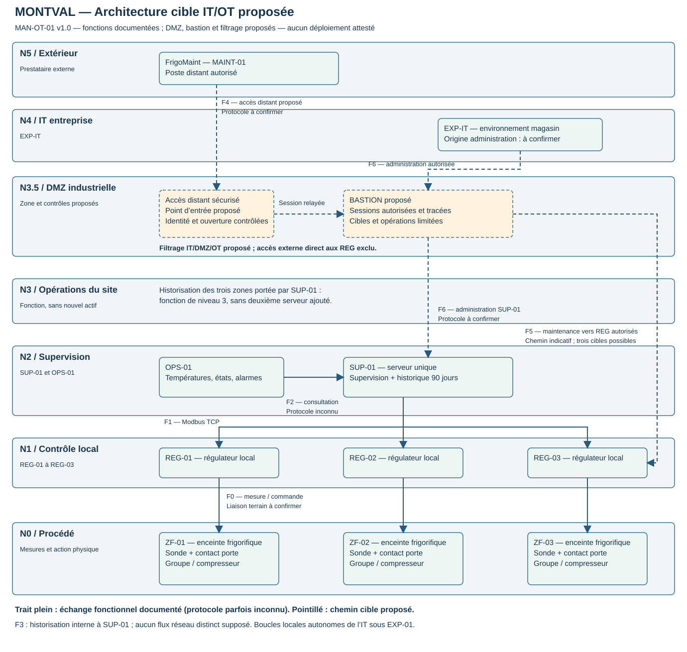

# J3-analyse-exigences-architecture-IT-OT

**Dossier d’analyse des exigences et de l’architecture IT/OT — C3**

**Olivier HIMBLOT · AIS 2026 · 28 octobre 2026 · Itération 2 — Journée 3**

## Compétence et preuve de travail

**Analyser les exigences d’exploitation et les interactions IT/OT.**

Critères du formateur : identifie les dépendances techniques ; traduit les exigences d’exploitation en besoins IT ; cartographie et justifie les communications.

**Preuve de travail : J3 — Dossier d’analyse des exigences et de l’architecture IT/OT.**

| Critère | Éléments du dossier | Portée |
| --- | --- | --- |
| Identifie les dépendances | Analyse des cinq situations de panne et liste des informations manquantes. | Dépendances déduites du manuel ou proposées ; topologie réelle inconnue. |
| Traduit les exigences en besoins IT | Matrice OT → IT avec principes techniques et confirmations nécessaires. | Options argumentées, sans produit choisi ni configuration appliquée. |
| Cartographie et justifie les communications | Schémas Purdue et cible IT/OT ; matrice C00–C03, A01–A05, S01–S04 et conditions d’accès. | Fonctions documentées et frontières proposées distinguées. |
| Tient compte des conditions d’intervention | Décisions SIT-01 à SIT-04 et contrôles de reprise. | Propositions à confronter en binôme et avec le formateur. |

## Statut des informations

**Documenté :** MAN-OT-01, version 1.0 du 14 octobre 2022, scénario fictif Montval. Les exigences ne constituent pas une preuve que les équipements les respectent.

**Proposé :** zones de sécurité, DMZ, bastion, chemins de maintenance, services OT de temps et sauvegarde. Aucun déploiement, règle réseau ni essai de panne n’est attesté dans ce dossier.

**À confirmer :** IP/topologie, ports, capacités des régulateurs, protocoles non nommés, services partagés, sauvegardes, objectifs de reprise, compatibilité des accès et organisation de l’astreinte.

Convention demandée : `[Nom]-[Prénom]-[Site]-Iteration2-Atelier7`. Nom/prénom connus : HIMBLOT Olivier ; site de remise à confirmer. Aucune approbation ou signature du formateur n’est préremplie.

<!-- page:A4L -->

## 1 — Matrice OT → IT : exploitation et données

| Référence OT | Besoin ou contrainte IT | Solution ou principe technique envisageable | Information à confirmer |
| --- | --- | --- | --- |
| **EXP-01**, §3.1 | Préserver le contrôle local pendant la maintenance IT. | Séparer les dépendances de la boucle locale des services de supervision ; cartographier alimentations et communications ; organiser la surveillance locale pendant l’arrêt de SUP-01. | Dépendances réelles des régulateurs, alimentations et équipements partagés ; conséquences d’une coupure réseau. |
| **EXP-04**, §3.2 ; §2.3 | Afficher les états utiles et leur fraîcheur ; rafraîchissement nominal souhaité de 5 s. | Horodater les mesures, afficher leur âge ou un état périmé, détecter la perte de communication ; vérifier le rafraîchissement sans surcharger les régulateurs. | Capacités de collecte, nombre de variables, seuil de péremption acceptable et origine des horodatages. |
| **EXP-05**, §3.2 | Conserver au moins une température/minute, changements de consigne, alarmes et acquittements pendant 90 jours. | Dimensionner stockage et rétention, surveiller la collecte et l’espace ; sauvegarder données et configuration ; examiner un tampon de collecte si disponible. | Volume réel, taille des événements, tampon local éventuel, sauvegardes, pertes de données et délais de restauration acceptables. |
| **EXP-06**, §3.2 | Permettre une chronologie cohérente des incidents. | Définir une référence horaire et un service de synchronisation compatible, par exemple NTP pour les systèmes qui le supportent ; surveiller les écarts et documenter fuseaux et sources d’heure. | Précision nécessaire, support des régulateurs, comportement sans source d’heure et chemins autorisés. Le manuel ne choisit pas de protocole. |
| **EXP-10**, §4 | Récupérer les états courants après retour de SUP-01 sans modifier les paramètres locaux. | Reprise par lecture ; désactiver ou maîtriser les écritures d’initialisation ; tester une restauration en environnement d’essai. | Comportement du logiciel au démarrage, cache de consignes, scripts et ordre de lancement des services. |
| **MAI-01**, §5.1 | Réserver les écritures aux interventions expressément autorisées. | Séparer consultation et administration ; comptes nominatifs et droits limités sur les systèmes compatibles ; contrôler les chemins d’écriture et l’ouverture des sessions de maintenance. | Authentification disponible, fonctions réellement requises, filtrage possible, autorité d’approbation et accès existants. |
| **MAI-05**, §5.3 | Préparer les changements selon leur effet sur l’exploitation. | Fiche de changement : périmètre, impacts, sauvegarde vérifiée, essai, critères de réussite et retour arrière si réalisable ; validation conjointe. | Configuration de référence, environnement d’essai, restauration possible, durée et procédure de retour arrière. |

Chaque solution reste envisageable : une exigence ne désigne pas un produit unique. Les ports et registres du PoC J1–J2 ne sont pas ceux de Montval par défaut. Les dispositions de reprise doivent préserver les paramètres locaux.

<!-- page:A4L -->

## 1 — Matrice OT → IT : maintenance et coordination

| Référence OT | Besoin ou contrainte IT | Solution ou principe technique envisageable | Information à confirmer |
| --- | --- | --- | --- |
| **MAI-07**, §5.3 | Évaluer les correctifs avec le mainteneur avant déploiement. | Inventaire des versions, suivi des avis, qualification de compatibilité ; planification selon l’effet sur le froid ; mesures temporaires de réduction d’exposition si le déploiement est différé. | Compatibilité fournisseur, arrêt nécessaire, remplacement éventuel, conséquences du report et validation du programme. |
| **EXP-08**, §3.3 | Garder un signalement local sans SUP-01 et identifier zone/heure sur OPS-01. | Vérifier indépendance de l’avertissement local ; procédure de relève ; recette de transmission et de présentation des alarmes. | Moyens locaux, alimentation, génération et acheminement des alarmes, organisation de leur prise en charge. |
| **EXP-11**, §4 | Vérifier l’état réel des zones après une panne. | Liste de contrôles de reprise : mesures locales, commandes, alarmes, consignes et fraîcheur des données ; validation par l’exploitation. | Intervenant disponible sur place, moyen de mesure indépendant et procédure détaillée. |
| **MAI-02**, §5.1 | Rattacher chaque changement à son motif, son autorisation, son heure et sa vérification. | Registre d’intervention relié aux traces de session et aux événements de supervision ; contrôle avant/après des valeurs. | Journaux disponibles et attribution de l’identité humaine : le seul échange Modbus ne fournit pas toute la traçabilité demandée. |
| **MAI-03–04**, §5.2 | Accès distant pendant les interventions et possibilité d’urgence, sans dépendance permanente de la régulation. | Accès activable sur autorisation et limité aux cibles nécessaires ; passerelle d’accès ou bastion envisageable ; procédure d’astreinte, fermeture en fin d’intervention. | Configuration actuelle, contacts et moyens d’ouverture hors horaires, durée de session et portée justifiée sur les trois régulateurs. |
| **MAI-06, MAI-08**, §5.3 | Planifier les interruptions et contrôler la remise en service. | Préparer la fenêtre avec exploitation/FrigoMaint, surveillance compensatoire et recette des températures, commandes, alarmes et consignes. | Mardi 06 h–08 h à confirmer ; durée d’interruption acceptable ; ce créneau n’autorise pas une coupure de froid. |
| **ORG-01–02**, §6 | Coordonner changements et diagnostic entre exploitation, maintenance et IT. | Désigner approbateur et contacts ; partager fonctions à préserver, plan de vérification et modalités d’escalade. | Responsabilités opérationnelles, disponibilité, délégations et contrats applicables. |

Pour trois températures, une valeur/minute pendant 90 jours représente au minimum **388 800 valeurs**, hors événements, métadonnées, index et sauvegardes. Cette rétention ne fixe ni perte admissible ni délai de reprise.

**Montval :** alarme après 10 minutes strictement au-dessus de +8 °C. **PoC :** temporisation accélérée de 10 secondes. La réaction Montval au défaut capteur dépend de la configuration du régulateur et de sa notice ; l’arrêt du PoC n’est pas une règle générale.

<!-- page:A3P -->

## 2 — Architecture Purdue et positionnement

| Niveau | Rôle | Application à Montval et justification |
| --- | --- | --- |
| **0 — Processus physique** | Procédé, mesures et action physique. | Enceintes ZF-01 à ZF-03, sondes, contacts de porte et groupes frigorifiques. Les capteurs/actionneurs sont regroupés ici avec le terrain. |
| **1 — Contrôle** | Exécution de la logique locale et commande. | REG-01 à REG-03 : hystérésis, consignes conservées localement et commande des compresseurs. |
| **2 — Supervision et conduite** | Présentation des états, conduite et alarmes. | OPS-01 et fonction de supervision de SUP-01. La supervision consulte les régulateurs, sans exécuter la boucle de régulation. |
| **3 — Opérations industrielles du site** | Fonctions de suivi et services d’exploitation à l’échelle du site. | Historisation des trois zones assurée par SUP-01. Il s’agit d’une fonction logique portée par le **même serveur**, pas d’un second historian identifié. |
| **3.5 — DMZ industrielle proposée** | Médiation des échanges entre entreprise/extérieur et OT. | Point d’entrée distant et bastion proposés, avec filtrage aux frontières. Aucun de ces actifs n’est identifié comme présent par le manuel. |
| **4 — Informatique de l’entreprise** | Systèmes métier et informatique générale du site. | EXP-IT ; un poste d’administration IT peut y être situé dans la cible, mais son identité et son implantation restent inconnues. |
| **5 / extérieur** | Réseau d’entreprise étendu et connexions extérieures, selon la représentation retenue. | FrigoMaint et MAINT-01 sont représentés **hors du périmètre OT du magasin**. Le niveau 5 sert de repère graphique ; le prestataire n’est pas un service interne de Montval. |

SUP-01 reste un serveur unique ; ses fonctions supervision/historique couvrent N2/N3. La DMZ et le bastion sont des ajouts proposés. Les niveaux sont des repères fonctionnels, sans obligation d’un réseau par niveau.

<!-- page:A3L -->

## 3 — Architecture IT/OT proposée

Les pointillés signalent chemins et services proposés. Les réponses réseau sont implicites. Les liaisons terrain regroupent mesure et commande, sans technologie supposée. A05 illustre REG-01 ; l’accès aux autres cibles exige des autorisations distinctes. Le schéma prépare J4, sans déploiement attesté.

<!-- page:A4L -->

## 3 — Zones et règles de conception

| Zone proposée | Composants ou fonctions | Justification par le manuel et contraintes |
| --- | --- | --- |
| **Contrôle frigorifique OT** | REG-01, REG-02, REG-03 ; sondes, contacts de porte, groupes et avertissements des ZF-01 à ZF-03. | Préserver les boucles locales et consignes sans SUP-01/OPS-01 (**EXP-01–03**). Aucun composant DMZ ou IT ne doit être ajouté comme dépendance du contrôle local. Besoin de sous-zones par enceinte à évaluer, sans imposer trois réseaux à partir du seul manuel. |
| **Supervision et conduite OT** | SUP-01, OPS-01 ; collecte, vue opérateur, alarmes et historique. | Accès aux mesures, fraîcheur visible et reprise sans écrasement des paramètres (**EXP-04–05, EXP-08–10**). SUP-01 reste un serveur unique : fonction de supervision N2 et fonction d’historisation N3. |
| **Services d’exploitation OT proposés** | `S-TEMPS` : référence horaire locale ; `S-SAUVEGARDE` : sauvegarde des données/configurations et moyens de restauration. | Répondre à **EXP-05–06, MAI-05** sans rendre les boucles locales dépendantes de l’IT général. Ces noms sont des repères de conception, pas des actifs du manuel. Existence, implantation et capacités à vérifier ; ce ne sont pas des serveurs nécessairement distincts. |
| **DMZ industrielle proposée** | Point d’accès distant sécurisé et **bastion**, filtrage côté extérieur/IT et côté OT. | Médiatiser les accès de diagnostic et d’administration ; limiter cibles, droits et durées (**MAI-01–04, ORG-01**). La DMZ est une zone, le bastion un service ; leur présence graphique ne démontre pas une protection effective. |
| **IT du magasin** | EXP-IT ; poste d’administration autorisé à identifier. | Distinguer usages informatiques généraux et conduite OT. Une panne d’EXP-IT ne doit pas interrompre les boucles locales. L’autonomie de la supervision par rapport aux services IT communs est un objectif à vérifier. |
| **Prestataire externe** | FrigoMaint ; MAINT-01 représenté comme poste d’intervention distant. | Accès autorisé quand nécessaire (**MAI-03–04**), sans nécessité permanente pour la régulation. Implantation réelle, outillage et gestion de MAINT-01 à confirmer. |

**Séparation des droits :** consultation, acquittement et modification sont distincts. Un acquittement ne modifie ni la consigne ni le compresseur (EXP-09). Une lecture seule doit être garantie par un mécanisme compatible : un pare-feu réseau ne reconnaît pas nécessairement les fonctions Modbus.

**Principes proposés :** pas d’accès général extérieur/IT → REG ; filtrage des échanges interzones selon besoin, origine, cible et service ; accès de maintenance par les chemins DMZ/bastion autorisés. Le bastion ne se trouve ni dans les boucles locales ni dans la collecte SUP → REG.

<!-- page:A4L -->

## 3 — Matrice de flux : contrôle et conduite

| ID | Source | Destination | Service / protocole | Fonction et droits | Condition d’accès proposée / confirmation nécessaire |
| --- | --- | --- | --- | --- | --- |
| **C00** | Sondes/contacts et régulateur | REG et groupe associés de la même zone | Liaison terrain **à confirmer**. | Mesures en lecture et commandes du groupe ; boucle locale. | Disponible pour le contrôle local ; ne pas filtrer/reconfigurer avant de connaître câblage et interfaces. EXP-01. |
| **C01** | SUP-01 | REG-01 à REG-03 | **Modbus TCP documenté** ; paramètres réseau et fonctions à confirmer. | Collecte de mesures, consignes, états et alarmes ; **lecture seule** dans ce chemin proposé. | Accès permanent pour les lectures périodiques ; cibles et variables précisées après obtention de la table. Rafraîchissement écran souhaité 5 s, sans contrainte temps réel sur la boucle. |
| **C02-L** | OPS-01 | SUP-01 | Interface de supervision, protocole **à confirmer**. | Consultation températures, états et alarmes. | Accès courant limité au rôle opérateur ; afficher date de mesure et péremption. EXP-04. |
| **C02-A** | OPS-01 / opérateur autorisé | SUP-01 | Même interface si prise en charge ; protocole et droits **à confirmer**. | **Acquittement**, distinct de la consultation et d’une commande frigorifique. | Rôle autorisé, événement journalisé ; aucun effet sur consigne ou compresseur. EXP-05, EXP-09. |
| **C03** | Fonction de collecte de SUP-01 | Historique de SUP-01 | Mécanisme applicatif / stockage **à confirmer**. | Écriture locale des mesures et événements ; lecture historique. | Au moins une température/minute et événements, 90 jours. Aucun flux réseau additionnel supposé tant que le stockage n’est pas décrit. |

**C01 :** Modbus TCP est nommé dans le manuel (§2.3). Les ports configurés, fonctions et registres réels restent à obtenir auprès de FrigoMaint. Aucun port 15020/15021 du PoC n’est transposé automatiquement.

**C03 :** le stockage historique est une fonction de SUP-01 ; aucune communication réseau supplémentaire n’est présumée tant que le découpage applicatif n’est pas connu.

Les traits pleins du schéma représentent les besoins fonctionnels documentés, pas des communications capturées. Les interfaces opérateur et liaisons terrain restent techniquement à confirmer.

<!-- page:A4L -->

## 3 — Matrice de flux : maintenance et administration

| ID | Source | Destination | Service / protocole | Fonction et droits | Condition d’accès proposée / confirmation nécessaire |
| --- | --- | --- | --- | --- | --- |
| **A01** | FrigoMaint sur MAINT-01 | Point d’accès distant en DMZ | Accès sécurisé **à définir** ; ne pas présumer le support d’un protocole particulier. | Authentification et ouverture d’une session ; **ne confère pas encore de droit d’écriture OT**. | Intervention autorisée et enregistrée, y compris urgence sollicitée par l’exploitation. Identité, durée et fermeture à définir. MAI-01–04. |
| **A02** | Session MAINT-01 via le point d’accès | Bastion en DMZ | Protocole de session **à confirmer**. | Session de diagnostic ou de maintenance selon le rôle accordé. | Traçabilité de l’intervenant et rattachement à l’autorisation ; pas de transit général vers l’OT. |
| **A03** | Poste IT d’administration identifié | Bastion en DMZ | Accès d’administration **à confirmer**. | Administration des cibles autorisées ; **modification possible** selon rôle. | Compte et poste autorisés, opération coordonnée ; pas d’accès aux régulateurs accordé du seul fait d’être administrateur IT. ORG-01. |
| **A04** | Outil/session autorisé via bastion | SUP-01 | Administration serveur/applicative **à confirmer** ; OS inconnu, ni SSH ni RDP imposés. | Diagnostic en lecture ; changements système/applicatifs **distinctement autorisés**. | Changement préparé, sauvegarde et vérifications ; ne pas imposer une consigne au redémarrage. EXP-10, MAI-05–08. |
| **A05-L** | Outil de FrigoMaint via bastion | REG concernés | Variables Modbus TCP documentées ; outil, connexion et fonctions de diagnostic **à confirmer**. | **Lecture** de diagnostic. | Cibles utiles à l’intervention seulement ; pas de droit d’écriture implicite. |
| **A05-E** | Outil de FrigoMaint via bastion | REG concernés | Méthode d’écriture / configuration **à confirmer** avec le mainteneur ; ne pas supposer que tout passe par Modbus. | **Modification** de consigne ou configuration autorisée. | Motif, autorisation et heure tracés, contrôle avant/après. Dérogation de consigne approuvée par exploitation et mainteneur. EXP-02, MAI-01–02. |

La disponibilité du point d’entrée n’équivaut pas à un droit d’écriture permanent. Le besoin urgent implique une procédure d’autorisation et d’astreinte praticable. Si l’équipement ne supporte pas de session interactive, il faut confirmer l’outil ou la station de maintenance compatible derrière le bastion.

<!-- page:A4L -->

## 3 — Matrice de flux : services et inconnues

| ID | Source logique | Destination | Protocole / sens à confirmer | Fonction et droits | Conditions et points ouverts |
| --- | --- | --- | --- | --- | --- |
| **S01** | SUP-01 ; OPS-01 si compatible | S-TEMPS | Service de temps **à choisir** selon les clients. | Consultation d’une référence ; ajustement technique de l’horloge du client. | Référence et fonctionnement local proposés ; mesurer écarts et perte de référence. Pas de sortie Internet directe implicite. EXP-06. Le dessin montre SUP-01 seulement. |
| **S02** | Agent SUP-01 → S-SAUVEGARDE **ou** collecteur → SUP-01 | Cible de sauvegarde **ou** source à lire, selon le mode retenu | Protocole et sens réel **à choisir** ; un seul mode à traduire en règles après décision. | Lecture des données/configurations sources ; **écriture** d’une sauvegarde sur le dépôt. | Planifier sans perturber la collecte, protéger les accès, tester la restauration ; définir périmètre, rétention, perte acceptable et temps de reprise. Le schéma illustre un mode poussé, proposé seulement. |
| **S03** | Dépôt et opérateur de restauration autorisé | Cible de restauration isolée puis SUP-01 après validation | Chemin, protocole et initiateur **à confirmer** selon l’outil. | **Écriture** des données/configurations restaurées ; pas une simple consultation. | Opération exceptionnelle, coordonnée ; préserver les consignes locales et vérifier les états après reprise. EXP-10–11, MAI-05, MAI-08. Non représenté comme liaison permanente. |
| **S04** | Régulateur compatible | Référence de temps adaptée | **Support non établi** ; aucun protocole ni règle à autoriser à ce stade. | Synchronisation si nécessaire et supportée ; sinon préciser l’origine des horodatages collectés. | Ne pas ajouter une dépendance de contrôle au temps réseau ; consulter les notices et la précision requise. EXP-06. |

**Flux supplémentaires à instruire :** sauvegarde des configurations REG et équipements d’accès, export des traces de maintenance, éventuels services d’identité, de noms ou relais de correctifs. Ne pas les couvrir par une règle générale DMZ → OT : préciser les besoins et les initiateurs avant ajout.

**Informations avant J4 :** topologie/IP/interfaces et équipements de filtrage ; notices et tables de registres ; interfaces SUP/OPS ; outils et accès FrigoMaint ; sauvegardes/restauration, origine des horodatages et objectifs de reprise ; responsables, fenêtre et critères de recette. Sources proposées : IT, responsable supervision, FrigoMaint et exploitation selon leur périmètre (§6 et §8).

<!-- page:A4L -->

## 3 — Dépendances et fonctionnement dégradé

| Situation | Fonctions à préserver | Dégradation possible | Mesures et vérifications pour la cible | Références et limites |
| --- | --- | --- | --- | --- |
| **Réseau IT du magasin indisponible** | Boucles locales, paramètres et avertissements locaux. Objectif proposé : conserver SUP/OPS, collecte et services OT si leurs dépendances locales restent disponibles. | Administration depuis EXP-IT ; éventuellement accès externe si l’entrée DMZ partage un lien/équipement IT ; services reposant réellement sur l’IT. | Relever dépendances d’alimentation, commutation, accès externe, identité et temps ; éviter de rendre le contrôle dépendant du bastion ou d’un service IT. Prévoir surveillance locale si la vue centrale est touchée. | **EXP-01, EXP-04, MAI-03**. L’isolement graphique ne prouve ni autonomie d’alimentation ni disponibilité de la DMZ. |
| **SUP-01 doit être redémarré** | Régulation et alarmes locales ; consignes conservées dans REG. | Vue OPS, collecte, historique et alarmes centrales pendant l’arrêt ; risque de trou de données sans tampon confirmé. | Autoriser l’impact, organiser la relève locale ; à la reprise, lire les états courants, signaler les données périmées et vérifier absence d’écriture de paramètres. Identifier les mesures perdues sans inventer leur reconstitution. | **EXP-01, EXP-04–05, EXP-08, EXP-10–11**, MAI-05–08. |
| **Lien SUP-01 / REG-02 interrompu** | Contrôle local et avertissement de ZF-02 si les composants locaux restent fonctionnels ; service des autres zones si la panne est limitée à ce lien. | Données ZF-02 périmées et lacunes d’historique ; alarmes de cette zone non remontées. | Indiquer l’âge/perte de communication sur OPS ; faire contrôler ZF-02 sur place ; après retour, relire état et paramètres et vérifier la zone. Ne pas confondre température inchangée à l’écran et température réelle stable. | **EXP-01, EXP-04, EXP-10–11**, §4. Le périmètre de panne dépend de la topologie réelle. |
| **FrigoMaint intervient en urgence depuis l’extérieur** | Contrôle et collecte courants ; alerte et coordination avec l’exploitation. | Pas d’intervention distante si point d’entrée, bastion, lien ou identité indisponible ; une réponse sur place peut être nécessaire. | Appel/autorisation selon astreinte, ouverture ciblée, rôle lecture puis écriture si justifié, traçabilité et contrôle de remise en service ; fermer l’accès accordé. Définir un recours autorisé sur place plutôt qu’un contournement libre de la DMZ. | **MAI-01–04, MAI-08, ORG-01–02**. La disponibilité de l’accès urgent et ses dépendances restent à qualifier ; la régulation n’en dépend pas (**MAI-03**). |
| **Service d’horodatage indisponible** | Contrôle local et signalement local ; viser la poursuite de collecte et supervision tant que les applications le permettent. | Dérive des horloges, incertitude sur fraîcheur des mesures et ordre des événements ; certains services d’accès/validation peuvent également dépendre du temps. | Détecter la perte de référence, conserver les événements avec leur qualité temporelle, mesurer les écarts ; à la reprise vérifier l’ordre des données et le comportement d’ajustement. Confirmer la génération locale de l’alarme temporisée et les mécanismes de temps des équipements. | **EXP-04, EXP-06**, §2.1 et §8. Aucune autonomie ou précision d’horloge chiffrée n’est fournie. La régulation ne doit pas être rendue dépendante de ce nouveau service. |

Les services OT proposés ne prouvent pas une autonomie effective : vérifier alimentation, réseau, identité et autres dépendances communes. Le retour d’un écran ne prouve pas le rétablissement du procédé (EXP-11). Les décisions sur les denrées reviennent à l’exploitation (EXP-12).

<!-- page:A4L -->

## 4 — Décisions d’intervention SIT-01 à SIT-04

| Situation | Décision technique proposée | Conditions et vérifications clés | Non confirmé |
| --- | --- | --- | --- |
| **SIT-01** | Autoriser seulement après préparation un redémarrage SUP-01 dans une fenêtre approuvée ; l’ouverture du magasin n’est ni une interdiction ni une autorisation automatique. | Contrôle local préservé, surveillance locale, sauvegarde/reprise ; relire états courants, vérifier consignes, alarmes et historique. | Durée, compatibilité, dépendances, tampon et accord d’exploitation. |
| **SIT-02** | Proposer un accès distant contrôlé, activable en urgence et limité à l’intervention ; ne pas ouvrir par défaut une écriture permanente sur trois REG. | Identité, autorisation, cibles/droits, bastion/DMZ proposés, traces et fermeture ; recette du parcours normal/urgent. | Accès existant, protocoles, compatibilité des outils et astreinte. |
| **SIT-03** | Planifier le correctif REG-02 avec exploitation et mainteneur, après qualification et préparation de l’interruption. | Reprise adaptée, produits/surveillance pris en charge ; recette du programme, paramètres, commandes, alarmes et état thermique. | 45 min hors validation, durée totale et interruption tolérable, comportement après reboot et retour arrière. |
| **SIT-04** | Préserver et analyser les sources ; récupérer uniquement ce qui peut être attesté ; déclarer explicitement les périodes non reconstructibles. | Analyse isolée, horodatages contrôlés, pas d’écrasement ; vérifier couverture et collecte après correction/import. | Sources couvrant le trou, intégrité, capacités de rattrapage et cause de la perte. |

**SIT-01 / SIT-03 :** SUP-01 porte la vue et l’historique des trois zones ; REG-02 exécute la boucle locale de ZF-02. Le premier redémarrage doit préserver les régulateurs sous EXP-01 ; le second peut interrompre directement le contrôle de la zone. Les 45 minutes fournisseur sont hors validation fonctionnelle.

**SIT-02 / SIT-04 :** les traces d’accès aident à attribuer les actions humaines et changements ; elles ne remplacent pas les températures manquantes. Les horodatages des sources doivent être rapprochés avec leurs incertitudes. Une mesure normale après panne ne démontre pas l’absence d’excursion avant la reprise.

**Report :** suspendre la modification si compatibilité, reprise, surveillance, droits ou autorisation ne sont pas maîtrisés ; tracer et réévaluer un report de correctif. Pour SIT-04, préserver les preuves immédiatement, mais différer un import qui risquerait d’écraser les données courantes.

<!-- page:A4L -->

## Cohérence du dossier et préparation J4

| Vérification documentaire | État / limite |
| --- | --- |
| Choix justifiés par le manuel | Références EXP/MAI/ORG présentes ; solutions marquées proposées. |
| Contrôle distinct de la supervision | REG responsables de la boucle ; SUP/OPS assurent visibilité, collecte et historique. |
| Communications explicites | Matrice de flux avec consultation/modification, conditions et inconnues. |
| Absences non transformées en défauts | Les informations du §8 sont des demandes de confirmation, pas des vulnérabilités démontrées. |
| Interventions adaptées à l’exploitation | Conditions, contrôles et limites des quatre décisions explicités. |

### Préparer la mise en œuvre de J4

- Valider en binôme et avec le formateur la cible, les hypothèses et les arbitrages ; relever décisions et responsables.
- Compléter IP, interfaces, protocoles/ports et droits effectivement supportés ; ne pas configurer une règle sur une valeur supposée.
- Préparer sauvegarde, fenêtre, surveillance et retour arrière si réalisable avant modification.
- Tester les communications nécessaires et les refus attendus dans le laboratoire convenu ; distinguer lecture, acquittement et écriture.
- Vérifier contrôle local, péremption, alarmes, historique, horodatage et reprise sans écrasement des paramètres ; conserver les résultats et écarts.

**Statut final :** dossier documentaire et conception proposés, sans application de règles J4 ni approbation collective attestée. Aucune analyse de risques formelle ou conformité réglementaire acquise n’est déclarée.

### Sources et fichiers

Source principale : **MAN-OT-01, v1.0, 14 octobre 2022**, sections 2 à 8 ; copie documentaire fournie dans le mémo. Synthèse des fiches 3.1 à 3.6 du 28 octobre 2026 ; schémas SVG et draw.io conservés avec la fiche 3.7.

Repère Purdue : [Cisco — Industrial Security 3.1 Design Guide, chapitre 2](https://www.cisco.com/c/dam/en/us/td/docs/Technology/Industrial-Security-3-1-DG.pdf). La DMZ est un ajout d’architecture de sécurité ; le niveau d’une fonction ne vaut pas preuve de segmentation.

Source éditable : `livrables/informatique-industrielle/it-2/J3-analyse-exigences-architecture-IT-OT.md`. Le générateur PDF assemble ce dossier sans exécuter d’intervention ou de test de panne.

